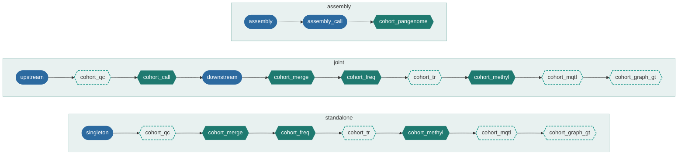
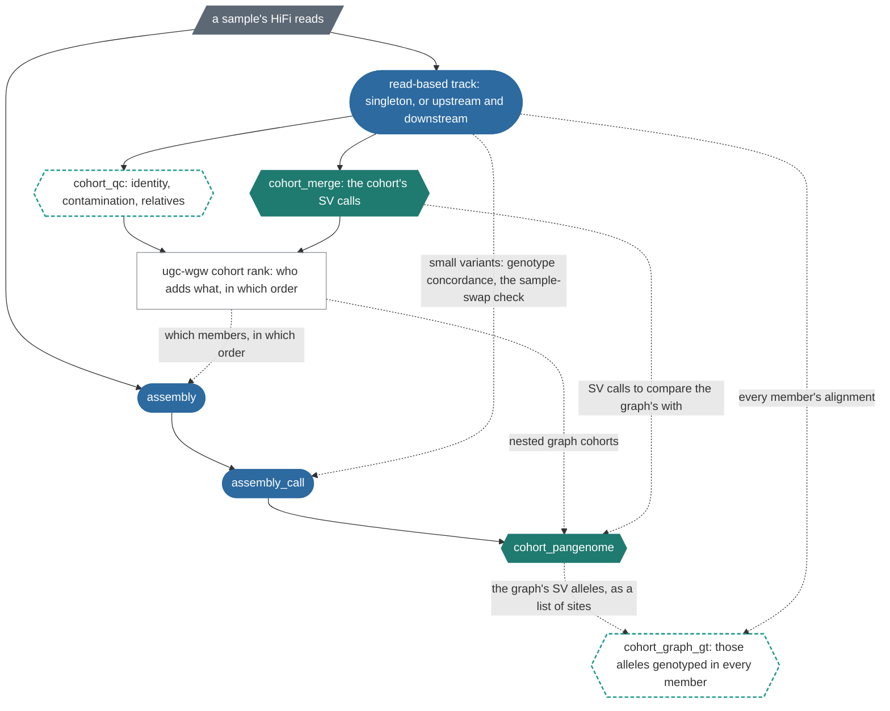

# Overview

## What ugc-pacbio-wgw is

PacBio publishes HiFi-human-WGS-WDL, a WDL pipeline that takes one sample's
HiFi reads to aligned BAM, small variants, structural variants, tandem repeats,
phasing, methylation and pharmacogenomics, with an optional family mode.
ugc-pacbio-wgw wraps that pipeline, unchanged, for a different job: hundreds to
thousands of samples on a SLURM cluster that has no network access at all. It
adds:

- Cohort aggregation. GLnexus joint genotyping, structural-variant merging with
  svx or bcftools, `trgt merge` and trgt-lps, all scattered over genome regions
  so that a 5000-sample cohort runs the same code as a 5-sample one.
- A joint-call-then-phase mode, which is upstream's family semantics at cohort
  scale: genotypes are joint-called across the cohort before each sample is
  phased.
- De novo assembly with hifiasm, trio-binned when the pedigree allows, with
  assembly QC (HMM-Flagger, yak trioeval), assembly-based calling (dipcall,
  PAV 3) and a cohort pangenome graph (Minigraph-Cactus).
- A driver, `ugc-wgw`, that registers samples, freezes cohorts, generates every
  input file, submits runs with a concurrency cap, tracks state in a database
  and writes a provenance manifest per run.
- An offline bundle: code, container images and the workflow engine in one
  tarball, installed and verified on the HPC without downloading anything.

The upstream pipeline is vendored verbatim under `vendor/` and never edited.
Everything ugc-pacbio-wgw adds is in `workflows/ugc*`, `bin/`, `scripts/` and
`backends/`.

## The model in one paragraph

The pipeline is a set of **stages**. Each stage is one WDL workflow invoked once
per **subject**, which is either a sample or a cohort. A **mode** is a named
sequence of stages. The driver decides which subject may run which stage next;
the workflows know nothing about each other. Everything a stage produces lands
under `<results>/<samples|cohorts>/<id>/<v>/<stage>/`.



Rounded nodes run once per sample. Hexagons run once per cohort and start only
when every frozen member has finished the stage before; `cohort_qc`, the
identity check, `cohort_tr`, the tandem-repeat screen, `cohort_mqtl`,
the variant-against-methylation screen, and `cohort_graph_gt`, the
graph's structural variants genotyped in every member, are the
exceptions: no stage waits for them. `cohort_graph_gt` exists only for a
project that names a graph cohort.
Text version:

```
standalone:  singleton ──► cohort_qc ──► cohort_merge ──► cohort_freq ──► cohort_tr ──► cohort_methyl ──► cohort_mqtl ──► cohort_graph_gt
joint:       upstream ──► cohort_qc ──► cohort_call ──► downstream ──► cohort_merge ──► cohort_freq ──► cohort_tr ──► cohort_methyl ──► cohort_mqtl ──► cohort_graph_gt
assembly:    assembly ──► assembly_call ──► cohort_pangenome
             per-sample stage    per-cohort stage (waits for every member)
```

The assembly mode waits for nothing of the other two, and reads their
results where they exist ("How the tracks relate" below).

| Mode | What you get | Chapter 03 |
|---|---|---|
| `standalone` | Upstream's singleton pipeline per sample, then cohort-level SV, TRGT and LPS files, plus an optional GLnexus cohort VCF. | Default choice. |
| `joint` | Per-sample phased VCFs whose genotypes are consistent across the cohort (including hom-ref at sites variant elsewhere). | Needs a frozen cohort before phasing starts. |
| `assembly` | Haplotype-resolved assemblies with their QC; the haplotypes aligned to the decoy-free GRCh38 and called with dipcall and PAV 3 in `assembly_call`; the cohort's Minigraph-Cactus graph and its VCFs in `cohort_pangenome`. | Independent of the other two; its cohort stage needs a frozen cohort. |

## How the tracks relate

The two read-based modes and the assembly mode start from the same reads
and run on their own, with one exception at the end. The assembly track
reads the read-based results in four places when they exist, and one of
them, the ranking, cannot do without. And one optional read-based stage,
`cohort_graph_gt`, reads the assembly track: it genotypes a graph's
structural variants in every member.



Text version:

| Step of the assembly track | Read-based results | What they are for |
|---|---|---|
| `assembly` | not read | Only the reads. |
| `assembly_call` | used when the sample has them | The sample's read-based small variants against the assembly's: genotype concordance and het loss, which is how a sample swap between the two tracks shows (`asm_genotype_concordance`). |
| `ugc-wgw cohort rank` | **required** | The cohort's merged SV calls to order the members by what each adds; `cohort_qc`'s pairs to leave contaminated samples out and hold relatives back; the per-sample QC status. |
| `cohort_pangenome` | used when the cohort has them | The read-based SV merge, to compare the graph's structural variants with (truvari). The graph itself is built without them. |

One thing flows the other way, at the end: `cohort_graph_gt`, an
optional stage of the read-based modes, takes the structural variants of
a finished graph and genotypes them in every member of a cohort from its
reads (its page; the project names the graph's cohort). Nothing else of
the read-based track reads an assembly or a graph, so read-based results
do not change when assemblies are added.

**Run the read-based track first.** It is not a rule of the driver, it is
the order that works:

1. The read-based mode for every sample, then `cohort_qc` and
   `cohort_merge`.
2. Look at the cohort page's Identity section. A contaminated or mixed
   sample is found here, from the reads, and nowhere in the assembly
   track: assembled, it is two genomes folded into one, and in a graph it
   is a member like any other.
3. `ugc-wgw cohort rank`: the order in which to assemble, and how much of
   the cohort's variation the first 20, 100 or 200 members already hold.
4. `assembly` and `assembly_call` in that order.
5. `cohort_pangenome` on cohorts frozen as prefixes of the ranking.
6. `cohort_graph_gt` on the whole cohort, against the graph that was
   built: its structural variants with genotypes and frequencies for
   everyone, not only for the assembled members.

The read-based track is also the cheaper of the two (about 87 core-hours
per 20x sample against 130 for the assembly stage alone), and its results
are what most analyses start from.

**An assembly-only project works too**: register the samples, submit the
assembly mode, freeze any list of members and build its graph. What it
does without: the identity check (nothing in the assembly track notices a
contaminated sample or a pair of relatives), the ranking (subsets and the
order of assembly are then yours to choose, and a ladder of nested
cohorts says less about what a graph of a given size holds), the
concordance check per sample, and the comparison of the graph's SVs with
an independent call set.

## What an operator does

1. **Install** a bundle version under `<prefix>` and activate it (chapter 04).
2. **Create a project** and register samples from a sample sheet (chapter 05).
3. **Freeze a cohort**: an immutable, ordered list of sample IDs (chapter 05).
4. **Submit** a mode and leave the driver running under `tmux` or as a SLURM
   job; watch with `ugc-wgw status`, read logs with `ugc-wgw logs` (chapter 06).
5. **Retry** what failed, once the cause is fixed; then hand results and
   manifests to the analysts (chapters 06, 07, 09).

## What is not automated

The driver classifies every failure and re-attempts only the transient ones
(a dead driver, a signal, a node failure) after a backoff; resource, input
and tool failures block their subject until you have fixed the cause and run
`ugc-wgw retry`. It records SLURM job IDs and cancels orphaned jobs, follows a
run's log, removes samples, and refuses to run beside a live driver on
another host. One project is driven by one `ugc-wgw submit` at a time. What a
task asks SLURM for is the WDL's own request, capped by the site and
overridden per task by a policy file the operator keeps (chapter 12);
nothing sizes requests from measured usage yet. Manifests do not yet map
images to tasks.
