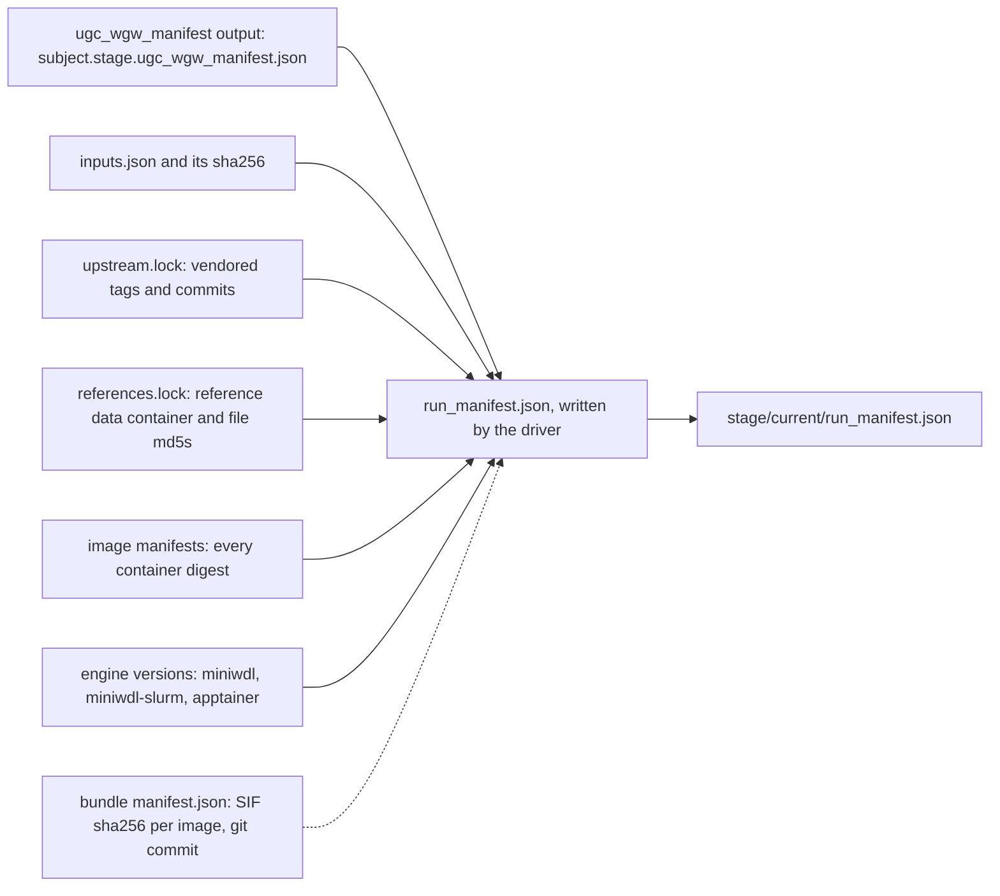

# Results

## The results tree

```
<results>/
├── samples/<sample_id>/<v>/<stage>/
│   ├── attempt-1/
│   │   ├── inputs.json        driver, before launch; its sha256 is in the manifest
│   │   ├── miniwdl.stdout     miniwdl's stdout (usually empty)
│   │   ├── miniwdl.stderr     miniwdl's stderr; the only log when it fails before workflow.log
│   │   ├── workflow.log       miniwdl, plain text; its appearance means "running"
│   │   ├── workflow.log.json  the same log as JSON lines
│   │   ├── run.json           miniwdl, at the end: {"outputs": ...} or {"error": ...}
│   │   ├── outputs.json       miniwdl, on success: output name -> path under out/
│   │   ├── error.json         miniwdl, on failure
│   │   ├── out/               miniwdl, on success: one directory per output, hardlinks
│   │   ├── call-<task>/       miniwdl work dirs; removed on success (delete_work), kept on failure;
│   │   │                      slurm_singularity.log.txt holds the SLURM job id and slurmd's messages
│   │   ├── run_manifest.json  driver, on every finished attempt
│   │   └── accounting.json    driver, the SLURM accounting of the attempt's jobs (sacct), on a cluster
│   ├── attempt-2/             a retry
│   └── current -> attempt-2   the latest finished attempt, whatever its status
└── cohorts/<cohort_id>/<v>/<stage>/   same shape
```

`<v>` is the ugc-pacbio-wgw version that produced the attempt. A cohort
assembled over years contains samples processed by different releases, and
the path says which.

## `outputs.json` and `out/`

`outputs.json` maps every workflow output, namespaced `ugc_wgw_<stage>.<name>`,
to a path. Files live under `out/<name>/<basename>`; array outputs under
`out/<name>/<i>/<basename>` in array order. Two ways to find a file:

```bash
python3 -c 'import json,sys; print(json.load(open(sys.argv[1]))["ugc_wgw_singleton.phased_small_variant_vcf"])' \
    samples/HG002/0.11.0/singleton/current/outputs.json
ls samples/HG002/0.11.0/singleton/current/out/phased_small_variant_vcf/
```

The output names are upstream's; the tables below give the ones analysts
ask for.

## What to look at, per stage

Per-sample files are named `<sample_id>.GRCh38_GIABv3.<what>`; the reference
name comes from the map (`name`). Cohort files are named
`<cohort_id>.joint.GRCh38_GIABv3.<what>` (`cohort_call`),
`<cohort_id>.merged.GRCh38_GIABv3.<what>` (`cohort_merge`) and
`<cohort_id>.freq.GRCh38_GIABv3.<what>` (`cohort_freq`).

### `singleton` (standalone) and `downstream` (joint)

| Output | What it is |
|---|---|
| `merged_haplotagged_bam`, `_index` | HiPhase-haplotagged alignments, the BAM to load in a browser. |
| `phased_small_variant_vcf`, `_index` | Phased DeepVariant (standalone) or cohort-consistent GLnexus (joint) small variants. |
| `phased_sv_vcf`, `_index` | Phased sawfish structural variants. |
| `phased_trgt_vcf` (`trgt_vcf` in `downstream`), `_index`, `trgt_spanning_reads` | Tandem repeat genotypes and the reads spanning them. |
| `small_variant_gvcf`, `_index` (`singleton`) | The gVCF; input to GLnexus in `cohort_merge`. |
| `cpg_pileup_bed`, `hmcpg_pileup_bed` (+ indices), `methbat_profile` | 5mCpG and 5hmCpG methylation per site (MethBat pileup) and per region (MethBat profile). |
| `methbat_report` | `<sample_id>.GRCh38_GIABv3.methbat.report.tsv`: MethBat's imprinting regions labelled `PASS`, `Inconclusive`, `Anomalous` or `AnomalousQcWarning` against their expected allele-specific methylation, with QC warnings (since 0.16; `cohort_methyl` makes it for older runs). |
| `pbstarphase_summary` (`pbstarphase_json` in `downstream`), `pbstarphase_tsv` | Pharmacogenomic star alleles (StarPhase) and its PharmCAT-style TSV. |
| `kivvi_kiv2_*`, `kivvi_d4z4_*` (`singleton`; in `upstream` for joint) | LPA KIV-2 and DUX4 D4Z4 repeat genotypes. The JSON records `call_status` (`failed_due_to_no_reads` when the region is empty); the allele plots exist only when an allele was called; all six are absent, with a `msg` line, when kivvi fails on low coverage. |
| `paraphase_*`, `mitorsaw_*` (`singleton`; in `upstream` for joint) | Paralog and mitochondrial calls. |
| `mt_*` (`singleton`; in `upstream` for joint) | mitorsaw's chrM calls collapsed to a diploid genotype, split into small variants and SVs, one haploid column per haplotype, a summary row, haplogrep3's haplogroups (the `upstream` table below lists them). |
| `phase_stats`, `phase_blocks`, `phase_haplotags` | HiPhase summaries. |
| `small_variant_stats`, `bcftools_roh_*`, `sv_stats_plot`, the pbjam plots (`read_length_plot`, `read_quality_plot`, `mapq_distribution_plot`, `mg_distribution_plot`) | QC. |
| `stats_file` | One TSV with every `stat_*` value of the sample: depth, inferred sex, mapped reads, phasing NG50, variant counts, TRGT and methylation numbers. |
| `msg_file`, `msg` | QC messages, for example an input BAM that was already aligned, or a catalog without fail-reads loci. |

### `upstream` (joint)

| Output | What it is |
|---|---|
| `aligned_hifi_reads`, `_index` | pbmm2 alignments, merged over uBAMs; not haplotagged yet. |
| `aligned_fail_reads`, `_index` | Baited fail reads for TRGT, when fail reads were given. |
| `small_variant_vcf`, `small_variant_gvcf` (+ indices) | DeepVariant per-sample calls and gVCF. |
| `sv_vcf`, `sv_supporting_reads`, `sv_copynum_*`, `sv_depth_bw`, `sv_gc_bias_corrected_depth_bw` | Per-sample sawfish call and CNV tracks (with `run_sawfish_call`). |
| `discover_tar` | sawfish discover directory, for a later multi-sample call. |
| `inferred_sex`, `stat_depth_mean`, `mosdepth_*` | Coverage and the inferred karyotype the driver passes on. |
| `input_checks`, `input_provenance` (with `aligned_bam_in`: a `bam`-kind sample) | `<sample_id>.input_checks.tsv` (check, target, status, detail) and `<sample_id>.input_provenance.tsv` (the given BAM's `@PG` and `@RG` fields). |
| `paraphase_*`, `mitorsaw_*` | Paralog and mitochondrial calls. |
| `mt_small_variant_vcf`, `mt_sv_vcf`, `mt_haplotypes_vcf` (+ indices), `mt_haplotypes_tsv`, `mt_summary`, `mt_haplogroups`, `mt_haplogroup` | mitorsaw's chrM calls collapsed to a diploid genotype (`0/1` heteroplasmic, `1/1` homoplasmic, `VAF` the read fraction), split at 50 bp into small variants and SVs; one haploid column per haplotype; a summary row; haplogrep3's haplogroup per haplotype and the sample's (its most abundant haplotype's). |

### `cohort_call`

| Output | What it is |
|---|---|
| `cohort_small_variant_vcf`, `_index` | The GLnexus multi-sample VCF, `<cohort_id>.joint.GRCh38.small_variants.vcf.gz`. |
| `split_small_variant_vcfs`, `_indices` | One single-sample VCF per member, in cohort order, `<sample_id>.<cohort_id>.joint.GRCh38.small_variants.vcf.gz`; hom-ref records kept by default. |
| `cohort_sv_vcf`, `split_sv_vcfs`, `sv_*` (optional) | Multi-sample sawfish call and its per-sample slices, with `run_sawfish_joint_call`. |

### `cohort_merge`

| Output | What it is |
|---|---|
| `cohort_sv_vcf`, `_index` | Merged structural variants, `<cohort_id>.merged.GRCh38.structural_variants.vcf.gz`; svx merges by breakpoint similarity, bcftools is a site union. |
| `cohort_trgt_vcf`, `_index` | Merged tandem repeat genotypes, `<cohort_id>.merged.GRCh38.trgt.vcf.gz`. |
| `cohort_trgt_lps` | trgt-lps table, `<cohort_id>.merged.GRCh38.trgt.lps.tsv`. |
| `cohort_small_variant_vcf`, `_index` (optional) | Unphased GLnexus VCF from the gVCFs, `<cohort_id>.merged.GRCh38.small_variants.vcf.gz`, standalone mode by default. |
| `cohort_phased_small_variant_vcf`, `_index` (optional) | bcftools merge of the phased per-sample small-variant VCFs. |
| `cohort_mt_small_variant_vcf`, `cohort_mt_sv_vcf` (+ indices) | The members' collapsed mitochondrial sets merged, `<cohort_id>.merged.GRCh38.mt_small_variants.vcf.gz` and `…mt_svs.vcf.gz`; `0/0` = no alternate allele reported by mitorsaw for that member; members whose run predates 0.15 were collapsed in the stage. |
| `cohort_mt_haplogroups` | `<cohort_id>.merged.GRCh38.mt_haplogroups.tsv`: every member's haplogroup per mitorsaw haplotype, with `made_in_stage`. |

### `cohort_freq`

| Output | What it is |
|---|---|
| `small_variant_freq_vcf`, `_index` (absent without a joint VCF) | Sites-only allele counts of the cohort's GLnexus VCF, `<cohort_id>.freq.GRCh38.small_variants.vcf.gz`: `AC`, `AN`, `AF`, `NS`, `AC_Hom`, `AC_Het`, `AC_Hemi` overall and `_XX`/`_XY`; no genotypes. |
| `sv_freq_vcf`, `_index` | The same over the merged SV VCF, `<cohort_id>.freq.GRCh38.structural_variants.vcf.gz`, plus `SUPP` (carrier samples) and `CF` (carrier frequency). |
| `mt_small_variant_freq_vcf`, `mt_sv_freq_vcf` (+ indices; when `cohort_merge` merged the mitochondrial sets) | Sites-only counts of the merged mitochondrial sets, `<cohort_id>.freq.GRCh38.mt_small_variants.vcf.gz` and `…mt_svs.vcf.gz`: `AC`, `AN`, `AF`, `NS`, `AC_Hom` (homoplasmic members), `AC_Het` (heteroplasmic members); no sex strata. |
| `freq_summary` | `<cohort_id>.freq.GRCh38.summary.tsv`: records by type, contig class, filter and AF bin; singletons; call rate; strata; the `mt_small_variants` and `mt_svs` resources when present. Long format, `resource metric key value`. |
| `freq_samples` | `<cohort_id>.freq.GRCh38.samples.tsv`: each member's sex group, where it came from, presence in each VCF (`in_mt_vcf` since 0.15) and its entry kind (`entry_kind` since 0.16: `reads`, `bam`, `vcf`). |

The `##ugc_wgw_cohort_freq_*` header lines of both VCFs say how the counts were
made (chapter 08).

### `cohort_qc`

| Output | What it is |
|---|---|
| `qc_pairs`, `qc_samples`, `qc_groups`, `qc_html` | somalier relate's tables and report, `<cohort_id>.qc.GRCh38_GIABv3.pairs.tsv` (every pair: `relatedness`, `ibs0`, `ibs2`, the pedigree's `expected_relatedness`, −1 when none), `.samples.tsv` (depth, heterozygosity, chrX and chrY counts per member), `.groups.tsv` (members that look identical; empty otherwise), `.html` (the interactive report). |
| `qc_ped` | The PED made from the sheet, `<cohort_id>.qc.ped`. |
| `qc_summary`, `qc_members`, `qc_related_pairs` | `.summary.tsv` (relatedness histogram in 0.05 bins, counts; long format), `.members.tsv` (per member: sex group and source, somalier's chrX call, `x_n`, heterozygosity ratio, closest relative with relatedness, IBS0 and expectation, ancestry label and probability, whether the extract was made in the stage), `.related_pairs.tsv` (the pairs at or above 0.1 or with a pedigree expectation). |
| `qc_ancestry`, `qc_ancestry_html` | `.somalier-ancestry.tsv` and report: each member's superpopulation probabilities and principal components next to the 2,504 labelled 1000 Genomes samples; absent when the reference set is not installed. |
| `somalier_extracts` | Every member's genotype sketch, cohort order. |

The flags (`duplicate`, `pedigree_mismatch`, `related`, `het_outlier`) are
the driver's, computed on the cohort page from these tables ("Analysis
summary" below); `ugc-wgw export --domains identity` copies the tables.

### `cohort_methyl`

| Output | What it is |
|---|---|
| `cohort_background` | `<cohort_id>.methyl.GRCh38_GIABv3.background.tsv`: MethBat's cohort profile, one row per CpG island and label (`data_category`): dataset counts per summary label, the means and standard deviations of combined methylation and of the haplotype delta. |
| `methyl_collection` | `.collection.tsv`: identifier, filename, labels per member, as `methbat build` read it. |
| `scored_profiles`, `scored_profiles_annotated` | Per member, cohort order: `<sample_id>.GRCh38_GIABv3.methbat.scored.tsv` (MethBat's profile against the background: `compare_label`, `background_category`, z-scores, population counts; one row per region per label) and `.scored.annotated.tsv` (the same rows with `hgnc_id`, `gene_symbol`, `region_type`). |
| `comparisons` | One `.compare.<baseline>_vs_<compare>.tsv` per `compare_pairs` entry (`summary_comparison`, z-scores, deltas, members per side); header-only when a side has no member. |
| `methyl_summary` | `.summary.tsv`, long format `resource metric key value`: cohort counts, labels and their member counts (with the ones below the minimum under `notes`), events and summary labels per member, imprinting counts per member and per region, the genes with the most members carrying an event, events by region type, the comparisons' label counts, deconvolution's top cell type. |
| `methyl_regions` | `.regions.tsv`: every background row with `n_datasets`, the summary-label counts, the means, the event counts across members (`n_hypo`, `n_hyper`, `n_hypo_asm`, `n_hyper_asm`) and the gene columns. |
| `methyl_events` | `.events.tsv`: every member's Hypo/Hyper rows (the scored row with `sample_id` first, the gene columns last), sorted by gene, position, member: the file to filter by a gene list. |
| `methyl_imprinting` | `.imprinting.tsv`: member × imprinting region from `methbat report`, with `report_source` (`run` or `stage`). |
| `methyl_samples` | `.samples.tsv`: one row per member: labels, event counts, summary-label counts, imprinting counts, `report_source`, deconvolution's top cell type. |
| `member_reports` | The `methbat report` used per member, cohort order. |
| `joint_segments`, `joint_combined_methyl`, `joint_asm` (with `run_joint_segment`) | `.joint.meth_regions.bed` (segments: Methylated, Unmethylated, AlleleSpecificMethylation), `.joint.combined_methyl.bedgraph`, `.joint.asm.bedgraph`. |
| `deconvolution` (with `run_deconvolve`) | `<sample_id>.GRCh38_GIABv3.methbat.deconvolution.json` per member: `metrics.normalized_fraction` per cell type of the atlas (nanomix 39Bisulfite, an example). |

`ugc-wgw export --domains methyl` copies the background, summary, regions,
imprinting, samples and events tables.

### `intake`

| Output | What it is |
|---|---|
| `aligned_hifi_reads`, `_index` | The given aligned BAM, passed through under upstream's name. |
| `small_variant_vcf`, `sv_vcf`, `small_variant_gvcf` (+ indices) | The given VCFs with their sample column named after the sample id, `<sample_id>.GRCh38_GIABv3.small_variants.vcf.gz`, `.structural_variants.vcf.gz`, `.small_variants.g.vcf.gz`. |
| `mosdepth_*`, `inferred_sex`, `stat_depth_mean`, `resolved_sex`, `resolved_sex_source`, `somalier_sex`, `sex_tsv`, `somalier_extract` | As `upstream` makes them. |
| `input_checks`, `input_provenance` | `<sample_id>.input_checks.tsv` (check, target, status, detail: BAM index, sort order, reference contigs, methylation tags; per VCF BGZF, index, sample column, contigs) and `.input_provenance.tsv` (the BAM's `@PG` and `@RG` fields, the VCFs' `##source` and tool lines). |

### `assembly`

| Output | What it is |
|---|---|
| `assembler_used`, `assembler_version` | `hifiasm` and its version line (`<sample_id>.asm.hifiasm.version.txt`). |
| `haplotype_labels` | `["hap1", "hap2"]`, or `["pat", "mat"]` when trio-binned: the order of every per-haplotype array below (file names keep hifiasm's `hap1`/`hap2`). |
| `hap_fastas`, `assembly_stats` | Contigs per haplotype, `<sample_id>.asm.<bp\|dip>.<hap>.p_ctg.fasta.gz`, with calN50 statistics. `dip` means trio-binned, `bp` HiFi-only. |
| `assembly_noseq_gfas`, `assembly_lowQ_beds` | Assembly graphs without sequence and low-quality regions. |
| `flagger_bed`, `flagger_summary` | HMM-Flagger's prediction for the diploid assembly (`Err`, `Dup`, `Hap` or `Col` per interval, assembly coordinates) and its summary table; the `base_level percentage` row of `whole_genome` gives the shares. |
| `trio_eval` | `yak trioeval` per haplotype (trio-binned samples): the `W` line is the switch error, `H` the Hamming error (count, sites, rate); the `S` lines are per contig. |
| `contig_qc` | `<sample_id>.asm.contig_qc.tsv`: per contig its haplotype, length, GC %, N bases and N runs, telomeric bases at the 5' and 3' ends (the assembly's motif), and Flagger's Err/Dup/Hap/Col bases. |
| `read_alignment_bam`, `read_alignment_bam_index` | The reads aligned to the diploid assembly, only with `keep_read_alignment`. |
| `trio`, `hap1_parent`, `hap2_parent` | Whether trio binning was used and which parent each haplotype follows. |

### `assembly_call`

| Output | What it is |
|---|---|
| `haplotype_labels_out` | The assembly's `haplotype_labels` (`hap1`, `hap2`, or `pat`, `mat`), echoed: the order of the per-haplotype arrays below (`asm_bams`, `asm_pafs`, `pav_callable_beds`, `unreliable_beds`) without opening the `assembly` run. |
| `asm_bams`, `asm_bam_indices`, `asm_pafs` | Each haplotype aligned to the decoy-free GRCh38: `<sample_id>.<hap>.asm.GRCh38_GIABv3.bam` for viewing, the same alignments as gzipped PAF. |
| `chrom_coverage` | Per haplotype and chromosome: aligned bases, contigs, the chromosome length and the fraction assembled. |
| `karyotype_json`, `inferred_karyotype` | `XX`, `XY` or `unknown`, from non-PAR chrX and chrY coverage, with the evidence and thresholds; `unknown` when too little of chrX was assembled (every chr20-only smoke sample). |
| `regroup_log` | For a non-trio XY sample, the contigs moved between dipcall's haplotype copies (chrY to hap1, non-PAR chrX to hap2). |
| `dipcall_vcf`, `dipcall_vcf_index`, `dipcall_vcf_stats` | The primary dipcall VCF, `<sample_id>.dipcall.GRCh38_GIABv3.vcf.gz`: sample named, genotypes unphased unless trio-binned, dipcall's FILTER values kept, `ASM_UNRELIABLE` added outside `reliable_bed`. |
| `dipcall_raw_vcf`, `dipcall_bed`, `dipcall_hap_beds` | dipcall's own files: the VCF as written (sample `syndip`), the region covered by exactly one contig of each haplotype, the per-haplotype covered regions. |
| `pav_vcf`, `pav_vcf_index`, `pav_vcf_stats` | The primary PAV 3 VCF, `<sample_id>.pav.GRCh38_GIABv3.vcf.gz`, unphased unless trio-binned; PAV's FILTER values kept, `ASM_UNRELIABLE` added outside `reliable_bed` (`PASS` is the filter to count by). |
| `pav_raw_vcf`, `pav_raw_vcf_index`, `pav_callable_beds` | PAV's VCF as written (`.csi`) and the reference regions it could call, per haplotype. |
| `unreliable_beds`, `reliable_bed`, `reliable_summary` | With a Flagger BED: its non-Hap regions lifted to the reference per haplotype, `dip.bed` minus them, and the bases of each with the reliable fraction of the reference. |
| `concordance` | With a read-based VCF: dipcall's `PASS` SNVs against the read-based ones inside the reliable region, as `metric<TAB>value` (sites compared, concordant, genotype concordance, read hets, het loss and its rate, assembly-only hets). |
| `call_spectra` | `<sample_id>.asm.call_spectra.tsv`: both primary VCFs counted by caller, FILTER class (`PASS`, `ASM_UNRELIABLE`, `OTHER`, `BOTH`), type (SNV, MNV, indel below 50 bp, INS, DEL, INV, other), size bin and contig class. |

Genotypes: dipcall and PAV write phased genotypes in haplotype-column order.
For a sample that was not trio-binned that order is hifiasm's local phasing,
not a chromosome-scale haplotype, so the primary VCFs carry `/` genotypes;
the raw VCFs keep the callers' `|`.

### `cohort_pangenome`

Under `cohorts/<cohort_id>/<version>/cohort_pangenome/current/out/`.

| Output | What it is |
|---|---|
| `pangenome_vcf`, `pangenome_vcf_index` | `<cohort_id>.pangenome.GRCh38_GIABv3.vcf.gz`: the graph's cohort VCF (`vg deconstruct` through `cactus-graphmap-join`) over the chromosomes built, one column per member under its sample ID; trio-binned members keep `\|` genotypes, the others carry `/`; a member without sequence in a chromosome's graph (an XX member on chrY) has missing genotypes there. |
| `pangenome_wave_vcf`, `pangenome_wave_vcf_index` | The same after `vcfwave`: alleles realigned to the reference and complex records decomposed; the file the frequencies and truvari read. |
| `chromosomes_built` | The chromosomes built, the order of every per-chromosome array below. |
| `chrom_gbzs`, `chrom_gfas` | The graph per chromosome, `<cohort_id>.pangenome.GRCh38_GIABv3.<chr>.gbz` and `.gfa.gz` (`vg` and `minigraph` read them). |
| `chrom_graph_stats`, `chrom_logs` | `graph-stats.tsv` per chromosome (nodes, edges, length) and the Cactus logs of its construction, tarred. |
| `chrom_path_stats`, `chrom_refgaps`, `chrom_genome_bp`, `chrom_degree_stats` | Per chromosome: the join's path statistics (every haplotype path fragment with its length) and reference gaps (intervals no haplotype covers), the paths and bases per genome (`sample#haplotype`), and `vg stats -D` of the GBZ (node degree histogram). |
| `member_stats`, `member_stats_shards` | `<cohort_id>.pangenome.GRCh38_GIABv3.members.tsv`: per member the hom-ref, hom-alt and het genotypes, singletons, missing genotypes, sites and call rate in the vcfwave VCF (a missing genotype is a site without assembled sequence), summed from `bcftools stats` per chromosome. |
| `name_map` | `<cohort_id>.pangenome.name_map.tsv`: sample ID, the Cactus-safe genome name (`<name>.1`, `<name>.2` are its haplotypes), trio. |
| `split_log`, `contig_sizes`, `ambiguous_contigs` | `cactus-graphmap-split`'s log and `contig_sizes.tsv`, and per haplotype the contigs (and bases) assigned to a chromosome or left ambiguous; ambiguous contigs are in no graph. |
| `freq_vcf`, `freq_vcf_index` | `<cohort_id>.pangenome.GRCh38_GIABv3.freq.vcf.gz`: sites-only allele counts and frequencies of the vcfwave VCF, overall and per karyotype (`_XX`, `_XY`), as `cohort_freq` writes them; a missing genotype stays missing, so `NS` reports how many members had assembled sequence at the site. |
| `freq_summary`, `freq_samples` | The summary table (resource `pangenome`: records by type, contig class, filter and allele-frequency bin, call rate, carriers per stratum) and the members with the stratum used. |
| `truvari_summary`, `truvari_details` | With a read-based SV merge: `truvari bench` of the graph's variants of 50 bp and longer against it (`summary.json`: recall, precision, F1, TP, FP, FN) and its output directory, tarred. |

## The stats and message files

`stats_file` (`<sample_id>.GRCh38.stats.txt`) is a two-column TSV of every
statistic the run computed, the same table upstream's singleton writes; it is
the file to aggregate across a cohort for QC. `msg_file` holds the QC messages
of the run, for example `Reported sex (MALE) does not match inferred sex
(FEMALE)`; in joint mode `downstream` prepends the `upstream` messages so the
file matches what `singleton` would have written.

## `run_manifest.json`

Written by the driver in every finished attempt directory, on success and on
failure. `<stage>/current/run_manifest.json` is the record to cite.

| Field | Content |
|---|---|
| `schema` | `1`. |
| `ugc_pacbio_wgw` | `version` and the `git_commit` of the installed code (on the HPC from the bundle's `manifest.json`, since the installed code is not a git checkout). |
| `upstream` | The `sources` section of `upstream.lock`: vendored repositories, tags, commits. |
| `references` | The `bundles` section of `references.lock`: the reference data container (build, digest, file md5s), ugc-wgw-extras and ugc-wgw-asm (shipped files and the files the installer builds, with their checksums). |
| `engine` | `miniwdl`, `miniwdl_slurm` and `apptainer` versions as probed by the driver. Empty when the run was finalised by a read-only command after a driver crash. |
| `stage`, `mode`, `subject` | What ran: `subject` is `{"type": "sample" or "cohort", "id": ...}`. |
| `cohort_members` | For a cohort stage (and for a trio assembly): per member, the stage, ugc-wgw version and run ID whose outputs were used. |
| `inputs_file`, `inputs_sha256` | The attempt's `inputs.json` and its checksum. |
| `containers`, `containers_source` | Every image digest of the installed code (upstream's and ugc-wgw's image manifests, union). The per-task mapping is not recorded in phase 1. |
| `run_id`, `run_dir`, `attempt`, `status`, `exit_code` | The attempt and how it ended. |
| `started_at`, `finished_at`, `host`, `slurm_job_ids` | Timestamps in UTC; the SLURM job ids of every task that was submitted (read from the task directories; empty without SLURM). |
| `resource_policy` | The site resource policy at launch, `path` and `sha256` (chapter 12); `null` when the install has none. |
| `gpu_type` | The gres type the `ugc_wgw_resources` plugin applied to the GPU tasks (chapter 12): `""` means any GPU, `null` the cpu flavour. |
| `error` | Only when the status is not `success`: `class`, `kind`, `message`, `engine_message`, `exit_code`, `exit_status`, `task_dir`, `node`, `evidence` (the log file and line that decided the kind), `not_before` (earliest automatic re-attempt). |
| `ugc_wgw_manifest` | Only on success: the workflow's own manifest, embedded (below). |

The embedded workflow manifest, `<subject>.<stage>.ugc_wgw_manifest.json`, is
written by the `ugc_wgw_manifest_write` task inside the run: `schema`,
`ugc_wgw_version`, `stage`, `subject`, `cohort_members` (plain ID list),
`upstream` (`workflow_name`, `workflow_version`, for example
`humanwgs_singleton` `4.0.0`), `written_at`, `host`.



The bundle's own `manifest.json` under `<prefix>/versions/<v>/` closes the
chain: it pins the sha256 of every SIF and the git commit the code was
archived from, so a run manifest's `git_commit` and image digests can be
traced to the exact files that were on the HPC.

## Run report

`ugc-wgw report [--mode M] [--cohort ID] [--any-version] [--sizes] [--price
KEY=VALUE ...] [--basis allocated|requested] [--out FILE]`
writes one self-contained HTML file (inline styles and charts, nothing
fetched from the network, so it opens anywhere) summarising the project's
runs. It is a technical summary of how the campaign ran, not of what it
found. Sections:

- Cards: samples, cohorts, runs by status, automatic retries, resource
  escalations, tasks and call-cache hits, summed run time and campaign
  span.
- At scale (the 864-sample run, 2026-10-30): the timeline becomes one lane
  per stage above 200 runs (runs in flight over time as an area, failures
  and cancellations as ticks, hover for the run); the concurrency lines keep
  at most four points per pixel column; the Runs and Per subject tables
  fold into a collapsed block from 100 rows, failures first, with a box that
  keeps the rows mentioning the typed text (an id, a stage, `failed`).
- Provenance: ugc-pacbio-wgw version and commit, upstream tags, reference
  bundles, engine versions, the container backend, the node-local scratch
  (`TMPDIR (bound at /mnt/scratch, ...)` or `off`) and the resource policy
  file of the install's `miniwdl.cfg`, hosts, the profile the project was
  created from.
- Stages: per stage the runs, subjects done, statuses, re-attempts, median,
  mean, max and total wall time, tasks and cache hits.
- Resource usage: core-hours, CPU-hours used, GPU-hours, memory GB-hours,
  queue wait, jobs, results on disk and, with prices, a cost estimate; per
  stage, per task and per subject, with a per-sample mean (next section).
- Timeline: one bar per attempt, coloured by status, on a shared time axis.
- Concurrency: runs and tasks in flight over time, with the peaks.
- Progress over time: the driver's `submit.progress` samples (done fraction
  and the estimate it gave at the time).
- Slowest tasks and a per-task table: calls, cache hits, miniwdl-level
  retries, failures, median, mean, max and total wall time, and cpu requests
  that miniwdl rounded down to the host.
- Runs: every attempt with its kind, duration, exit code, task count, SLURM
  job count, accounting source, optional `out/` size (`--sizes` walks the
  results tree) and a link to its manifest.
- Failures: kind, class, node, exit status, the evidence line and the task
  directory, and when the driver will re-attempt.
- resource adjustments (site caps, policy rows and escalations per task,
  chapters 06 and 12), driver sessions, and the notable events
  (reconciliations, cancellations, automatic retries, learned requests,
  warnings, errors).

Task timings come from `workflow.log.json`, which miniwdl writes for the
whole run, so they survive `delete_work`. The default output is
`<results>/reports/ugc-wgw-report-<timestamp>.html`; the path is printed.

## Resource usage and cost

```bash
ugc-wgw usage                                   # per stage, task and subject
ugc-wgw usage --by task --top 40                # the tasks that cost the most
ugc-wgw usage --sizes --price cpu_hour=0.04 --price gpu_hour=2.5 \
    --price storage_gb_month=0.02 --price currency=EUR
ugc-wgw usage --collect                         # read sacct for runs that have no accounting yet
```

`ugc-wgw usage [--mode M] [--cohort ID] [--samples ...] [--any-version]
[--by stage|task|subject|attempt|all] [--top N] [--sizes] [--price KEY=VALUE
...] [--basis allocated|requested] [--collect] [--refresh] [--json|--tsv]`
prints what the campaign consumed, and the report's "Resource usage"
section shows the same numbers. Per stage, task and subject: jobs, elapsed
(compute) time, queue wait, core-hours allocated and requested, CPU-hours
actually used with the efficiency, GPU-hours, memory GB-hours, peak memory
against the request, disk written, and with `--sizes` the bytes of each
attempt's `out/` and whole directory. Two rows close the subject table:
the mean per sample *clean* (the latest successful attempt of every stage,
cohort stages divided equally among the samples: what a clean run would be
billed) and *as run* (everything consumed, retries and failed attempts
included, divided by the samples that have results).

Where the numbers come from. On the cluster the driver reads `sacct` for
every attempt's jobs when the run finishes and keeps the answer as
`accounting.json` next to the manifest: elapsed time without the queue
wait, the wait itself (`Start − Submit`), allocated and requested CPUs,
`TotalCPU`, peak RSS, GPUs and disk volumes per job, joined to the task
names of the workflow log. A run finished before this version, or while
`sacct` was unavailable, has no file; `--collect` reads it later for every
finished run that lacks one (or has a partial one, from jobs that were
still ending), `--refresh` for all of them, as far as the cluster's
accounting retention reaches. Without a file an attempt is *estimated*
from the workflow log: each task's wall time, which includes the SLURM
queue wait, times the cpu it was launched with (policy row, site cap, else
the inventory) and the inventory's memory. The source line of the report
and the `source` column of `--by attempt` say which attempts are
estimates; on the dev machine every one is.

Cost is a multiplication you control. Prices come from `config.json`
`prices` and `--price` (`cpu_hour`, `gpu_hour`, `mem_gb_hour`,
`storage_gb_month`, `currency`); a cost column appears when any is set:
core-hours × `cpu_hour` + GPU-hours × `gpu_hour` + memory GB-hours ×
`mem_gb_hour`, and `storage_gb_month` × the results on disk per month. Two
choices to make deliberately: `--basis allocated` (default) charges the
CPUs SLURM gave, which on a whole-node partition such as `fat` is more
than the task asked for; `requested` charges what the task asked for,
which is what a cloud instance would be sized to. A cloud bills instance
hours, not core-hours, so size the per-core price from the instance shape
the task would run on (a 48-core alignment task on a 48-vCPU instance:
that instance's hourly price divided by 48) and treat the result as an
estimate, not a quote. GPU hours and the per-sample clean figure are the
two numbers to carry into such an estimate.

## Analysis summary

`ugc-wgw summary [--samples ID... | --samples-file F] [--cohort ID] [--mode M]
[--any-version] [--out-dir DIR] [--force] [--threshold KEY=VALUE ...]
[--jobs N] [--pass-list FILE] [--pass-on assembly|identity|all]` writes what the analysis found, as
self-contained HTML (inline styles, inline SVG charts, nothing fetched from
the network), one page per sample and one per cohort, under
`<results>/reports/summary/` (`<id>.summary.html`). It summarises the latest
successful runs of the mode: `singleton` in standalone mode, `upstream` and
`downstream` in joint mode, and with `--mode assembly` the assembly stages
alone, with the cohort's `cohort_pangenome`; a sample's `assembly` and
`assembly_call` runs join its page in every mode when they exist. Without
`--samples` or `--cohort` every registered sample is summarised; `--cohort`
adds the cohort page and covers the cohort's members. `--pass-list FILE`
also writes the IDs that pass `--pass-on`, in sample-sheet order: `assembly`
(no assembly QC fail flag: the input of `cohort freeze` for a pangenome
cohort), `identity` (no identity failure in the cohort's `cohort_qc` run and
no undeclared relative or duplicate earlier in the sheet; a declared pair
stays; needs `--cohort`) or `all` (both) (chapter 06). The paths written are printed, one per line.

The sample page has a fixed menu on the left and these sections: overview
with the QC flags and the sex from every source (sheet, coverage, somalier)
beside the one the run used; reads; coverage (mean depth per chromosome, the
chrX/chrY ratios behind the sex inference, depth along the genome in 1 Mb
bins with sawfish's copy-number segments); small variants (counts, Ts/Tv,
het/hom, substitution spectrum, indel lengths, site quality and depth
histograms, runs of homozygosity); structural variants by type and size;
phasing; tandem repeats (coverage dropouts and the catalog's known disease
loci with their genotypes); methylation; the targeted callers (Paraphase,
mitorsaw with the collapsed chrM counts and a haplogroup per haplotype,
StarPhase, kivvi); the assembly, when the sample has one; with
`--cohort`, the sample's identity in that cohort (closest relative,
relatedness and expectation, heterozygosity ratio, somalier's chrX call,
ancestry, its identity flags) from the cohort's `cohort_qc` run; the
workflow messages and the files read; software and workflow (tool versions
as pinned in the WDL, engine versions, ugc-wgw and upstream commits, the
reference build and its checksums, citations, the project URL).

The Assembly section reads every file the assembly stages write: the
haplotypes' contiguity (length, contigs, NG50, LG50 and auNG against a 3.1 Gb
genome, hifiasm's low-quality regions, the NGx curve); Flagger's composition
of the diploid assembly (Err, Dup, Hap, Col, Unk as a stacked bar, with the
bases and the flagged blocks); for trio-binned samples the switch and
Hamming errors with the contigs that carry the most switches; the
chromosomes (assembled fraction per chromosome and haplotype, a track of
`reliable.bed` and `dip.bed` coverage in 1 Mb bins, a per-chromosome table);
the karyotype with its evidence (non-PAR chrX and chrY fractions against
the stage's thresholds, dipcall's regrouping); both callers' statistics
(records, SNVs, indels, Ts/Tv, het and hom-alt genotypes, het/hom, missing
genotypes, the indel-length and substitution spectra, the reference covered
by `dip.bed`, the haplotype BEDs and PAV's callable regions; both callers'
records by FILTER class and type, and PAV's PASS structural variants by
size); the reliable region in full; and the concordance with the sample's
read-based SNVs. With the per-contig QC of 0.12.0 it also shows Flagger per
haplotype, GC, N bases, telomeric contig ends and the contigs with the most
non-Hap bases. A sample with only an assembly gets these sections,
provenance and the files table like any other.

The cohort page lists the members with their QC status (each row links to
the sample page), draws every metric across the members (median,
interquartile box, outliers beyond median ± 3 MAD in red, QC thresholds as
dashed lines), checks sex consistency (the sheet, the coverage inference,
somalier's chrX call and the sex each run used, side by side), reads the
identity stage (`cohort_qc`: the relatedness histogram of every pair with
the thresholds drawn, the pairs worth a look with their expectation, the
identity flags, the ancestry projection as superpopulation counts and a
PC1/PC2 scatter over the 1000 Genomes background, the members extracted in
the stage), summarises the cohort call sets
(joint VCF, merged SVs with the support histogram, trgt-lps), the
`cohort_freq` summary (allele-frequency bins, singletons, call rate, sex
strata), the targeted callers across the cohort (Paraphase copy-number
histograms of the regions with the most variation and a table of every
region, StarPhase diplotype frequencies per gene with the called rate,
HLA allele frequencies, the mitorsaw unexplained fraction with the members
above its threshold and the members' haplogroups and macro-haplogroups: the
same tables `ugc-wgw export` writes), the pangenome graph (`cohort_pangenome`: the chromosomes built
with their nodes, edges and length, the contigs the split assigned to a
chromosome or left ambiguous per haplotype, the allele frequencies of the
vcfwave VCF, truvari's recall, precision, F1 and genotype concordance
against the read-based SV merge, the reference length and the haplotypes'
sequence per chromosome, and the members in the graph VCF with the sequence
the split assigned or left ambiguous for each) and the assemblies: one row
per member with both haplotypes side by side, the trio QC, Flagger, the
reliable fraction, the concordance and both callers' counts. The assembly
metrics are part of the distributions (strips, outliers, threshold
failures above or below the limit, as each threshold's direction says) and
the sex section counts the assemblies' karyotypes next to the sheet and the
coverage inference. The pangenome section further shows the graph's
structure (haplotype sequence and reference gaps per chromosome, the node
degree histogram, records by nesting level, vcfwave type and allele length)
and the members' genotypes in the graph VCF (call rate, singletons, het and
hom-alt counts as strips with outliers; members below
`pg_member_call_rate_min`, 0.90, are listed as a signal for the next cohort
freeze, not as a sample flag).

QC flags are advisory checks by the driver, not the workflow's:
`low_depth` (`depth_mean_min`, 20x), `low_mapped`
(`mapped_read_percent_min`, 95 %) and `low_read_quality`
(`read_quality_median_min`, 25) fail the sample; `sex_not_inferred` fails
when no source (sheet, coverage, somalier) could sex the sample, because
sawfish and TRGT then ran with the XX default (`sex_unknown_fails` 0 makes
it a warning; it is a warning when only the coverage inference is missing);
`sex_mismatch` (the sources disagree: the message names each and what the
run used), `tool_status` (kivvi without
reads, Paraphase regions failed for coverage, mitorsaw without haplotypes)
and `mito_unexplained_high` (mitorsaw's haplotypes leave more than
`mito_unexplained_max`, 0.02, of the fingerprint reads unexplained: a
contamination or NUMT signal; 0.02 is mitorsaw's own passing criterion)
and `imprinting_anomalous` (`methbat report`: an imprinting region lost its
expected allele-specific methylation without a QC warning; the message
names the regions) warn; workflow messages and `external_input` (the sample
entered as the `bam` or `vcf` kind: its alignment, or its calls too, came
from outside the project) are informational. The identity flags live on the
cohort page, because they need the whole cohort: `duplicate` (both members
of a pair at or above `duplicate_relatedness_min`, 0.9: the same
individual, a re-delivered sample or monozygotic twins) and
`pedigree_mismatch` (a declared parent-child pair outside
`pedigree_relatedness_min`–`pedigree_relatedness_max`, 0.35–0.65: child and
parent both; a sheet error as often as a swap) fail; `related` (an
undeclared pair at or above `related_relatedness_max`, 0.2) and
`het_outlier` (heterozygosity ratio beyond the cohort's median ±
`het_ratio_mad_max`, 3, scaled MADs: contamination or a sample mix) warn;
`methyl_outlier` (a member's methylation events against the cohort
background beyond the median + `methyl_events_mad_max`, 3, MADs, from
`cohort_methyl`'s samples table) warns too;
`sex_mismatch` also fires for a member whose own run predates the extract
when the stage's chrX call disagrees with its sheet or coverage. They join
the member's flags and QC status on the cohort page and in the export, not
in the per-sample digest. The assembly flags
(`asm_flagger_err`, `asm_hap_length`, `asm_switch_error`,
`asm_reliable_fraction`, `asm_het_loss`, `asm_concordance_low`) fail the
sample and are what `--pass-list` gates on; `asm_karyotype_mismatch` (sheet
versus the assembly) and `asm_karyotype_unknown` (too little non-PAR chrX
assembled: the sample joins no sex stratum of the pangenome frequencies)
warn. Thresholds come from
`summary_thresholds` in `config.json` or `--threshold KEY=VALUE`; unknown
keys are refused. Flags are re-evaluated whenever a page is written, so a
changed threshold needs no rebuild.

Each sample's numbers are also written as `<sample>.summary.json`, a digest
the cohort page reads instead of the sample's files, so a cohort of a
thousand samples renders from a thousand small JSON files. A digest is
reused while the runs it came from are unchanged and its schema is current
(0.15.0 moved to schema 4 for the collapsed chrM counts and the
haplogroups in the mitorsaw block; 0.14.0 to schema 3: every digest
rebuilds once after each) and rebuilt otherwise
(`--force` rebuilds all). Building one costs
about 15 s of pure Python per
sample (the 500 bp mosdepth bed and the TRGT outputs are streamed);
`--jobs N` builds N in parallel. Set `project_url` in `config.json` to the
repository the pages should link to.

## Cohort tables

`ugc-wgw export --cohort C1` writes the cohort's numbers as files, one TSV
per domain under `<results>/cohorts/C1/<version>/export/`, from the
members' digests (the same `<sample>.summary.json` files `summary` keeps,
reused when current and rebuilt otherwise) and from the cohort stages'
own outputs. The HTML pages are for reading; the export is for joining.
Every file starts with one `#` line naming the version, the cohort, the
mode, the time and what the rows mean, then a header row. Floats carry
ten significant digits, booleans are `true`/`false`, lists are
comma-joined. Files are rewritten in full on every export; nothing is
appended.

| File | Rows | Columns |
| --- | --- | --- |
| `C1.members.tsv` | one per member, frozen order | `present`; sex from the sheet, from coverage, the sex group the strata use, somalier's call and the ancestry label when `cohort_qc` ran; the parents; every extra sheet column as `sheet_<col>`; the version and run id of each stage (`v_<stage>`, `run_<stage>`); `qc_status`, `qc_flags`, the digest's warnings and time; `entry_kind` (`reads`, `bam`, `vcf`) |
| `C1.coverage.tsv` | one per member | mean depth, sawfish's haploid coverage, the chrX and chrY ratios, the read metrics, mean depth per chromosome (`depth_chr1` …) |
| `C1.variants.tsv` | one per member | SNVs, indels, Ts/Tv, het/hom, records, bcftools' per-sample counts (hets, hom-alt, singletons, missing), ROH, SVs by type and in total, TRGT loci genotyped, uncalled, dropouts and disease loci, CpG and MethBat counts, then every remaining `stat_*` value of the stats file under its own name |
| `C1.phasing.tsv` | one per member | phased bases, block NG50 and N50, blocks, HiPhase's variant counts, `phased_fraction` |
| `C1.cn.tsv` | one per member × Paraphase region, plus `KIV2` and `D4Z4` from kivvi | `total_cn`, `gene_cn` (where Paraphase separates the gene from its paralogs), haplotypes in total and per gene, two-copy haplotypes, fusions, `failed`, `called`, depths |
| `C1.cn.freq.tsv` | one per region × metric × copy number × stratum | `count`, `fraction`, `n_called`, `n_members`; Paraphase regions only (kivvi's copy number is continuous) |
| `C1.pgx.tsv` | one per member × StarPhase gene (HLA excluded) | the diplotype, its core-allele form, both haplotypes, the number of candidate diplotypes, `inexact`, `called` |
| `C1.pgx.freq.tsv` | one per gene × core diplotype × stratum | `count`, `fraction`, `n_called`, `n_members` |
| `C1.hla.tsv`, `C1.hla.freq.tsv` | one per member × HLA gene; one per gene × allele × stratum | StarPhase's HLA alleles; the frequency file pools both haplotypes (`n_alleles` = 2 × `n_called`) |
| `C1.mito.tsv` | one per member × mitorsaw haplotype | abundance, variants against the reference, whether it is the member's major haplotype, haplogrep3's `haplogroup` with its `quality` and where it came from (`run`, or `cohort_merge` for a member collapsed there), the member's homoplasmic and heteroplasmic site counts and highest heteroplasmic `VAF`, the unexplained fingerprint fraction and whether `mito_unexplained_high` fired |
| `C1.mito.freq.tsv` | one per `kind` (`haplogroup`, `macro_haplogroup`: its first letter) × value × stratum | `count`, `fraction`, `n_called`, `n_members`, over each member's major haplotype |
| `C1.assembly.tsv` | one per member with an assembly | the flat assembly summary the cohort page draws (haplotype lengths, NG50, Flagger, reliable fraction, concordance, both callers' counts, karyotype) |
| `C1.identity.*.tsv`, `C1.tr.*.tsv` | copies | the tables of `cohort_qc` and `cohort_tr`, when the stage has run for the cohort in this mode; skipped with a message otherwise |
| `C1.methyl.background.tsv`, `.summary.tsv`, `.regions.tsv`, `.imprinting.tsv`, `.samples.tsv`, `.events.tsv` | copies | `cohort_methyl`'s tables (chapter 07 above); `C1.methyl.events.tsv` is the one to filter by a gene list |
| `export_manifest.json` | | ugc-wgw version, the cohort's freeze, the mode, the digest schema and thresholds, the strata used, the run ids read per member and per cohort stage, the domains written or skipped, every file with its rows, bytes and sha256 |

Frequencies are computed over the members with a call: `n_called` is the
group's called members in the stratum, `n_members` its members with a row
at all. `stratum_kind` is `ALL` (every member), `sex` (`XX`/`XY` by the
rule `cohort_freq` uses: the resolved sex of the member's run, else the
sheet, else coverage) or `ancestry`: the superpopulation somalier's
`cohort_qc` projected the member onto (a description of structure, not an
origin; the file header says so). `--strata none|sex|ancestry|all` (default
`all`) selects; without a `cohort_qc` run the ancestry stratum is left out
with a note, not an error. The cohort page's "Methylation (cohort_methyl)" section shows the stage's
labels and their member counts, the events per member, the genes with the
most members carrying an event, the recurrent regions, the imprinting
screen and the comparisons; each sample page lists its own imprinting
regions under Methylation. Digest schema 5 (0.16): every per-sample digest
rebuilds once. The cohort page's "Targeted callers" section
draws from the same computation, so page and files agree. `--domains D[,D…]`
selects domains, `--out DIR` another directory (refused when it holds
files but no manifest, unless `--force`), `--force` also rebuilds the
digests and removes stale tables of the cohort the export does not write.

## The driver's logs

`.ugc-wgw/logs/ugc-wgw.log` is the human log (UTC timestamps).
`.ugc-wgw/logs/events.jsonl` has one JSON object per line, `{"ts", "run_id",
"level", "event", "detail"}`, also stored in the `events` table of the database.
Events: `sample.added`, `sample.warning`, `sample.input_dropped` (a read
file `samples add --drop-empty` left out), `sample.removed`,
`cohort.frozen`, `submit.start`, `submit.stop`, `submit.progress` (the
progress summary, when the counts change or `progress_interval` elapses),
`run.created`, `run.preflight` (the raw read files checked just before
launch, with their number), `run.submitted` (with the command line),
`run.running`, `run.blocked`, `run.auto_retry`, `run.terminating`,
`run.success`, `run.failed`, `run.cancelled` (each with the kind, message,
task directory, node and SLURM job ids), `run.reconciled`, `run.scancel`,
`run.accounting` (the sacct read: `ok`, `partial` or `failed`, with the job
counts). The sequence of a clean run is `created`, `submitted`, `running`,
`success` and, on a cluster, `accounting`; a stage that reads raw read
files has `preflight` between `created` and `submitted`.
