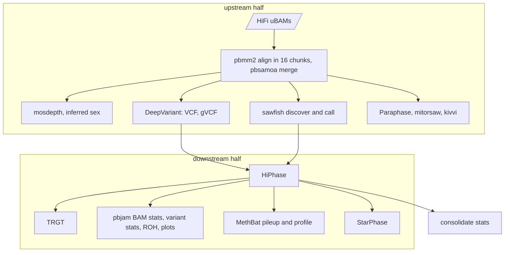
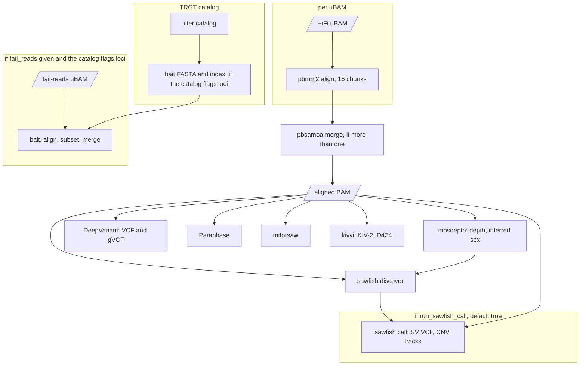
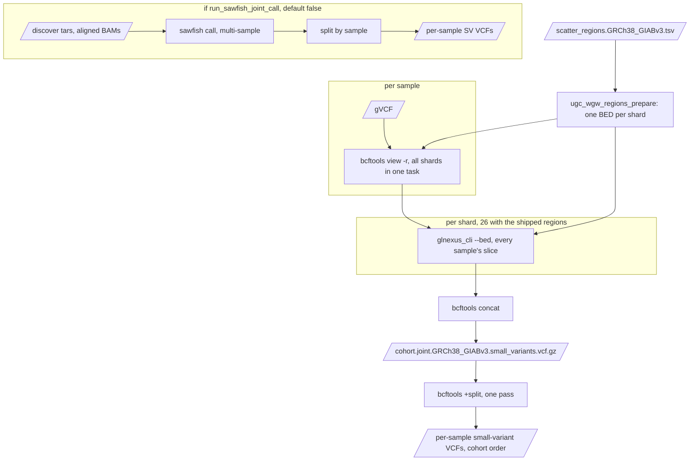
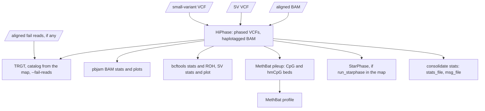
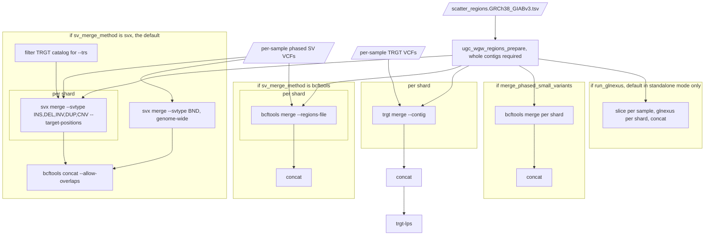
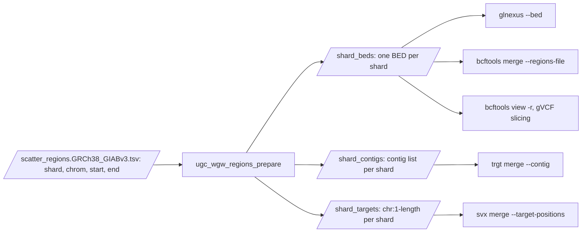
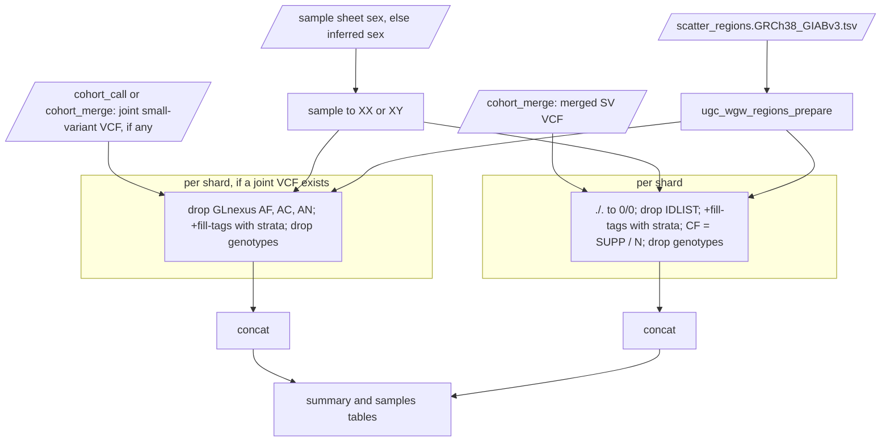
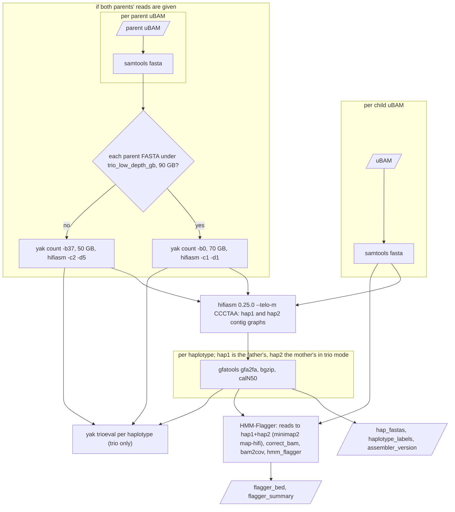
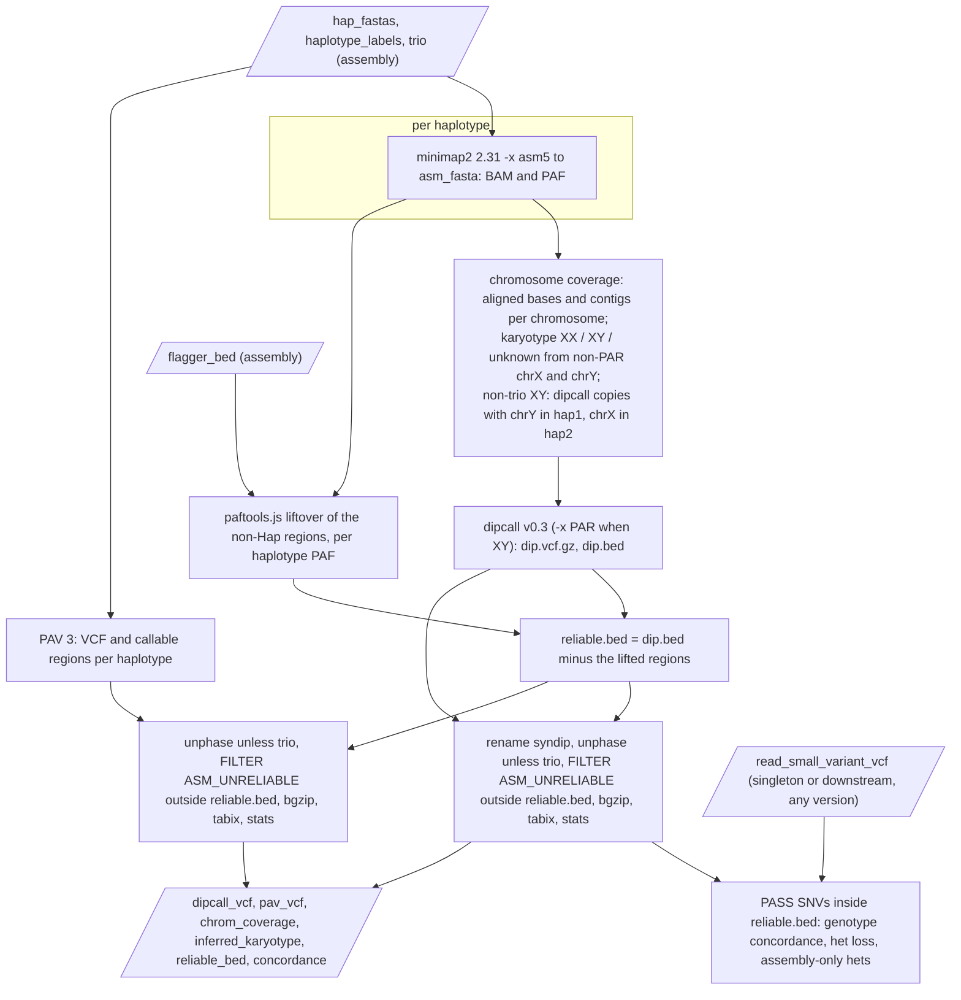
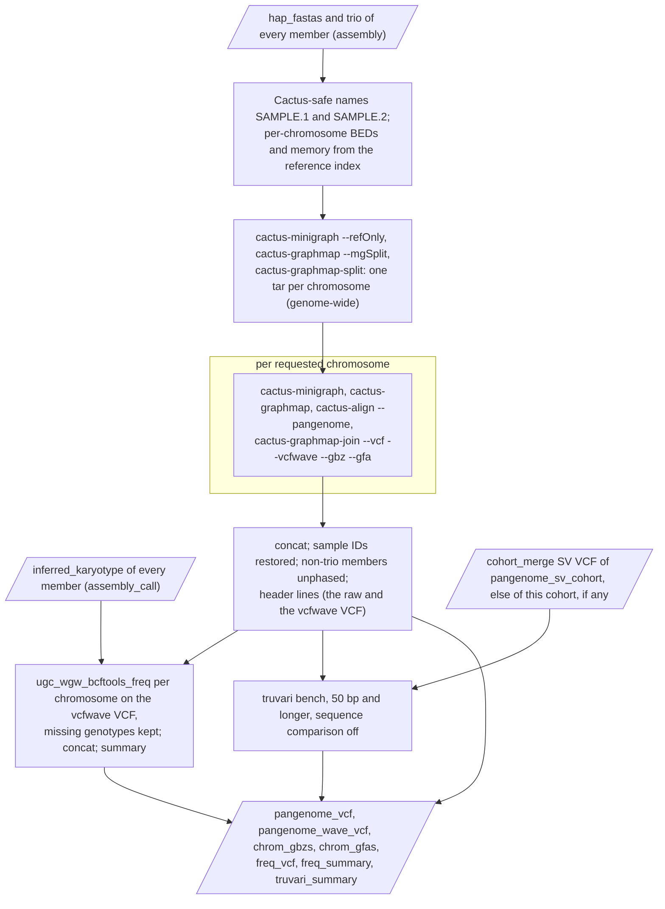

# Stages

For each stage: what it runs, which inputs the driver fills and which you may
override through `stage_inputs`, the switches, the resources, and where the
outputs are described. The diagrams are simplified; the exact call graphs are
in [workflow-graphs.md](workflow-graphs.md). Upstream documents its tools in
`vendor/hifi-human-wgs-wdl/docs/` (`pbmm2.md`, `deepvariant.md`, `trgt.md`,
`kivvi.md`, `methbat.md`, `gpu.md`).

Every stage takes `ugc_wgw_version` (echoed back and checked), `ref_map_file`
(the one rendered map, chapter 04), `backend` (`HPC`) and `preemptible` from
the driver; `cohort_merge` and `assembly` also take `ugc_wgw_container_registry`
for the images this repository builds. `ugc-wgw stage-inputs --stage <stage>`
prints these tables from the installed WDL: every input with its type,
default, description, who fills it and the project's override; `--nested`
adds the inputs of the tasks inside (chapter 05).

Per-sample resource requests are upstream's own and unchanged: every task's
request is in the generated [inventory](task-resources.md), and chapter 12
shows how a site caps or overrides them. The numbers below are the ones
ugc-pacbio-wgw sets. The N-scaled memory formulas are first estimates until
the cohort smoke test replaces them.

## `singleton`

Upstream's `singleton.wdl`, mirrored call for call (the reference data comes
from the rendered map instead of being unpacked from PacBio's data container
in every run), plus the manifest task. One run does everything `upstream` and
`downstream` do, in one process. Use it in standalone mode.



| Driver fills | You may override |
|---|---|
| `sample_id`, `hifi_reads`, `fail_reads` | `use_alignment_chunking` (true), `use_gpu` (false), `use_parabricks_deepvariant` (false) |

Outputs: the 96 upstream outputs by name plus the two ugc-wgw ones (chapter 07).
Task set: catalog preparation, pbmm2 per BAM (16 chunks) against the
prebuilt reference index of the reference map (upstream would build the
5.8 GB index once per BAM), pbsamoa merge,
mosdepth, DeepVariant (8 shards), sawfish discover and call, Paraphase,
mitorsaw, kivvi (KIV-2 and D4Z4), optional fail-reads baiting, HiPhase, TRGT,
pbjam BAM stats, variant stats, MethBat pileup and profile, StarPhase,
consolidate stats. An aligned input BAM is realigned as one chunk, with its
haplotype tags stripped and a message in `msg_file`.

## `upstream`

The pre-phasing half. Same code as inside `singleton`; the split lets the
cohort be joint-called before phasing.



| Driver fills | You may override |
|---|---|
| `sample_id`, `hifi_reads`, `fail_reads` | `run_sawfish_call` (true), `use_alignment_chunking` (true), `use_gpu`, `use_parabricks_deepvariant` |

`run_sawfish_call = true` gives every sample its own SV VCF, so `downstream`
can run without a multi-sample call; set it to `false` only when
`cohort_call` will run `run_sawfish_joint_call`, in which case `upstream`
produces the discover tarball only. Upstream's own default for this flag
(`single_sample`) is `false`; ugc-pacbio-wgw flips it.

Outputs: aligned BAM, optional aligned fail reads, mosdepth and
`inferred_sex`, DeepVariant VCF and gVCF, `discover_tar`, optional per-sample
SV set, Paraphase, mitorsaw, kivvi (the allele plots only when an allele was
called; nothing when kivvi fails on low coverage), `msg` (chapter 07).

## `cohort_call`

GLnexus over the cohort's gVCFs, scattered by region; a per-sample split; an
optional multi-sample sawfish call. Mirrors upstream's `joint.wdl`.



Why the slicing: `glnexus_cli` ignores gVCF indices and reads every gVCF end
to end for each region, so 26 shards over 1000 samples would read 26 000
whole gVCFs. One `bcftools view` per sample cuts all 26 slices index-based,
and each GLnexus shard reads only its slices.

| Driver fills | You may override |
|---|---|
| `cohort_id`, `sample_ids`, `gvcfs`, `gvcf_indices`; with `run_sawfish_joint_call`: `discover_tars`, `aligned_bams`, `aligned_bam_indices` | `split_keep_homref` (true), `run_sawfish_joint_call` (false), `glnexus_threads` (32), `glnexus_mem_gb` (32 + 0.1 N), `split_mem_gb` (8 + 0.02 N), `scatter_regions_file` |

Resources per shard: GLnexus `glnexus_threads` CPUs and `glnexus_mem_gb` GB,
which is also its `--mem-gbytes` budget; the database lives on the node's
local scratch when the site set `TASK_SCRATCH_ENV` (chapter 04), else in
the task's work directory.
The split runs one bgzip writer per sample. Outputs: cohort VCF, per-sample
split VCFs in cohort order, optional joint SV set (chapter 07).

## `downstream`

The post-phasing half. Mode-agnostic: it phases whatever small-variant and SV
VCF the driver hands it, and needs the inferred `sex` and the aligned BAM
from `upstream`.



| Driver fills | You may override |
|---|---|
| `sample_id`, `sex` (from `upstream.inferred_sex`), `aligned_hifi_reads` (+ index), `aligned_fail_reads` (+ index, when present), `small_variant_vcf` and `sv_vcf` (+ indices; from `cohort_call` slices in joint mode, from `upstream` otherwise), `stat_depth_mean`, `upstream_msg` | nothing beyond the shared inputs |

Outputs: the 62 `downstream` outputs plus `stats_file` and `msg_file`, so
that `upstream` plus `downstream` equals `singleton`.

## `cohort_merge`

Four independent branches after phasing, every one scattered over the shards
of `scatter_regions`: SV merge, TRGT merge with trgt-lps, optional phased
small-variant merge, optional GLnexus.



Why the genome-wide BND job: svx keeps only breakends whose mates are inside
the target positions, so a per-contig shard would silently drop
inter-chromosomal breakends. The BND job runs unscattered and its records are
concatenated with the per-contig results.

| Driver fills | You may override |
|---|---|
| `cohort_id`, `sample_ids`, `sv_vcfs`, `trgt_vcfs` (+ indices; from `singleton` in standalone, from `downstream` in joint), `gvcfs` when `run_glnexus`, `phased_small_variant_vcfs` when `merge_phased_small_variants`, `ugc_wgw_container_registry` | `sv_merge_method` (`svx`), `svx_threads` (8), `svx_min_supp` (1), `svx_mem_gb` (8 + 0.05 N), `trgt_merge_threads` (2), `trgt_merge_mem_gb` (8 + 0.02 N), `trgt_lps_threads` (8), `run_glnexus` (true in standalone, false in joint), `glnexus_threads` (32), `glnexus_mem_gb` (32 + 0.1 N), `merge_phased_small_variants` (false), `bcftools_merge_mem_gb` (8 + 0.02 N) |

Outputs: `<cohort_id>.merged.GRCh38_GIABv3.` SV VCF, TRGT VCF, trgt-lps TSV,
optional phased small-variant VCF and GLnexus VCF (chapter 07).

### Scatter regions



The shipped file has the 25 primary contigs as one shard each and a `rest`
shard holding the 193 other contigs (the 170 unplaced, unlocalised and decoy
contigs of GRCh38 plus the 23 decoys GIABv3 adds), 26 shards in total, so
region-scoped steps see the same contigs as upstream's unscoped ones.
`cohort_merge` requires whole-contig shards because `trgt merge` scopes by
contig only; `cohort_call` accepts finer shards (`scatter_regions_file`),
since GLnexus scopes by BED.

## `cohort_freq`

The last stage of both cohort modes turns the cohort's two multi-sample
VCFs into an in-house frequency resource: sites-only VCFs with allele
counts overall and per sex, a summary and the list of members with the sex
used. Nothing in it is upstream's; the tools are bcftools 1.23 from
`pb_wdl_base`.



Text version: one `ugc_wgw_regions_prepare`; per shard, `ugc_wgw_bcftools_freq`
over the joint small-variant VCF (when there is one) and over the merged SV
VCF; `bcftools concat` of each; `ugc_wgw_freq_summary`; the manifest.

| Driver fills | You may override |
|---|---|
| `cohort_id`, `sample_ids`, `sample_sexes` and `sample_sex_sources` (sheet sex, else the sex `singleton`/`upstream` inferred, else unknown), `sv_vcf` (+ index; from `cohort_merge`), `small_variant_vcf` (+ index; from `cohort_call` in joint mode, from `cohort_merge` with `run_glnexus` in standalone mode; absent otherwise) | `freq_threads` (2), `freq_mem_gb` (4) |

Outputs: `<cohort_id>.freq.GRCh38.` small-variant VCF (only with a joint
VCF), SV VCF, summary TSV, samples TSV (chapter 07). Resources are small:
every task streams one record at a time; the smoke cohort takes ten seconds.

### Reading the counts

- `AC`, `AN`, `AF` per ALT allele as `bcftools +fill-tags` counts them,
  plus `NS` (samples with a call), `AC_Hom`, `AC_Het`, `AC_Hemi`. With
  `_XX` and `_XY` suffixes the same over the members of that sex; a member
  of unknown sex counts in the unsuffixed tags only. Multiallelic records
  stay multiallelic (`Number=A`, one value per ALT); to split them, run
  `bcftools norm -m -any` on the frequency file.
- Small variants: missing genotypes (`./.`, uncovered in GLnexus) are not
  in `AN`, so `AN ≤ 2 · NS` and `AF` is over called alleles. GLnexus's own
  `AF` is replaced; its `AQ` and the `MONOALLELIC` filter are kept.
- SVs: the svx merge marks a sample without the variant in its own sawfish
  call set as `./.`, which is a non-carrier, not a missing call. The stage
  counts those as hom-ref, so `NS = N` and `AN = 2N` on every record and a
  true no-call cannot be told apart. `SUPP` is the number of carrier
  samples, `CF = SUPP / N` the carrier frequency; `AF` counts ALT alleles.
- Half-called genotypes: `AC_Hemi` is not sex-chromosome hemizygosity.
  GLnexus writes `./1` when one allele lacks depth and sawfish encodes
  depth-based CNV carriers as `./1`; the called allele of such a genotype
  counts under `AC_Hemi` with one added to `AN`.
- Sex chromosomes: upstream calls every contig diploid, so an XY sample's
  hemizygous ALT on chrX appears as `AC_Hom_XY` and `AN_XY` is two per XY
  sample there.

The `##ugc_wgw_cohort_freq_*` header lines repeat these conventions in the file
itself, with the cohort, version and source file names.

### Using the files

```bash
# sites with an alternate allele in at most 1 % of alleles among XX members
bcftools view -i 'AF_XX <= 0.01 && AC_XX > 0' C1.freq.GRCh38_GIABv3.small_variants.vcf.gz

# annotate a sample VCF with the cohort frequency
bcftools annotate -a C1.freq.GRCh38_GIABv3.small_variants.vcf.gz -c INFO/AF,INFO/AC,INFO/AN \
    --rename-annots <(printf 'INFO/AF\tUGC_AF\nINFO/AC\tUGC_AC\nINFO/AN\tUGC_AN\n') sample.vcf.gz

# SVs carried by at least a tenth of the cohort
bcftools view -i 'CF >= 0.1' C1.freq.GRCh38_GIABv3.structural_variants.vcf.gz
```

Counts from cohorts that share no samples can be summed (`AC`, `AN`, `NS`
per record); a driver command for that is not written yet. Sample names of
fewer than three characters cannot be stratified by sex (a limit of
`bcftools +fill-tags --samples-file`); the stage fails and names them.

## `assembly`

hifiasm per sample, trio-binned with the parents' reads when the pedigree
allows, then each haplotype converted to FASTA with statistics. Ported from
PacBio's HiFi-human-assembly-WDL v1.0.2. The stage ends at an **output
contract** that every later stage reads: `assembler_used`,
`assembler_version`, `haplotype_labels`, `hap_fastas`, statistics and graphs.
The assembler behind it is named by the `assembler` input; only `hifiasm`
exists, and any other value fails at the start of the run.



Text version: `samtools fasta` per child uBAM (and per parent uBAM in trio
mode, followed by `yak count` per parent with depth-dependent parameters);
hifiasm with `--telo-m CCCTAA`, trio-binned when the yak tables exist; then
`gfatools gfa2fa` and calN50 per haplotype. The outputs are the contract.
Two QC steps read it: HMM-Flagger aligns the sample's own reads back to the
diploid assembly (hap1 and hap2 together, minimap2 `-x map-hifi -I8g`),
cleans the alignment with secphase's `correct_bam` (primary alignments,
reads and alignments of 5 kb or more, divergence at most 0.1), and models
the per-base coverage into `Err`, `Dup`, `Hap` and `Col` regions
(`flagger_bed`, with the shares in `flagger_summary`); trio-binned samples
also get `yak trioeval` per haplotype against the parental k-mer tables,
with the thresholds the binning used (switch and Hamming error rates).

| Driver fills | You may override |
|---|---|
| `sample_id`, `hifi_reads`; in trio mode `father_id`, `mother_id`, `father_hifi_reads`, `mother_hifi_reads` | `assembler` (`hifiasm`), `hifiasm_telomere_motif` (`CCCTAA`; empty = off), `hifiasm_extra_params`, `hifiasm_threads` (48), `hifiasm_mem_gb` (288), `yak_threads` (24), `yak_mem_gb`, `yak_params`, `hifiasm_trio_params`, `trio_low_depth_gb` (90), `keep_read_alignment` (false: the reads-to-assembly BAM is tens of GB per sample), `flagger_align_threads` (32), `flagger_align_mem_gb` (64), `flagger_threads` (16), `flagger_mem_gb` (32), `trioeval_c`, `trioeval_d` (the binning's) |

Resources: hifiasm 48 CPUs and 288 GB for up to a day at 30x (about 135 GB
observed); yak 24 CPUs and 70 or 50 GB per parent; the Flagger alignment
32 CPUs and 64 GB (the whole diploid assembly indexed at once), bam2cov and
hmm_flagger 16 CPUs and 32 GB; trioeval 8 CPUs and 48 GB. The site's default
wall time of three days covers hifiasm. The yak tables are not exported; the
call cache re-uses them for siblings. Flagger's read alignment is an
intermediate unless `keep_read_alignment`.

**The hifiasm command is frozen.** miniwdl keys its call cache on a task's
command and inputs, so anything that changes the hifiasm command line (the
motif does; the thread count does not) costs every sample's assembly again,
up to a day each. 0.11.0 made the one change (`--telo-m`, the version file);
later releases change only the stages after the contract, and
`assembly_call` with `--any-version` builds on the assemblies of the previous
version (chapter 10).

Outputs: per-haplotype FASTAs and statistics, graphs, Flagger's BED and
summary, trioeval per haplotype (trio), `trio`, `hap1_parent`, `hap2_parent`
(chapter 07). `haplotype_labels` gives the order of every per-haplotype
array: `hap1`, `hap2`, or `pat`, `mat` when trio-binned. The QC flags the
summary derives from these (chapter 11, `asm_*` thresholds) feed
`ugc-wgw summary --pass-list`, the sample list a pangenome cohort is frozen
from (chapter 06).

## `assembly_call`

The assembly's haplotypes aligned to the decoy-free GRCh38 and called with
dipcall and PAV 3, with a per-chromosome account of what was assembled and
the karyotype the assembly implies.



Text version: minimap2 aligns each haplotype once (SAM, then `samtools sort`
for the BAM and `paftools.js sam2paf` for the PAF); the coverage task reads
the PAFs; dipcall runs in male mode with the PAR BED when the karyotype is
`XY`, on regrouped haplotype copies unless the assembly was trio-binned; PAV
runs on the original haplotypes (`hap_h1`/`hap_h2`, or `hap_pat`/`hap_mat`
when trio); each caller's VCF is finished into the primary VCF. With the
assembly's `flagger_bed`, its non-Hap intervals (Err, Dup, Col; assembly
coordinates) are lifted to the reference through each haplotype's PAF
(`paftools.js liftover`, alignments of 50 kb and MAPQ 5 or more, dipcall's
own thresholds) and `reliable.bed` is `dip.bed` minus them; every record of
both primary VCFs outside it gets `FILTER=ASM_UNRELIABLE` added. Calls are
annotated, never dropped: count by `PASS` to use the mask, ignore the filter
to see everything. With a read-based VCF, dipcall's `PASS` SNVs are compared
with the read-based ones inside `reliable.bed` (inside `dip.bed` when there
is no Flagger mask): genotype concordance, the het-loss rate (read hets the
assembly calls homozygous or not at all, the signature of collapsed
haplotypes) and the assembly's hets the reads lack.

| Driver fills | You may override |
|---|---|
| `sample_id`, `hap_fastas`, `haplotype_labels`, `trio`, `flagger_bed` (from `assembly`); `read_small_variant_vcf` and its index when the sample has a `singleton` or `downstream` run of any version | `align_threads` (16), `align_mem_gb` (32), `dipcall_threads` (8; the task takes twice as many cores), `dipcall_mem_gb` (48), `pav_threads` (8), `pav_align_threads` (4), `pav_mem_gb` (40), `chrx_min_fraction` (0.5), `chry_min_fraction` (0.1) |

Resources (dev-machine measurements on chr20 assemblies against the whole
reference, before the pilot sets the real rows): minimap2 asm5 needs about
12 GB for the reference index per haplotype; dipcall's two concurrent
minimap2 runs about 2 × 16 GB; PAV's `align_map` peaks at 15 GB per
haplotype, both haplotypes at once, and its single-process table merges and
VCF writer take tens of minutes on a whole genome; the liftover, the
reliable-region arithmetic and the concordance are seconds to minutes on
small tasks. The karyotype thresholds are read against the chrX and chrY
lengths, so a chr20-only smoke assembly always infers `unknown`.

Outputs: alignments as BAM and PAF, the coverage table, the karyotype with
its evidence, the two primary VCFs with their statistics, the callers' raw
files, the unreliable and reliable regions with their summary, the
concordance table (chapter 07).

## `cohort_pangenome`

The last stage of the assembly mode builds a Minigraph-Cactus graph of the
cohort's haplotype assemblies on the decoy-free GRCh38 and turns it into
cohort VCFs with allele frequencies. The graph is built one chromosome at a
time (Cactus's `--mgSplit` route): one genome-wide step maps every haplotype
to a reference-only graph and bins the contigs by chromosome, then every
requested chromosome is constructed, mapped, aligned and joined in its own
task. The tools are cactus v3.3.0 (minigraph 0.21, vg 1.76.1, vcfwave) from
the `comparative-genomics-toolkit/cactus` image, bcftools 1.23 from
`pb_wdl_base` and truvari 5.5.0.



Text version: `ugc_wgw_pangenome_names` maps each sample ID to a Cactus-safe
genome name (dots and dashes to `_`; a collision fails the run), writes the
rename table and, from the reference index, a BED and a memory size per
requested chromosome; `ugc_wgw_cactus_split` writes the seqfile (`GRCh38`,
then `<name>.1` and `<name>.2` per member in cohort order), runs
`cactus-minigraph --refOnly`, `cactus-graphmap --mgSplit` and
`cactus-graphmap-split` over the whole genome, and tars each chromosome's
directory with its seqfile; per requested chromosome `ugc_wgw_cactus_chrom`
untars, rewrites the paths and runs the four construction steps, ending in
`cactus-graphmap-join` with `--vcf --vcfwave --gbz --gfa`; two
`ugc_wgw_pangenome_vcf_post` calls concatenate the raw and the vcfwave VCFs,
restore the sample IDs (`bcftools reheader`), unphase the members that were
not trio-binned (`+setGT`) and add the header lines (cohort, chromosomes,
the ambiguity rule, the phase policy); the `cohort_freq` tasks run per
chromosome on the vcfwave VCF with missing genotypes kept, their shards are
concatenated and `ugc_wgw_pangenome_freq_summary` writes the summary; with a
read-based SV merge, a biallelic copy of the vcfwave VCF (`bcftools norm -m
-any`; truvari refuses multiallelic records) goes through
`ugc_wgw_truvari_bench`; the manifest.

Contigs enter a chromosome's graph only when enough of their length aligns
to one reference contig (75, 50 or 25 % below 100 kb, below 1 Mb and from 1
Mb, with a best-to-second ratio of 2 at MAPQ 5 or more, Cactus's defaults);
the rest is ambiguous and in no graph. `ambiguous_contigs` counts them per
haplotype, and the summary's cohort page shows the totals. The other
contigs (chrM and the unplaced ones, lumped together as `chrOther`) are
built only with `build_other_contigs = true`.

| Driver fills | You may override |
|---|---|
| `cohort_id`, `sample_ids`, `hap1_fastas`, `hap2_fastas` and `trios` (from every member's `assembly`), `sample_sexes` and `sample_sex_sources` (`XX`, `XY` or empty from every member's `assembly_call` karyotype; the sheet's sex is not used), `sv_vcf` and its index (the `cohort_merge` SV VCF of `pangenome_sv_cohort`, else of this cohort, any version and either read mode, when one exists) | `chromosomes` (the map's chr1–22, X, Y), `build_other_contigs` (false), `split_cpu` (32), `split_mem_gb` (128), `split_disk_gb` (from the inputs), `chrom_cpu` (16), `chrom_mem_gb_floor` (64), `chrom_mem_gb_per_100mb` (32; the larger rule wins), `freq_threads` (2), `freq_mem_gb` (4) |

`chromosomes = ["chr20"]` under `stage_inputs.cohort_pangenome` is how the
scaling pilot runs (and the smoke): the split step still maps every
haplotype genome-wide, only the per-chromosome tasks are limited. Every
member needs a successful `assembly` and `assembly_call` at the version
(or `--any-version`); freeze the pangenome cohort from `ugc-wgw summary
--pass-list` (chapter 06) so that no assembly with a QC failure enters the
graph.

Resources (dev-machine measurements on two chr20 assemblies, eight cores,
before the pilot sets the real rows): the split step took 12 minutes; one
chromosome task about 50 minutes with `cactus-align` peaking at 11 GB; the
VCF post-processing, the frequencies and truvari are minutes. The memory of
a chromosome task is the larger of `chrom_mem_gb_floor` and
`chrom_mem_gb_per_100mb` times the chromosome's length in 100 Mb; the
default rule gives 64 GB for every human chromosome but chr1 and chr2 (80
and 78 GB). Chapter 12 gets the scaling table once the pilot has run.

Outputs: the graph's cohort VCF and its vcfwave form, the GBZ and GFA per
chromosome with their statistics and logs, the name map and the split's
tables, the frequency VCF with its summary and samples tables, truvari's
figures (chapter 07).
