# Stages

For each stage: what it runs, which inputs the driver fills and which you may
override through `stage_inputs`, the switches, the resources, and where the
outputs are described. The diagrams are simplified; the exact call graphs are
in [workflow-graphs.md](workflow-graphs.md). Upstream documents its tools in
`vendor/hifi-human-wgs-wdl/docs/` (`pbmm2.md`, `deepvariant.md`, `trgt.md`,
`kivvi.md`, `methbat.md`, `gpu.md`).

Every stage takes `ugc_wgw_version` (echoed back and checked), `ref_map_file`
(the one rendered map, chapter 04), `backend` (`HPC`) and `preemptible` from
the driver; `cohort_merge`, `assembly` and `assembly_call` also take
`ugc_wgw_container_registry` for the images this repository builds.
`ugc-wgw stage-inputs --stage <stage>` prints these tables from the
installed WDL: every input with its type, default, description, who fills it
and the project's override; `--nested` adds the inputs of the tasks inside
(chapter 05).

Per-sample resource requests are upstream's own and unchanged: every task's
request is in the generated [inventory](task-resources.md), and chapter 12
shows how a site caps or overrides them. The numbers below are the ones
ugc-pacbio-wgw sets. The N-scaled memory formulas are first estimates until
the cohort smoke test replaces them.

## `singleton`

Upstream's `singleton.wdl`, mirrored call for call (the reference data comes
from the rendered map instead of being unpacked from PacBio's data container
in every run), plus the manifest task. One run does everything `upstream` and
`downstream` do, in one process. Use it in standalone mode.

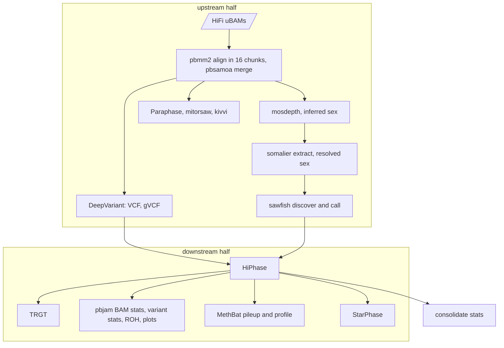

| Driver fills | You may override |
|---|---|
| `sample_id`, `hifi_reads`, `fail_reads` | `use_alignment_chunking` (true), `use_gpu` (false), `use_parabricks_deepvariant` (false) |

Outputs: the 96 upstream outputs by name plus the two ugc-wgw ones (chapter 07).
Task set: catalog preparation, pbmm2 per BAM (16 chunks) against the
prebuilt reference index of the reference map (upstream would build the
5.8 GB index once per BAM), pbsamoa merge,
mosdepth, DeepVariant (8 shards), sawfish discover and call, Paraphase,
mitorsaw, kivvi (KIV-2 and D4Z4), optional fail-reads baiting, HiPhase, TRGT,
pbjam BAM stats, variant stats, MethBat pileup and profile, then our
`methbat report` (below, `downstream`), StarPhase,
consolidate stats. An aligned input BAM is realigned as one chunk, with its
haplotype tags stripped and a message in `msg_file`.

## `upstream`

The pre-phasing half. Same code as inside `singleton`; the split lets the
cohort be joint-called before phasing.

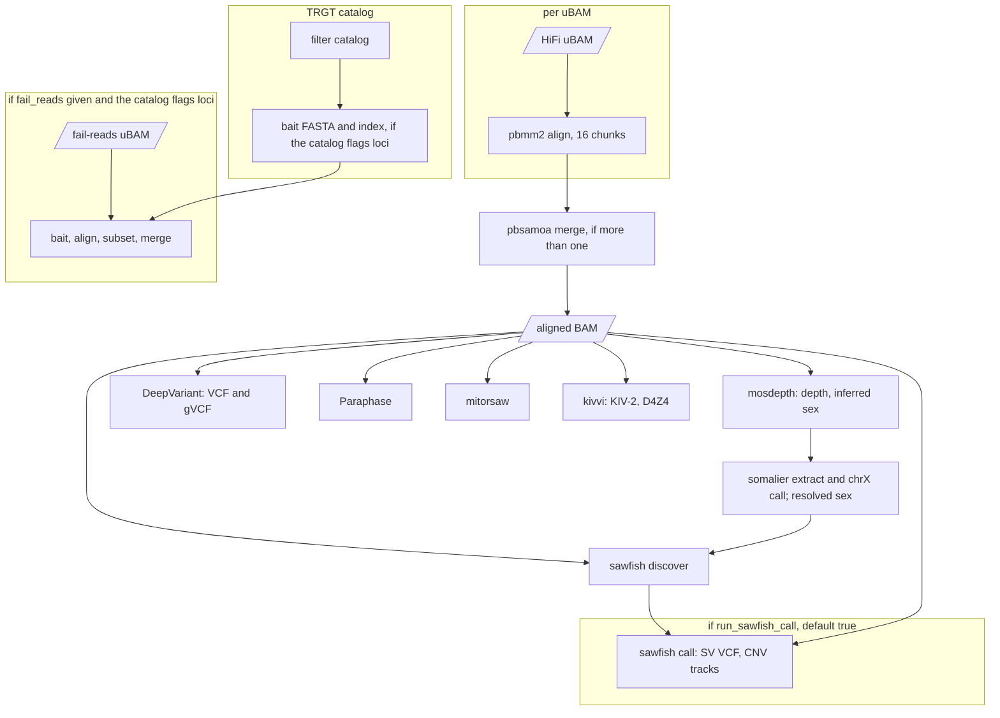

| Driver fills | You may override |
|---|---|
| `sample_id`, `hifi_reads`, `fail_reads` | `run_sawfish_call` (true), `use_alignment_chunking` (true), `use_gpu`, `use_parabricks_deepvariant` |

`run_sawfish_call = true` gives every sample its own SV VCF, so `downstream`
can run without a multi-sample call; set it to `false` only when
`cohort_call` will run `run_sawfish_joint_call`, in which case `upstream`
produces the discover tarball only. Upstream's own default for this flag
(`single_sample`) is `false`; ugc-pacbio-wgw flips it.

Outputs: aligned BAM, optional aligned fail reads, mosdepth and
`inferred_sex`, DeepVariant VCF and gVCF, `discover_tar`, optional per-sample
SV set, Paraphase, mitorsaw, kivvi (the allele plots only when an allele was
called; nothing when kivvi fails on low coverage), `msg` (chapter 07).

Since 0.14 both per-sample stages make a somalier **extract** (a 200 KB
genotype sketch at 17,766 informative sites, `<sample_id>.somalier`) right
after mosdepth and **resolve the sex** the run uses from the sheet, the
coverage inference and somalier's chrX heterozygosity call, in that order
(chapter 02); sawfish and TRGT take the resolved value, and the outputs
`resolved_sex`, `resolved_sex_source`, `somalier_sex`, `somalier_extract`
and `somalier_sex_tsv` (one row of every source and statistic) record it.
The three tasks sit at the end of the mosdepth branch, so a re-run of an
older sample replays everything else from the call cache; sawfish onward
recomputes only where the resolved sex differs from what coverage said.
`declared_sex` (the sheet's, filled by the driver), `somalier_sex_min_x_sites`
(50) and `somalier_sex_min_x_depth` (5.0) are the inputs.

Since 0.15 both per-sample stages also turn mitorsaw's chrM calls into a
call set the cohort can use. mitorsaw writes one genotype entry per
mitochondrial haplotype it detects (`0|1|1|1` for four haplotypes), which
nothing downstream can merge or count. `ugc_wgw_mito_collapse` rewrites it
as a diploid genotype by the rule nallo uses: every haplotype reference
`0/0`, every haplotype alternate `1/1` (homoplasmic), a mix `0/1`
(heteroplasmic); the read fraction of the allele is mitorsaw's own `VAF`.
It splits small variants from SVs at `mito_sv_min_size` (50 bp), writes a
VCF with one haploid column per haplotype, and a one-row summary. With
`run_haplogrep` (default true) `ugc_wgw_haplogrep` classifies every
haplotype against a phylogenetic tree (`haplogrep_tree`, default
`phylotree-fu-rcrs@1.3`, the forensic update of PhyloTree 17;
`phylotree-rcrs@17.3` is in the image too) and names the sample by its most
abundant haplotype. Outputs `mt_small_variant_vcf`, `mt_sv_vcf`,
`mt_haplotypes_vcf`, `mt_haplotypes_tsv`, `mt_summary`, `mt_haplogroups`
and the string `mt_haplogroup`. Both tasks hang off mitorsaw, so a re-run
of an older sample replays everything else from the call cache. On
chr20-only data (the smoke) mitorsaw sees no chrM read: the files are
empty but valid and the haplogroup is empty.

With `aligned_bam_in` (the driver sets it for a `bam`-kind sample, chapter
05) the alignment and the merge are skipped: `ugc_wgw_input_checks` first
checks the given BAM against the installed reference (coordinate-sorted,
indexed, every `@SQ` contig in the FASTA index with the same length, the
read group's sample name equal to the sample id, MM/ML methylation tags in
the first 2,000 reads; a failure stops the stage as an
input error, and `require_methylation_tags = false` turns the missing tags
into a note), writes `input_checks` and `input_provenance` (the header's
`@PG` and `@RG` fields), and every caller reads the given BAM unchanged.
`hifi_reads` is empty then. A `reads`-kind sample whose BAM happens to be
aligned still goes through upstream's own `samtools reset` path; the `bam`
kind is the deliberate opt-out of realignment.

## `cohort_qc`

The identity check of a frozen cohort, first of the cohort stages in both
read modes and the one stage that never blocks the stages after it: it
runs in minutes at any cohort size, and its findings go to the cohort page
and the identity pass list (chapter 06) rather than into the gating rule.
Everything in it is ours around somalier 0.3.7 (`workflows/ugc_wgw/qc/somalier.wdl`).

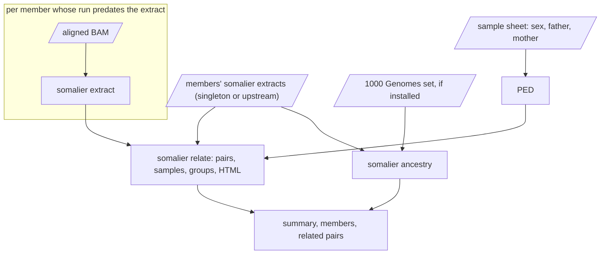

Text version: `ugc_wgw_somalier_extract` for each member without an
extract; `ugc_wgw_somalier_ped`; `ugc_wgw_somalier_relate` over every
extract (`SOMALIER_SEED=1`, every pair reported); `ugc_wgw_somalier_ancestry`
when `run_ancestry`; `ugc_wgw_qc_summary`; the manifest.

| Driver fills | You may override |
|---|---|
| `cohort_id`, `sample_ids`, `somalier_files` (each member's extract, null where the run predates it), `aligned_bams` and `aligned_bam_indices` (for those members: the haplotagged BAM in standalone, the aligned BAM in joint; one warning names them), `sample_sexes` and `sample_sex_sources` (the resolved sex of each member's run), `father_ids`, `mother_ids` (the sheet), `run_ancestry` (on when the reference map's `somalier_1kg_tar` exists) | `min_depth` (7), `min_ab` (0.3), `report_all_pairs` (true), `relate_threads` (2), `relate_mem_gb` (4), `ancestry_mem_gb` (8), `extract_mem_gb` (2) |

Outputs: `<cohort_id>.qc.GRCh38_GIABv3.` pairs, samples, groups and HTML
(somalier's), the PED, the summary, members and related-pairs tables, the
ancestry table and report when run (chapter 07). What the numbers mean:

- **Relatedness** is somalier's coefficient from shared genotypes at the
  sites: about 1 for the same individual, 0.5 for parent-child or
  siblings, 0.25 for second degree, near 0 for unrelated people. The
  cohort page bins every pair and flags `duplicate` at or above 0.9,
  `related` (undeclared) at or above 0.2, `pedigree_mismatch` for a
  declared parent-child pair outside 0.35–0.65 (chapter 07 lists the
  thresholds). `expected_relatedness` in the pairs table is the pedigree's
  (−1 when the PED says nothing about the pair).
- **Sex** per member: somalier's chrX call next to the sheet and the
  coverage inference, and the one the run used. On chr20-only data (the
  smoke) somalier genotypes no chrX site and says nothing; on a genome it
  has 365 sites.
- **Heterozygosity ratio** `n_het / (n_het + n_hom_alt)`: a contaminated
  sample or a mix of two has more heterozygous genotypes than the cohort;
  `het_outlier` is median ± 3 scaled MADs across the cohort.
- **Ancestry** is a projection onto the principal components of the 2,504
  1000 Genomes samples with the nearest superpopulation (AFR, AMR, EAS,
  EUR, SAS) and its probability: a description of genetic structure that
  `cohort_freq`'s export uses as strata, not a statement about origin. It
  needs the 83 MB reference set (`ugc-wgw-qc`), which the bundle carries
  unless it was built `--without-ancestry`.

A member whose run predates 0.14 (no extract among its outputs) is extracted
inside the stage from its aligned BAM: 1 CPU, 2 GB, a few minutes, cached by
BAM, sites file and reference, so it happens once however many cohorts the
member joins. The stage therefore runs on the 864 cohort without
re-running anything per sample (chapter 10).

## `cohort_call`

GLnexus over the cohort's gVCFs, scattered by region; a per-sample split; an
optional multi-sample sawfish call. Mirrors upstream's `joint.wdl`.

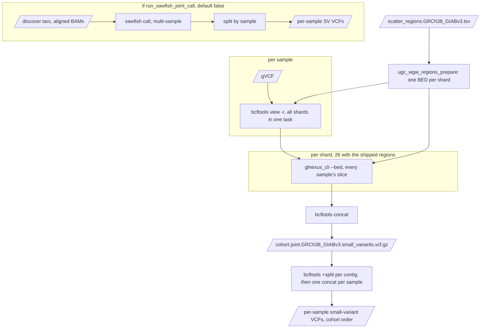

Why the slicing: `glnexus_cli` ignores gVCF indices and reads every gVCF end
to end for each region, so 26 shards over 1000 samples would read 26 000
whole gVCFs. One `bcftools view` per sample cuts all 26 slices index-based,
and each GLnexus shard reads only its slices.

| Driver fills | You may override |
|---|---|
| `cohort_id`, `sample_ids`, `gvcfs`, `gvcf_indices`; with `run_sawfish_joint_call`: `discover_tars`, `aligned_bams`, `aligned_bam_indices` | `split_keep_homref` (true), `run_sawfish_joint_call` (false), `glnexus_threads` (32), `glnexus_mem_gb` (32 + 0.1 N), `split_mem_gb` (8 + 0.02 N), `scatter_regions_file`, `skip_contigs` (`["chrM"]`) |

GLnexus skips the `chrM` shard (`skip_contigs`): the cohort's mitochondrial
genotypes come from mitorsaw through `cohort_merge`, not from DeepVariant's
diploid calls on a genome that is not diploid, so the cohort small-variant
VCF carries no chrM record since 0.15.

Resources per shard: GLnexus `glnexus_threads` CPUs and `glnexus_mem_gb` GB,
which is also its `--mem-gbytes` budget; the database lives on the node's
local scratch when the site set `TASK_SCRATCH_ENV` (chapter 04), else in
the task's work directory.
The split runs one bgzip writer per sample. Outputs: cohort VCF, per-sample
split VCFs in cohort order, optional joint SV set (chapter 07).

## `downstream`

The post-phasing half. Mode-agnostic: it phases whatever small-variant and SV
VCF the driver hands it, and needs the inferred `sex` and the aligned BAM
from `upstream`.

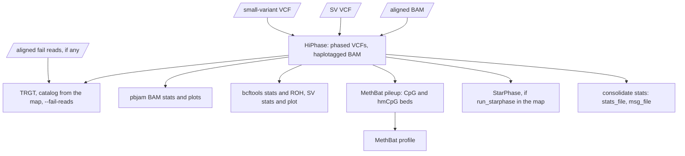

| Driver fills | You may override |
|---|---|
| `sample_id`, `sex` (from `upstream.inferred_sex`), `aligned_hifi_reads` (+ index), `aligned_fail_reads` (+ index, when present), `small_variant_vcf` and `sv_vcf` (+ indices; from `cohort_call` slices in joint mode, from `upstream` otherwise), `stat_depth_mean`, `upstream_msg` | nothing beyond the shared inputs |

Outputs: the 62 `downstream` outputs plus `stats_file` and `msg_file`, so
that `upstream` plus `downstream` equals `singleton`, plus `methbat_report`.

> `methbat report` labels the imprinting regions of
> `methbat_report_regions_tsv` (`PLAGL1`, `GRB10`, `MEST`, `H19/IGF2`,
> `KCNQ1OT1`, `MEG3`, `SNRPN`, `PEG3`, the `GNAS` cluster and the others of
> MethBat's `hg38_imprinting_targets`) as `PASS`, `Inconclusive`, `Anomalous`
> or `AnomalousQcWarning` against their expected allele-specific methylation
> (`ugc_wgw_methbat_report`, 1 CPU, 4 GB, seconds). Output `methbat_report`,
> in `singleton` and `downstream` alike. Off with `run_methbat_report =
> false`. A run from before 0.16 has none: `cohort_methyl` makes it for the
> cohort.

## `intake`

Per sample, the `vcf` entry kind only (chapter 05): a sample registered from
an aligned BAM and its small-variant and SV VCFs (and optionally a gVCF)
gets what `downstream` needs from `upstream` without alignment or calling.

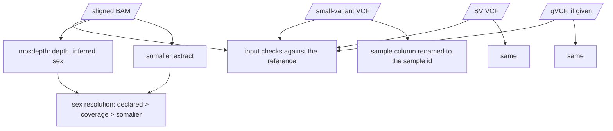

Text version: `ugc_wgw_input_checks` first (the BAM is coordinate-sorted,
indexed, aligned to the installed reference with the same contig lengths,
its read group's sample name is the sample id, and it carries MM/ML tags in
its first reads; every VCF is BGZF-compressed,
indexed, has exactly one sample column and only reference contigs); a
failed check exits with `INPUT CHECK FAILED` lines and the driver records
an input error (the sample blocks, no retry). Then upstream's `mosdepth`,
our `ugc_wgw_somalier_extract`, the one-sample relate and
`ugc_wgw_resolve_sex` as in `upstream`, and `ugc_wgw_vcf_sample_rename` per
VCF (`bcftools reheader` when the column is not the sample id; the file is
copied otherwise) under upstream's file names. Minutes.

| Driver fills | You may override |
| --- | --- |
| `sample_id`, `declared_sex`, `aligned_bam` (+ index), `small_variant_vcf_in` (+ index), `sv_vcf_in` (+ index), `gvcf_in` (+ index, when the sheet has one), `ugc_wgw_container_registry` | `require_methylation_tags` (true), `somalier_sex_min_x_sites` (50), `somalier_sex_min_x_depth` (5.0) |

Outputs carry upstream's names for the fields `downstream` reads
(`aligned_hifi_reads`, `inferred_sex`, `resolved_sex`, `stat_depth_mean`,
`small_variant_vcf`, `sv_vcf`, `small_variant_gvcf`, `somalier_extract`,
`msg`) plus `input_checks` (check, target, status, detail),
`input_provenance` (the BAM header's `@PG` and `@RG` fields, the VCF
headers' `##source` and tool version lines) and the manifest, which names
the external files with their size and modification time. The member's
page and the cohort's members table mark it `external_input`
(informational), and `cohort_freq`'s samples file carries the kind. Such a
member has no mitorsaw call: `cohort_merge` leaves the mitochondrial merge
out for a cohort that holds one, and says so.

## `cohort_merge`

Four independent branches after phasing, every one scattered over the shards
of `scatter_regions`: SV merge, TRGT merge with trgt-lps, optional phased
small-variant merge, optional GLnexus.

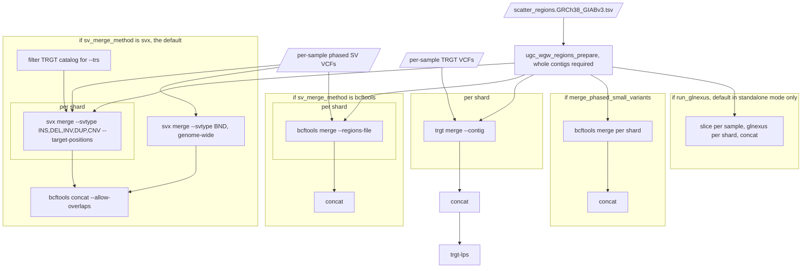

Why the genome-wide BND job: svx keeps only breakends whose mates are inside
the target positions, so a per-contig shard would silently drop
inter-chromosomal breakends. The BND job runs unscattered and its records are
concatenated with the per-contig results.

| Driver fills | You may override |
|---|---|
| `cohort_id`, `sample_ids`, `sv_vcfs`, `trgt_vcfs` (+ indices; from `singleton` in standalone, from `downstream` in joint), `gvcfs` when `run_glnexus`, `phased_small_variant_vcfs` when `merge_phased_small_variants`, `merge_mitochondria` with each member's `mt_small_variant_vcfs`, `mt_sv_vcfs`, `mt_haplogroups` (+ indices) or, for a member whose run predates 0.15, null plus its `mitorsaw_vcfs` and `mitorsaw_hap_stats`, `ugc_wgw_container_registry` | `sv_merge_method` (`svx`), `svx_threads` (8), `svx_min_supp` (1), `svx_mem_gb` (8 + 0.05 N), `trgt_merge_threads` (2), `trgt_merge_mem_gb` (8 + 0.02 N), `trgt_lps_threads` (8), `run_glnexus` (true in standalone, false in joint), `glnexus_threads` (32), `glnexus_mem_gb` (32 + 0.1 N), `merge_phased_small_variants` (false), `bcftools_merge_mem_gb` (8 + 0.02 N), `merge_mitochondria` (true when any member brings something; false leaves the branch out), `mito_sv_min_size` (50), `haplogrep_tree`, `run_haplogrep` (true), `skip_contigs` (`["chrM"]`, the GLnexus scatter only) |

Outputs: `<cohort_id>.merged.GRCh38_GIABv3.` SV VCF, TRGT VCF, trgt-lps TSV,
optional phased small-variant VCF and GLnexus VCF, and the mitochondrial
sets (chapter 07).

Since 0.15 the stage also merges the members' collapsed mitochondrial call
sets (`bcftools merge` over one contig, no scatter): `…mt_small_variants.vcf.gz`
and `…mt_svs.vcf.gz`, where `0/0` means mitorsaw reported no alternate
allele for that member at the site, and `…mt_haplogroups.tsv`, every
member's haplogroups in one table. A member whose per-sample run predates
the collapse (the 864) is collapsed and classified inside the stage from
its mitorsaw VCF and JSON (seconds each; the driver names them once), so
an existing cohort gets its mitochondrial sets without any per-sample
re-run (chapter 10). The GLnexus branch takes its own shard list without
chrM; the SV and TRGT merges keep every shard.

### Scatter regions

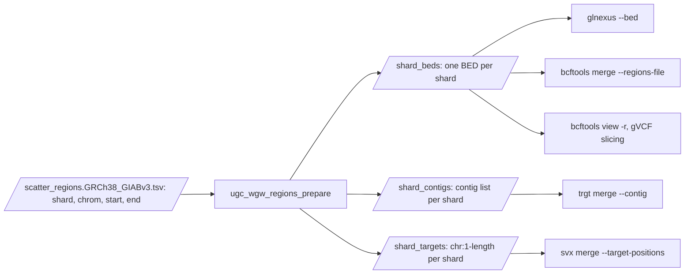

The shipped file has the 25 primary contigs as one shard each and a `rest`
shard holding the 193 other contigs (the 170 unplaced, unlocalised and decoy
contigs of GRCh38 plus the 23 decoys GIABv3 adds), 26 shards in total, so
region-scoped steps see the same contigs as upstream's unscoped ones.
`cohort_merge` requires whole-contig shards because `trgt merge` scopes by
contig only; `cohort_call` accepts finer shards (`scatter_regions_file`),
since GLnexus scopes by BED.

## `cohort_freq`

The last stage of both cohort modes turns the cohort's two multi-sample
VCFs into an in-house frequency resource: sites-only VCFs with allele
counts overall and per sex, a summary and the list of members with the sex
used. Nothing in it is upstream's; the tools are bcftools 1.23 from
`pb_wdl_base`.

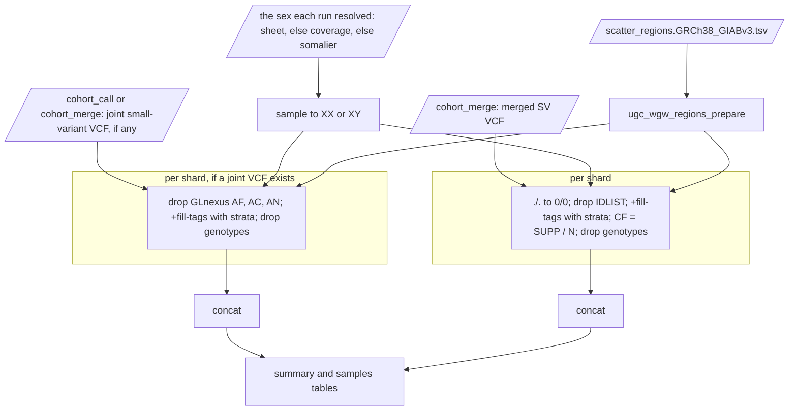

Text version: one `ugc_wgw_regions_prepare`; per shard, `ugc_wgw_bcftools_freq`
over the joint small-variant VCF (when there is one) and over the merged SV
VCF; `bcftools concat` of each; `ugc_wgw_freq_summary`; the manifest.

| Driver fills | You may override |
|---|---|
| `cohort_id`, `sample_ids`, `sample_sexes` and `sample_sex_sources` (the sex each member's run resolved and where it came from: `declared`, `coverage` or `somalier`; for a run from before 0.14 the sheet, else the coverage inference), `sv_vcf` (+ index; from `cohort_merge`), `small_variant_vcf` (+ index; from `cohort_call` in joint mode, from `cohort_merge` with `run_glnexus` in standalone mode; absent otherwise), `mt_small_variant_vcf` and `mt_sv_vcf` (+ indices; from `cohort_merge` when it merged the mitochondrial sets) | `freq_threads` (2), `freq_mem_gb` (4), `mt_contig` (`chrM`), `mt_length` (16569) |

Outputs: `<cohort_id>.freq.GRCh38.` small-variant VCF (only with a joint
VCF), SV VCF, the two mitochondrial VCFs (when `cohort_merge` made the
sets), summary TSV, samples TSV (chapter 07). Resources are small: every
task streams one record at a time; the smoke cohort takes ten seconds.

### Reading the counts

- `AC`, `AN`, `AF` per ALT allele as `bcftools +fill-tags` counts them,
  plus `NS` (samples with a call), `AC_Hom`, `AC_Het`, `AC_Hemi`. With
  `_XX` and `_XY` suffixes the same over the members of that sex; a member
  of unknown sex counts in the unsuffixed tags only. Multiallelic records
  stay multiallelic (`Number=A`, one value per ALT); to split them, run
  `bcftools norm -m -any` on the frequency file.
- Small variants: missing genotypes (`./.`, uncovered in GLnexus) are not
  in `AN`, so `AN ≤ 2 · NS` and `AF` is over called alleles. GLnexus's own
  `AF` is replaced; its `AQ` and the `MONOALLELIC` filter are kept.
- SVs: the svx merge marks a sample without the variant in its own sawfish
  call set as `./.`, which is a non-carrier, not a missing call. The stage
  counts those as hom-ref, so `NS = N` and `AN = 2N` on every record and a
  true no-call cannot be told apart. `SUPP` is the number of carrier
  samples, `CF = SUPP / N` the carrier frequency; `AF` counts ALT alleles.
- Half-called genotypes: `AC_Hemi` is not sex-chromosome hemizygosity.
  GLnexus writes `./1` when one allele lacks depth and sawfish encodes
  depth-based CNV carriers as `./1`; the called allele of such a genotype
  counts under `AC_Hemi` with one added to `AN`.
- Sex chromosomes: upstream calls every contig diploid, so an XY sample's
  hemizygous ALT on chrX appears as `AC_Hom_XY` and `AN_XY` is two per XY
  sample there.
- Mitochondria (`…mt_small_variants.vcf.gz`, `…mt_svs.vcf.gz`): the counts
  come from mitorsaw's collapsed genotypes, not from the joint VCF, which
  carries no chrM. `0/1` means heteroplasmic (some haplotypes carry the
  allele), `1/1` homoplasmic, so `AC_Het` and `AC_Hom` count members in
  each state; a member without the variant in its mitorsaw call set counts
  as reference; no sex strata (mitochondria are maternal, and a split would
  only thin the cohort). The per-member read fraction (`VAF`) is in the
  merged VCF of `cohort_merge`, not in the sites-only frequency file.

The `##ugc_wgw_cohort_freq_*` header lines repeat these conventions in the file
itself, with the cohort, version and source file names.

### Using the files

```bash
# sites with an alternate allele in at most 1 % of alleles among XX members
bcftools view -i 'AF_XX <= 0.01 && AC_XX > 0' C1.freq.GRCh38_GIABv3.small_variants.vcf.gz

# annotate a sample VCF with the cohort frequency
bcftools annotate -a C1.freq.GRCh38_GIABv3.small_variants.vcf.gz -c INFO/AF,INFO/AC,INFO/AN \
    --rename-annots <(printf 'INFO/AF\tUGC_AF\nINFO/AC\tUGC_AC\nINFO/AN\tUGC_AN\n') sample.vcf.gz

# SVs carried by at least a tenth of the cohort
bcftools view -i 'CF >= 0.1' C1.freq.GRCh38_GIABv3.structural_variants.vcf.gz
```

Counts from cohorts that share no samples can be summed (`AC`, `AN`, `NS`
per record); a driver command for that is not written yet. Sample names of
fewer than three characters cannot be stratified by sex (a limit of
`bcftools +fill-tags --samples-file`); the stage fails and names them.

## `cohort_methyl`

The cohort's methylation layer, from the per-sample MethBat outputs: a
background profile of the cohort, every member scored against it, group
comparisons, the imprinting anomalies tabulated, every region annotated
with its genes, and optionally a joint segmentation and a cell-type
deconvolution. Nothing here is upstream's; the tools are MethBat 1.1.0 from
upstream's `methbat` image. Independent of `cohort_merge` and `cohort_freq`;
last in both cohort modes.

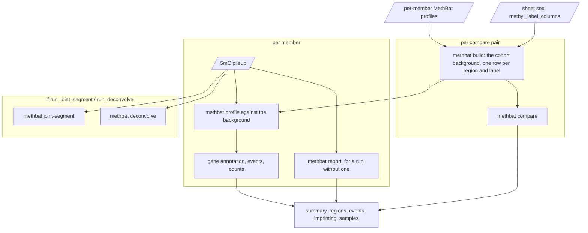

Text version: one `ugc_wgw_methbat_build` (or N with `leave_one_out`);
per member `ugc_wgw_methbat_report` when its run has none, then
`ugc_wgw_methbat_profile_bg`; per pair `ugc_wgw_methbat_compare`;
optionally `ugc_wgw_methbat_joint_segment` and, per member,
`ugc_wgw_methbat_deconvolve`; one `ugc_wgw_methyl_summary`; the manifest.

Why the labels matter: the background's statistics are per label, and a
member is compared against each label it carries (`ALL` always, its sex
group as `cohort_freq` resolves it, and `column=value` for every sheet
column named in `config.json`'s `methyl_label_columns`). Without the sex
label every XX member looks hyper-methylated on chrX against an `ALL`
background that is half XY, and real events drown. A label group needs at
least `background_min_datasets` (10) members or every comparison against
it is `InsufficientData`; the summary notes the labels below that.

| Driver fills | You may override |
| --- | --- |
| `cohort_id`, `sample_ids`, `cpg_pileup_beds`, `methbat_profiles`, `methbat_reports` (null for a member whose run predates the report), `sample_labels` (`;`-joined per member: the sex group, then `column=value` of `methyl_label_columns`) | `compare_pairs` (`["XX:XY"]`, `baseline:compare`; empty = none), `leave_one_out` (false), `background_min_datasets` (10), `zscore_min` (3.0), `methyl_delta_min` (20), `run_joint_segment` (false), `run_deconvolve` (false), `build_mem_gb` (8), `profile_mem_gb` (4), `joint_segment_threads` (8), `joint_segment_mem_gb` (32), `summary_mem_gb` (4) |

Resources: chapter 12. The whole stage is minutes on the smoke cohort and
well under an hour at 800 members without the joint segmentation.

Outputs (`<cohort_id>.methyl.GRCh38_GIABv3.`): the background TSV, the
collection file it was built from, per member the scored profile as MethBat
writes it and the same with `hgnc_id`, `gene_symbol` and `region_type`
appended, one comparison TSV per pair, the per-region table, the events
file, the imprinting table, the samples table, the long summary, and with
the switches the joint segments (BED and two bedGraphs) and the
deconvolution estimates (chapter 07).

#### Reading the scores

- A member's scored profile is MethBat's single-dataset profile with the
  background columns filled: `compare_label` (`HypoMethylated`,
  `HyperMethylated`, `HypoASM`, `HyperASM`, `Uncategorized`,
  `InsufficientData`), `background_category` (one row per region per
  label), `mean_combined_methyl_zscore` and `mean_abs_meth_delta_zscore`,
  and the population counts (`category_pop_count`, `category_pop_freq`). In
  MethBat 1.1.0 a `Hyper`/`Hypo` label also requires the matching
  `summary_label` (`Methylated`/`Unmethylated`); 1.2.0 drops that coupling,
  so the next MethBat bump changes these counts and the sync procedure must
  say so.
- With `leave_one_out = false` (default) the member is one of the N datasets
  behind the mean and stdev it is compared against. At N ≥ 100 this is
  negligible; below that it makes z-scores conservative at exactly the
  regions where the member is an outlier. `leave_one_out = true` builds a
  background per member from the other N−1.
- Every per-region row carries `hgnc_id`, `gene_symbol` and `region_type`
  from `methbat_map` (the reference map key of the same name): the genes
  whose TSS is within 10 kb of the island or whose body overlaps it, and
  `imprinted`, `promoter`, `gene_body` or `intergenic`. The events file
  lists every member's Hypo/Hyper rows with those columns, sorted by gene
  then member: the file to filter by a gene list (`methyl_genes_of_interest`
  in `config.json` puts those genes first on the cohort page). Regions
  without a gene keep their rows. PacBio's review rule: genes within ±10 kb,
  then the genes of interest; this leaves tens of regions per sample.
- The per-region table (`n_hypo`, `n_hyper`, `n_hypo_asm`, `n_hyper_asm`
  across members, next to the background's dataset counts) separates
  recurrent cohort artefacts (a region flagged in 30 % of members is a
  reference or mappability problem, not 30 % rare events) from singletons.
- `compare` output: per region `summary_comparison`, z-scores and deltas,
  and the member counts per side; `InsufficientData` below 10 per side. The
  default `XX:XY` pair is a check as much as a result: chrX should light up
  and little else.
- Imprinting table: `PASS`, `Inconclusive`, `Anomalous`, `AnomalousQcWarning`
  per member per region from `methbat report`, with `report_source` (`run`,
  or `stage` for a member whose run predates the task).
  `LowHaplotypeCoverage` and `WeakASM` are phasing-quality signals as well
  as biology; a member with many QC warnings is a candidate for the phasing
  section of its sample page. `Anomalous` without a warning flags the
  member `imprinting_anomalous` (warn) on its own page.
- The cohort page's Methylation section draws the labels, the events per
  member (beyond median + 3 MAD: `methyl_outlier`, warn), the genes with
  the most members carrying an event, the events by region type, the
  recurrent regions, the imprinting screen, the comparisons and, when run,
  the deconvolution's top cell type per member (chapter 07).

## `assembly`

hifiasm per sample, trio-binned with the parents' reads when the pedigree
allows, then each haplotype converted to FASTA with statistics. Ported from
PacBio's HiFi-human-assembly-WDL v1.0.2. The stage ends at an **output
contract** that every later stage reads: `assembler_used`,
`assembler_version`, `haplotype_labels`, `hap_fastas`, statistics and graphs.
The assembler behind it is named by the `assembler` input; only `hifiasm`
exists, and any other value fails at the start of the run.

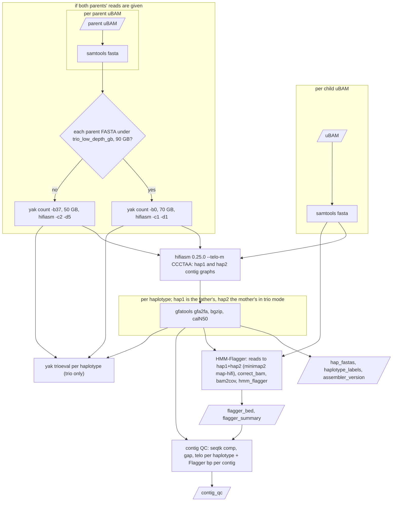

Text version: `samtools fasta` per child uBAM (and per parent uBAM in trio
mode, followed by `yak count` per parent with depth-dependent parameters);
hifiasm with `--telo-m CCCTAA`, trio-binned when the yak tables exist; then
`gfatools gfa2fa` and calN50 per haplotype. The outputs are the contract.
Two QC steps read it: HMM-Flagger aligns the sample's own reads back to the
diploid assembly (hap1 and hap2 together, minimap2 `-x map-hifi -I8g`),
cleans the alignment with secphase's `correct_bam` (primary alignments,
reads and alignments of 5 kb or more, divergence at most 0.1), and models
the per-base coverage into `Err`, `Dup`, `Hap` and `Col` regions
(`flagger_bed`, with the shares in `flagger_summary`); trio-binned samples
also get `yak trioeval` per haplotype against the parental k-mer tables,
with the thresholds the binning used (switch and Hamming error rates).
Since 0.12.0 a small task (seqtk, in the Flagger image) writes one row per
contig with its length, GC, N bases and runs, telomeric bases at each end
(the assembly's motif) and Flagger's bases per label (`contig_qc`).

| Driver fills | You may override |
|---|---|
| `sample_id`, `hifi_reads`; in trio mode `father_id`, `mother_id`, `father_hifi_reads`, `mother_hifi_reads` | `assembler` (`hifiasm`), `hifiasm_telomere_motif` (`CCCTAA`; empty = off), `hifiasm_extra_params`, `hifiasm_threads` (48), `hifiasm_mem_gb` (288), `yak_threads` (24), `yak_mem_gb`, `yak_params`, `hifiasm_trio_params`, `trio_low_depth_gb` (90), `keep_read_alignment` (false: the reads-to-assembly BAM is tens of GB per sample), `flagger_align_threads` (32), `flagger_align_mem_gb` (64), `flagger_threads` (16), `flagger_mem_gb` (32), `trioeval_c`, `trioeval_d` (the binning's) |

Resources: hifiasm 48 CPUs and 288 GB for up to a day at 30x (about 135 GB
observed); yak 24 CPUs and 70 or 50 GB per parent; the Flagger alignment
32 CPUs and 64 GB (the whole diploid assembly indexed at once), bam2cov and
hmm_flagger 16 CPUs and 32 GB; trioeval 8 CPUs and 48 GB. The site's default
wall time of three days covers hifiasm. The yak tables are not exported; the
call cache re-uses them for siblings. Flagger's read alignment is an
intermediate unless `keep_read_alignment`.

**The hifiasm command is frozen.** miniwdl keys its call cache on a task's
command and inputs, so anything that changes the hifiasm command line (the
motif does; the thread count does not) costs every sample's assembly again,
up to a day each. 0.11.0 made the one change (`--telo-m`, the version file);
later releases change only the stages after the contract, and
`assembly_call` with `--any-version` builds on the assemblies of the previous
version (chapter 10).

Outputs: per-haplotype FASTAs and statistics, graphs, Flagger's BED and
summary, the per-contig QC table, trioeval per haplotype (trio), `trio`,
`hap1_parent`, `hap2_parent` (chapter 07). `haplotype_labels` gives the
order of every per-haplotype array: `hap1`, `hap2`, or `pat`, `mat` when
trio-binned. The QC flags the summary derives from these (chapter 11,
`asm_*` thresholds) feed
`ugc-wgw summary --pass-list`, the sample list a pangenome cohort is frozen
from (chapter 06).

## `assembly_call`

The assembly's haplotypes aligned to the decoy-free GRCh38 and called with
dipcall and PAV 3, with a per-chromosome account of what was assembled and
the karyotype the assembly implies.

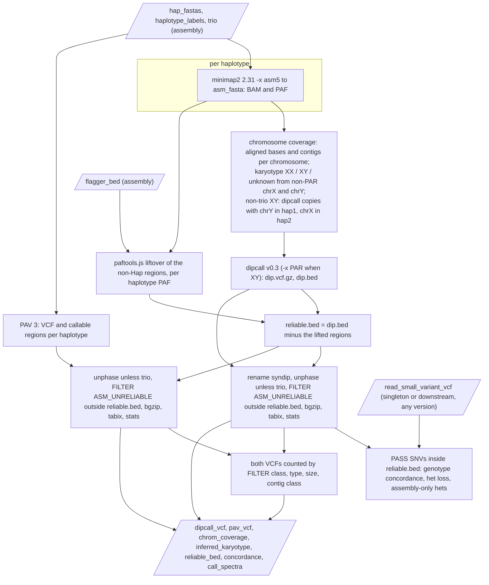

Text version: minimap2 aligns each haplotype once (SAM, then `samtools sort`
for the BAM and `paftools.js sam2paf` for the PAF); the coverage task reads
the PAFs; dipcall runs in male mode with the PAR BED when the karyotype is
`XY`, on regrouped haplotype copies unless the assembly was trio-binned; PAV
runs on the original haplotypes (`hap_h1`/`hap_h2`, or `hap_pat`/`hap_mat`
when trio); each caller's VCF is finished into the primary VCF. With the
assembly's `flagger_bed`, its non-Hap intervals (Err, Dup, Col; assembly
coordinates) are lifted to the reference through each haplotype's PAF
(`paftools.js liftover`, alignments of 50 kb and MAPQ 5 or more, dipcall's
own thresholds) and `reliable.bed` is `dip.bed` minus them; every record of
both primary VCFs outside it gets `FILTER=ASM_UNRELIABLE` added. Calls are
annotated, never dropped: count by `PASS` to use the mask, ignore the filter
to see everything. With a read-based VCF, dipcall's `PASS` SNVs are compared
with the read-based ones inside `reliable.bed` (inside `dip.bed` when there
is no Flagger mask): genotype concordance, the het-loss rate (read hets the
assembly calls homozygous or not at all, the signature of collapsed
haplotypes) and the assembly's hets the reads lack. Since 0.12.0 both
primary VCFs are also counted by FILTER class, type, size bin and contig
class (`call_spectra`, a bcftools query of about a minute), which is what
the summary's PASS-versus-masked panels read.

| Driver fills | You may override |
|---|---|
| `sample_id`, `hap_fastas`, `haplotype_labels`, `trio`, `flagger_bed` (from `assembly`); `read_small_variant_vcf` and its index when the sample has a `singleton` or `downstream` run of any version | `align_threads` (16), `align_mem_gb` (32), `dipcall_threads` (8; the task takes twice as many cores), `dipcall_mem_gb` (48), `pav_threads` (8), `pav_align_threads` (4), `pav_mem_gb` (40), `chrx_min_fraction` (0.5), `chry_min_fraction` (0.1) |

Resources (dev-machine measurements on chr20 assemblies against the whole
reference, before the pilot sets the real rows): minimap2 asm5 needs about
12 GB for the reference index per haplotype; dipcall's two concurrent
minimap2 runs about 2 × 16 GB; PAV's `align_map` peaks at 15 GB per
haplotype, both haplotypes at once, and its single-process table merges and
VCF writer take tens of minutes on a whole genome; the liftover, the
reliable-region arithmetic and the concordance are seconds to minutes on
small tasks. The karyotype thresholds are read against the chrX and chrY
lengths, so a chr20-only smoke assembly always infers `unknown`.

Outputs: alignments as BAM and PAF, the coverage table, the karyotype with
its evidence, the two primary VCFs with their statistics, the callers' raw
files, the unreliable and reliable regions with their summary, the
concordance table (chapter 07).

## `cohort_pangenome`

The last stage of the assembly mode builds a Minigraph-Cactus graph of the
cohort's haplotype assemblies on the decoy-free GRCh38 and turns it into
cohort VCFs with allele frequencies. The graph is built one chromosome at a
time (Cactus's `--mgSplit` route): one genome-wide step maps every haplotype
to a reference-only graph and bins the contigs by chromosome, then every
requested chromosome is constructed, mapped, aligned and joined in its own
task. The tools are cactus v3.3.0 (minigraph 0.21, vg 1.76.1, vcfwave) from
the `comparative-genomics-toolkit/cactus` image, bcftools 1.23 from
`pb_wdl_base` and truvari 5.5.0.

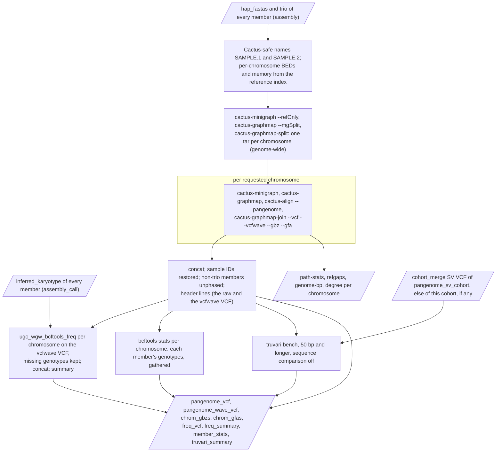

Text version: `ugc_wgw_pangenome_names` maps each sample ID to a Cactus-safe
genome name (dots and dashes to `_`; a collision fails the run), writes the
rename table and, from the reference index, a BED and a memory size per
requested chromosome; `ugc_wgw_cactus_split` writes the seqfile (`GRCh38`,
then `<name>.1` and `<name>.2` per member in cohort order), runs
`cactus-minigraph --refOnly`, `cactus-graphmap --mgSplit` and
`cactus-graphmap-split` over the whole genome, and tars each chromosome's
directory with its seqfile; per requested chromosome `ugc_wgw_cactus_chrom`
untars, rewrites the paths and runs the four construction steps, ending in
`cactus-graphmap-join` with `--vcf --vcfwave --gbz --gfa`; two
`ugc_wgw_pangenome_vcf_post` calls bring every chromosome VCF to the
cohort's sample columns (a member without sequence in a chromosome's
graph, an XX member on chrY, gets missing genotypes there), concatenate
the raw and the vcfwave VCFs, restore the sample IDs (`bcftools
reheader`), unphase the members that were not trio-binned and add the
header lines (cohort, chromosomes, the ambiguity rule, the phase policy);
the `cohort_freq` tasks run per
chromosome on the vcfwave VCF with missing genotypes kept, their shards are
concatenated and `ugc_wgw_pangenome_freq_summary` writes the summary (since
0.12.0 also records by nesting level, vcfwave type and allele length);
`ugc_wgw_pangenome_member_stats` runs `bcftools stats --samples -` per
chromosome on the same VCF and the gather task sums each member's
genotypes, singletons, missing calls and call rate (`member_stats`); the
chromosome task keeps the join's path statistics and reference gaps and adds
the bases per genome and the node degree histogram; with a read-based SV
merge, a biallelic copy of the vcfwave VCF (`bcftools norm -m -any`; truvari
refuses multiallelic records) goes through `ugc_wgw_truvari_bench`; the
manifest.

Contigs enter a chromosome's graph only when enough of their length aligns
to one reference contig (75, 50 or 25 % below 100 kb, below 1 Mb and from 1
Mb, with a best-to-second ratio of 2 at MAPQ 5 or more, Cactus's defaults);
the rest is ambiguous and in no graph. `ambiguous_contigs` counts them per
haplotype, and the summary's cohort page shows the totals. The other
contigs (chrM and the unplaced ones, lumped together as `chrOther`) are
built only with `build_other_contigs = true`.

| Driver fills | You may override |
|---|---|
| `cohort_id`, `sample_ids`, `hap1_fastas`, `hap2_fastas` and `trios` (from every member's `assembly`), `sample_sexes` and `sample_sex_sources` (`XX`, `XY` or empty from every member's `assembly_call` karyotype; the sheet's sex is not used), `sv_vcf` and its index (the `cohort_merge` SV VCF of `pangenome_sv_cohort`, else of this cohort, any version and either read mode, when one exists) | `chromosomes` (the map's chr1–22, X, Y), `build_other_contigs` (false), `split_cpu` (32), `split_map_cores` (`split_cpu`: cores per minigraph mapping, several haplotypes at once below it), `split_mem_gb` (128), `split_disk_gb` (from the inputs), `chrom_cpu` (16), `chrom_map_cores` (4), `chrom_mem_gb_floor` (64), `chrom_mem_gb_per_100mb` (32; the larger rule wins), `freq_threads` (2), `freq_mem_gb` (4) |

`chromosomes = ["chr20"]` under `stage_inputs.cohort_pangenome` is how the
scaling pilot runs (and the smoke): the split step still maps every
haplotype genome-wide, only the per-chromosome tasks are limited. Every
member needs a successful `assembly` and `assembly_call` at the version
(or `--any-version`); freeze the pangenome cohort from `ugc-wgw summary
--pass-list` (chapter 06) so that no assembly with a QC failure enters the
graph.

Resources (dev-machine measurements on two chr20 assemblies, eight cores,
before the pilot sets the real rows): the split step took 12 minutes; one
chromosome task about 50 minutes with `cactus-align` peaking at 11 GB; the
VCF post-processing, the frequencies and truvari are minutes. The memory of
a chromosome task is the larger of `chrom_mem_gb_floor` and
`chrom_mem_gb_per_100mb` times the chromosome's length in 100 Mb; the
default rule gives 64 GB for every human chromosome but chr1 and chr2 (80
and 78 GB). Chapter 12 gets the scaling table once the pilot has run.

Outputs: the graph's cohort VCF and its vcfwave form, the GBZ and GFA per
chromosome with their statistics (graph size, path fragments, reference
gaps, bases per genome, node degrees) and logs, the name map and the split's
tables, the frequency VCF with its summary and samples tables, the members'
genotype statistics, truvari's figures (chapter 07).
