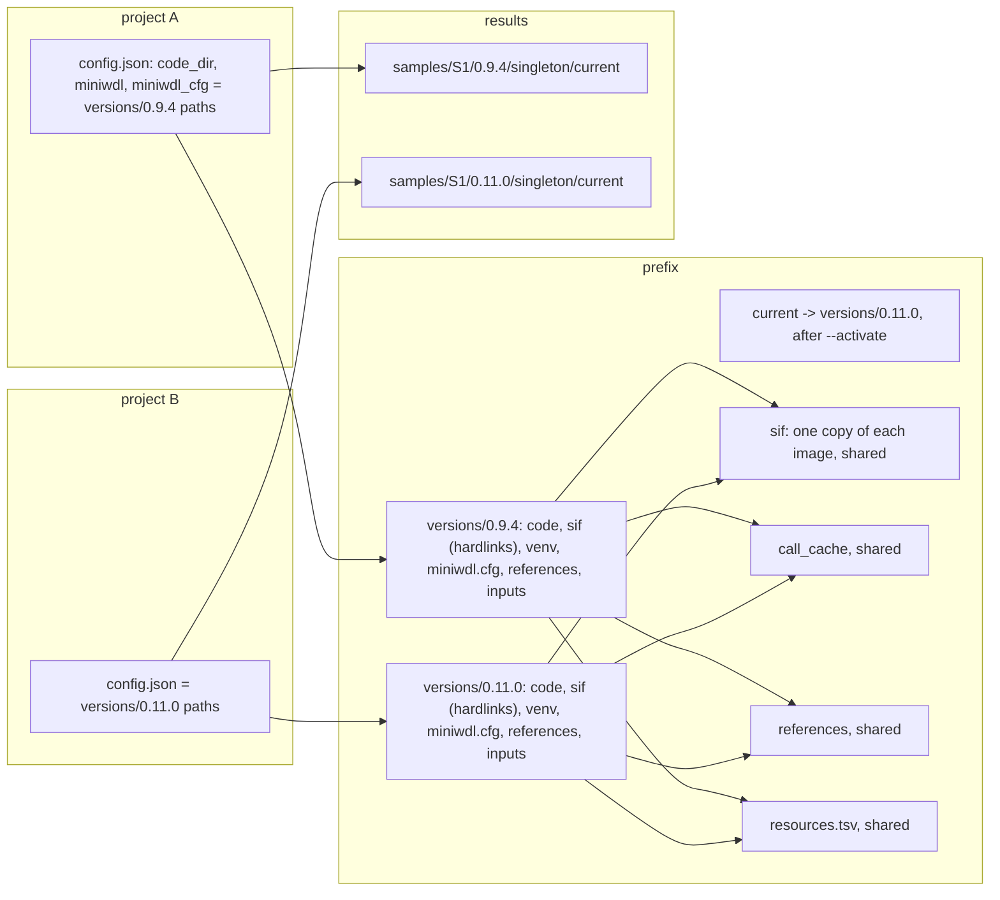

# Upgrading

## Versions side by side



A bundle installs into its own `versions/<v>/` with its own image
directory (hardlinks into the prefix's SIF store, chapter 04), engine and
rendered configuration; `install-bundle.sh` never touches another
version, and every version's rendered config names the same
`<prefix>/resources.tsv`, so the resource policy carries over (a new
version's inventory may list new tasks: check `ugc-wgw resources` for rows that
no longer match). `--activate` only moves `current`. A project records the
resolved version directory it was initialised against, so an existing
project keeps running on its version after a newer one is activated.
Results paths carry
the version, so two versions never overwrite each other's attempts.

## Before upgrading

Stop every `ugc-wgw submit` of the project (Ctrl-C; the runs are cancelled and
retried later from the call cache). The first command of a newer driver on a
project migrates its state database forward and says so
(`migrated ... to schema N`); an older driver refuses a database migrated by
a newer one, so do not point an old install at a project that a new one has
touched.

## Moving a project to a new version

Either create a new project against the new install (chapter 05) and register
the same sample sheet and cohort list, or edit the four engine paths in
`.ugc-wgw/config.json` (`code_dir`, `miniwdl`, `miniwdl_cfg`, `venv_dir`) and
the one reference map path (`ref_map_file`) to the new version's
directories. The driver reads `VERSION` from `code_dir` on every command, so
after the edit every subject is "not done" at the new version and `submit`
starts from the first stage.

What actually re-runs is decided by miniwdl's call cache, not by the driver:
a task whose inputs, command and image digest are unchanged replays from the
cache in seconds. An upstream bump that changes an image digest re-runs every
task using that image and everything downstream of it. The changelog names
what changed in each release.

## Re-using older results

`--any-version` on `submit` accepts an earlier stage's success at any version
as a prerequisite and reads its outputs. Use it to run `cohort_merge` at
version 0.11.0 over `singleton` results produced at 0.9.4 without re-running
the samples, or to `downstream` old `upstream` results after a phasing-only
change. The run manifest records, per member, the version and run ID whose
outputs were used, so the mixture is traceable. Do not use it across an
upstream change that alters the earlier stage's outputs in a way the later
stage cares about; the changelog says when that is the case.

## Members from before 0.14 in `cohort_qc`

`cohort_qc` wants one somalier extract per member, an output `singleton`
and `upstream` make since 0.14. For a member whose latest run predates it
the driver passes the aligned BAM instead and the stage extracts the sketch
itself (minutes, cached), with one warning naming those members. So the
stage runs on an existing cohort at once: `submit --mode <mode> --cohort
<id> --stage cohort_qc --any-version`, no per-sample re-run. Such a member
has no somalier sex in its own run; the cohort page takes the stage's chrX
call for it, and the sex its run used stays what 0.13 used (the coverage
inference). Re-running `singleton` or `upstream` for an old member at 0.14
replays every task but the three new ones from the call cache; sawfish
onward recomputes only where the resolved sex differs from the coverage
inference (none of the 864), and `downstream` then takes the resolved sex.

## Assemblies across versions

A new version re-gates every stage: `submit` only counts runs of the current
version as done. For the read-based modes that costs little, because the
call cache replays unchanged tasks. For `assembly` it is cheap only while the
hifiasm command is unchanged, and expensive otherwise: a change to the hifiasm
command line (its options, its image) recomputes every sample's assembly, up
to a day each. The changelog marks such a release **EXPENSIVE: invalidates
the assembly call cache**; 0.11.0 is one, and no later release touches the
hifiasm command.

When only the stages after the assembly changed (calling, QC, the graph), run
them with `--any-version`, so that `assembly` successes of the previous version
satisfy the prerequisite instead of being redone:

```bash
ugc-wgw submit --mode assembly --stage assembly_call --any-version
```

The run's manifest records which `assembly` run, and of which version, the
stage read (`cohort_members` in `run_manifest.json`).

## When to re-initialise instead

- The new bundle changes `config.json`'s schema (the driver refuses to load
  and says so).
- The reference data changed (`references.lock` in the changelog): the
  installer copies the new tree under `<prefix>/references/` next to the old
  one, and a new project's `--ref-map` points at the new rendered map; old
  projects keep the old map. Results made against different builds (0.1.0 on
  GRCh38, 0.2.0 on GRCh38_GIABv3) must not be mixed with `--any-version`.
- You want a clean state database for a new campaign.

## SIF cache and storage

The prefix holds one copy of each image in `<prefix>/sif/` (about 27 GB
for every image of a release; 32 SIFs in 0.13.1); a version's `sif/` is
hardlinks into it, so a new version adds only the images that changed,
and a release whose images did not change ships as a delta bundle of
about 10 MB (chapter 04, "The SIF store"). A delta installs only where
its base was installed; the installer checks that before placing anything.
Prefixes from before 0.14.0 carry a full copy per version: the first
install with the new installer adopts the active version's SIFs into the
store (a read of every SIF, minutes), and `install-bundle.sh --prefix
<prefix> --dedupe-sif` replaces the older versions' copies by hardlinks and
prints what it freed (161 GB for six old versions on the smoke cluster).

Remove `versions/<old>/` when no project references it any more
(`grep -l versions/<old> */.ugc-wgw/config.json` across your projects) and
its results have their manifests; it frees what no other version links,
and `find <prefix>/sif -maxdepth 1 -name '*.sif' -links 1` then lists the
store's unreferenced copies, safe to delete. The call cache grows with
every distinct task execution; it is safe to delete entries, at the price
of recomputation. Successful runs' work directories are already reclaimed
by `delete_work = success`; failed attempts keep theirs until you remove
the attempt directory by hand, which the driver never does.
