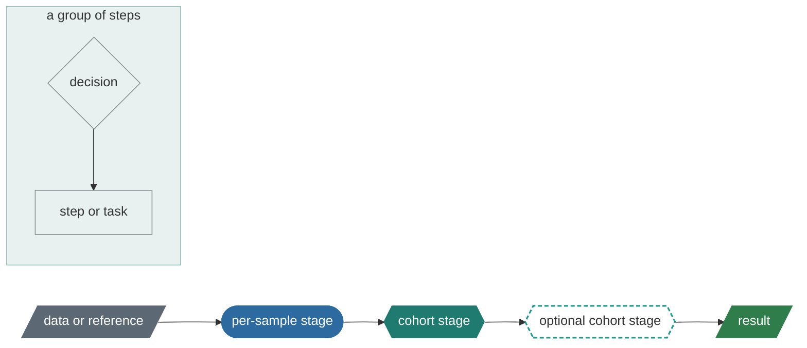

# Operator guide

This guide is for the people who run ugc-pacbio-wgw on the HPC and for the
analysts who read its results. It explains what the pipeline produces, how the
driver sequences the work, and what to do when something fails. The driver's
reference page is [`../../bin/README.md`](../../bin/README.md).

## Two ways in

**Running the pipeline** (operators): 00 quick start, then 04 install, 05
project setup, 06 running, 09 troubleshooting and 10 upgrading as they
come up; 12 when a job does not fit the cluster; 11 is the reference for
every command and key.

**Reading the results** (analysts): 14 reading the pages, with 13 for
what a QC flag means; 07 to find a file or use the exported tables; the
stage pages under 08 for what an analysis does and how to read it
(`cohort_qc`, `cohort_freq`, `cohort_tr`, `cohort_methyl`).

## Chapters

| Chapter | Read it when |
|---|---|
| [00 Quick start](00-quick-start.md) | You have a bundle and want the first cohort's results: the eight steps with what to expect at each. |
| [01 Overview](01-overview.md) | You want the one-page picture: what runs where, and the five things an operator does. |
| [02 Concepts](02-concepts.md) | You need the vocabulary: stage, subject, mode, version, attempt, manifest, frozen cohort. |
| [03 Choosing a mode](03-choosing-a-mode.md) | You are deciding between standalone and joint calling, or adding assembly. |
| [04 Install](04-install.md) | A bundle has arrived and must be installed on the HPC. |
| [05 Project setup](05-project-setup.md) | You are creating a project, registering samples and freezing a cohort, or choosing the aligner and caller. |
| [06 Running](06-running.md) | You are submitting, watching, cancelling, retrying or rerunning. |
| [07 Results](07-results.md) | You are looking for a file, want to know what a manifest says, or want the cohort's tables. |
| [08 Stages](08-stages.md) | You want to know what each stage runs, which switches it has and what it costs: an index with one page per stage under [`stages/`](stages/). |
| [09 Troubleshooting](09-troubleshooting.md) | Something failed. |
| [10 Upgrading](10-upgrading.md) | A new bundle version must coexist with, or replace, the current one. |
| [11 Reference](11-reference.md) | Every command, flag, config key and file name in one place. |
| [12 Task resources](12-resources.md) | A job was refused or killed for cores, memory or time, or the requests must fit the cluster. |
| [13 QC flags](13-qc-flags.md) | A sample or member is flagged: what raised it, which threshold moves it, what to do. |
| [14 Reading the pages](14-reading-the-pages.md) | You have the cohort page or a sample page open and want to know what a section says. |
| [15 Measurements and evaluations](15-measurements.md) | You want what the tasks really used, or the comparison behind a tool choice. |
| [Workflow call graphs](workflow-graphs.md) | Generated exact call graphs of the thirteen entrypoints. |
| [Task resources, inventory](task-resources.md) | Generated table of what every task asks SLURM for. |

## Reading the diagrams

Diagrams are Mermaid blocks. GitHub, Forgejo and most editors render them in
place; on the HPC there is no browser, so the core diagrams are
followed by a plain-text version introduced by "Text version:". The guide is
shipped inside every bundle: on the HPC it is at
`<prefix>/versions/<v>/code/docs/guide/`.

Shape and colour say the same thing twice, so the diagrams read in a
terminal's text version, in print and on a dark page alike:



Text version: slanted box = data or a reference file (slate; green when
it is a result nothing else reads); rounded box = a per-sample stage
(blue); hexagon = a cohort stage (teal; a dashed outline = optional, the
stages after it never wait for it); diamond = a decision and plain box =
a step or task (outlines). A frame around several nodes groups them (a
scatter, a mode, a machine): a faint teal wash, deeper where one frame
sits inside another. In the generated call graphs a task of this pipeline
is blue and one of upstream's slate.

## Conventions

| Placeholder | Meaning |
|---|---|
| `<prefix>` | The install root on the HPC, e.g. `/proj/ugc`. Holds `versions/`, `current`, `call_cache/`, `references/`. |
| `<v>` | A ugc-pacbio-wgw version, e.g. `0.11.0`. Appears in install paths and in every results path. |
| `<project>` | A directory holding `.ugc-wgw/` (config, state database, logs). One project per campaign. |
| `<results>` | The results root, `<project>` unless `ugc-wgw init --results` said otherwise. |
| `ugc-wgw` | `<prefix>/current/code/bin/ugc-wgw`. Put it on `PATH` or define an alias. |
| `<sample_id>`, `<cohort_id>` | Identifiers matching `[A-Za-z0-9._-]+`; both become directory names. |

Commands shown in `bash` blocks are meant to be copied. Blocks without a
language tag are file layouts, synopses or program output.

## The quick path

Chapter 00 is the walkthrough: install, project, samples, cohort, a dry
run, `submit` under `tmux`, watching and retrying, the result pages. In
three lines:

```bash
./install-bundle.sh --bundle ugc-pacbio-wgw-0.11.0.tar --prefix /proj/ugc --references /proj/ugc/references --site site.cfg --activate
ugc-wgw init <project> --install /proj/ugc/current --ref-map <ref_map from the installer's report>
ugc-wgw samples add samples.tsv && ugc-wgw cohort freeze C1 --samples cohort.txt && ugc-wgw -v submit --mode standalone --cohort C1
```
