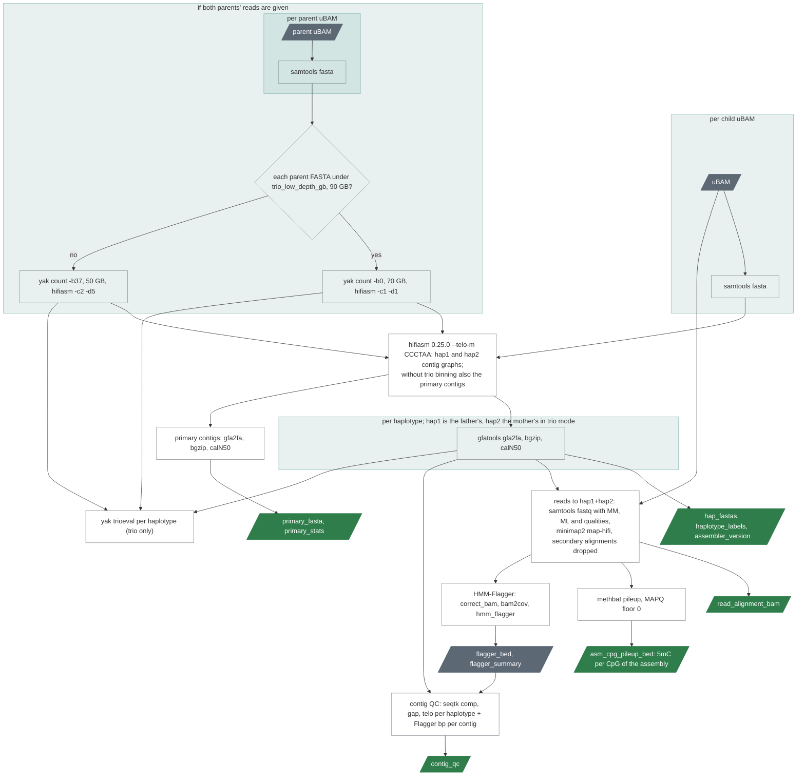

# `assembly`

A phased de novo assembly with hifiasm and its quality control.

| | |
|---|---|
| Subject | per sample |
| Modes | assembly |
| All stages | [08 Stages](../08-stages.md) |

hifiasm per sample, trio-binned with the parents' reads when the pedigree
allows, then each haplotype converted to FASTA with statistics. Ported from
PacBio's HiFi-human-assembly-WDL v1.0.2. The stage ends at an **output
contract** that every later stage reads: `assembler_used`,
`assembler_version`, `haplotype_labels`, `hap_fastas`, statistics and graphs.
The assembler behind it is named by the `assembler` input; only `hifiasm`
exists, and any other value fails at the start of the run.

Text version: `samtools fasta` per child uBAM (and per parent uBAM in trio
mode, followed by `yak count` per parent with depth-dependent parameters);
hifiasm with `--telo-m CCCTAA`, trio-binned when the yak tables exist; then
`gfatools gfa2fa` and calN50 per haplotype, and for the primary contigs of
a run without trio binning; the reads from the uBAMs as FASTQ with their
tags, aligned to hap1 and hap2 together, without secondary alignments:
that alignment is an output, `methbat pileup` makes the 5mC table from it
and HMM-Flagger its BED and summary; contig QC per haplotype from the
FASTAs and Flagger's BED; `yak trioeval` per haplotype in trio mode. The
outputs are the contract.

A HiFi-only run also keeps hifiasm's primary contigs (`primary_fasta`):
one assembly that follows the longest path and switches between the
haplotypes, more contiguous than either haplotype and the one to use when
an analysis wants a single sequence per person. hifiasm writes none when
it trio-bins.

The sample's own reads are then aligned back to the diploid assembly
(hap1 and hap2 together, minimap2 `-x map-hifi -I8g`). They are taken
from the read BAMs as FASTQ with their `MM` and `ML` tags, so the
alignment carries base qualities and the 5mC calls, and it is kept
(`read_alignment_bam`, about the size of the read BAMs). minimap2 writes a
secondary alignment for nearly every read, on the other haplotype; those
are dropped, because nothing reads them and a pileup would count each
read twice. Three things read the alignment:

- `methbat pileup` writes `asm_cpg_pileup_bed`: the methylation of every
  CpG of the assembly, in assembly coordinates, including sequence the
  reference does not have. There are no haplotype rows: a contig is a
  haplotype. Reads in a stretch where the two haplotypes are identical
  have mapping quality 0 and land on either at random, so the floor is 0
  (`asm_pileup_min_mapq`); with 1, about 4% of the CpGs of chr20 had no
  row. In such stretches a row mixes both haplotypes' reads.
- HMM-Flagger cleans it with secphase's `correct_bam` (primary alignments,
  reads and alignments of 5 kb or more, divergence at most 0.1) and models
  the per-base coverage into `Err`, `Dup`, `Hap` and `Col` regions
  (`flagger_bed`, with the shares in `flagger_summary`).
- Whatever comes later: a polishing step, calls against the own assembly,
  methylation of an insertion allele.

Trio-binned samples
also get `yak trioeval` per haplotype against the parental k-mer tables,
with the thresholds the binning used (switch and Hamming error rates).
Since 0.12.0 a small task (seqtk, in the Flagger image) writes one row per
contig with its length, GC, N bases and runs, telomeric bases at each end
(the assembly's motif) and Flagger's bases per label (`contig_qc`).

| Driver fills | You may override |
|---|---|
| `sample_id`, `hifi_reads`; in trio mode `father_id`, `mother_id`, `father_hifi_reads`, `mother_hifi_reads` | `assembler` (`hifiasm`), `hifiasm_telomere_motif` (`CCCTAA`; empty = off), `hifiasm_extra_params`, `hifiasm_threads` (48), `hifiasm_mem_gb` (288), `yak_threads` (24), `yak_mem_gb`, `yak_params`, `hifiasm_trio_params`, `trio_low_depth_gb` (90), `keep_read_alignment` (false: the reads-to-assembly BAM is tens of GB per sample), `flagger_align_threads` (32), `flagger_align_mem_gb` (64), `flagger_threads` (16), `flagger_mem_gb` (32), `trioeval_c`, `trioeval_d` (the binning's) |

Resources: hifiasm 48 CPUs and 288 GB for up to a day at 30x (about 135 GB
observed); yak 24 CPUs and 70 or 50 GB per parent; the Flagger alignment
32 CPUs and 64 GB (the whole diploid assembly indexed at once), bam2cov and
hmm_flagger 16 CPUs and 32 GB; trioeval 8 CPUs and 48 GB. The site's default
wall time of three days covers hifiasm. The yak tables are not exported; the
call cache re-uses them for siblings. The read alignment is an output
since 0.21.0; `keep_read_alignment = false` under `stage_inputs.assembly`
turns it back into an intermediate. Measured on chr20: 1.3 GB for 1.5 GB
of read BAM, so plan for about the size of the read BAMs again per sample.
The aligner of this step is minimap2 and stays so: pbweave was tried and
puts every read of a stretch where the haplotypes are identical on the
first haplotype, which distorts both Flagger and the pileup (chapter 15).

**The hifiasm command is frozen.** miniwdl keys its call cache on a task's
command and inputs, so anything that changes the hifiasm command line (the
motif does; the thread count does not) costs every sample's assembly again,
up to a day each. 0.11.0 made one change (`--telo-m`, the version file)
and 0.21.0 the second and last before the stage runs on a whole cohort
(the primary contigs, the tags, the pileup): a sample assembled before
0.21.0 is assembled again at 0.21.0. Other releases change only the
stages after the contract, and `assembly_call` with `--any-version`
builds on the assemblies of the previous version (chapter 10).

Outputs: per-haplotype FASTAs and statistics, the primary contigs
(HiFi-only), graphs, the read alignment and its 5mC pileup, Flagger's BED
and summary, the per-contig QC table, trioeval per haplotype (trio), `trio`,
`hap1_parent`, `hap2_parent` (chapter 07). `haplotype_labels` gives the
order of every per-haplotype array: `hap1`, `hap2`, or `pat`, `mat` when
trio-binned. The QC flags the summary derives from these (chapter 11,
`asm_*` thresholds) feed
`ugc-wgw summary --pass-list`, the sample list a pangenome cohort is frozen
from (chapter 06).
