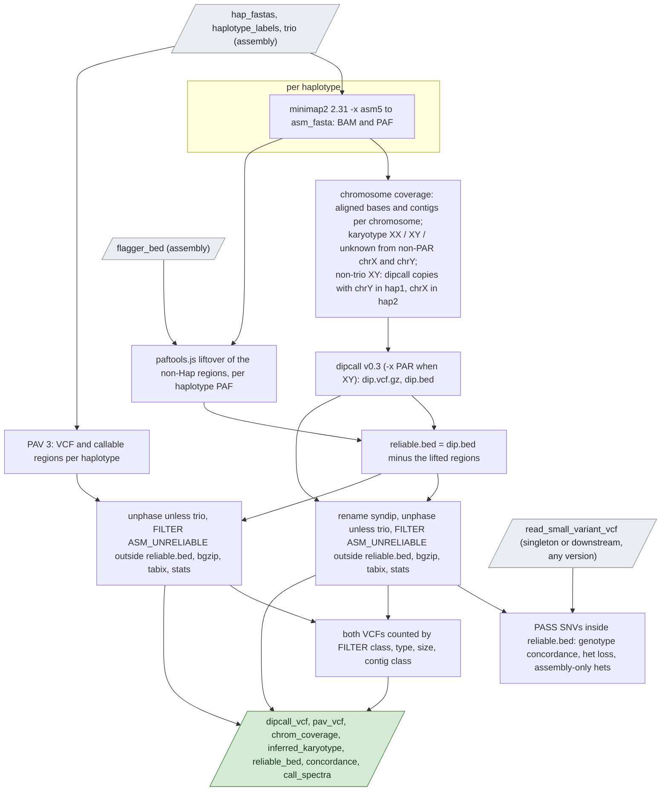

# `assembly_call`

Variants from the assembly against the reference with dipcall and PAV.

| | |
|---|---|
| Subject | per sample |
| Modes | assembly |
| All stages | [08 Stages](../08-stages.md) |

The assembly's haplotypes aligned to the decoy-free GRCh38 and called with
dipcall and PAV 3, with a per-chromosome account of what was assembled and
the karyotype the assembly implies.

Text version: minimap2 aligns each haplotype once (SAM, then `samtools sort`
for the BAM and `paftools.js sam2paf` for the PAF); the coverage task reads
the PAFs; dipcall runs in male mode with the PAR BED when the karyotype is
`XY`, on regrouped haplotype copies unless the assembly was trio-binned; PAV
runs on the original haplotypes (`hap_h1`/`hap_h2`, or `hap_pat`/`hap_mat`
when trio); each caller's VCF is finished into the primary VCF. With the
assembly's `flagger_bed`, its non-Hap intervals (Err, Dup, Col; assembly
coordinates) are lifted to the reference through each haplotype's PAF
(`paftools.js liftover`, alignments of 50 kb and MAPQ 5 or more, dipcall's
own thresholds) and `reliable.bed` is `dip.bed` minus them; every record of
both primary VCFs outside it gets `FILTER=ASM_UNRELIABLE` added. Calls are
annotated, never dropped: count by `PASS` to use the mask, ignore the filter
to see everything. With a read-based VCF, dipcall's `PASS` SNVs are compared
with the read-based ones inside `reliable.bed` (inside `dip.bed` when there
is no Flagger mask): genotype concordance, the het-loss rate (read hets the
assembly calls homozygous or not at all, the signature of collapsed
haplotypes) and the assembly's hets the reads lack. Since 0.12.0 both
primary VCFs are also counted by FILTER class, type, size bin and contig
class (`call_spectra`, a bcftools query of about a minute), which is what
the summary's PASS-versus-masked panels read.

| Driver fills | You may override |
|---|---|
| `sample_id`, `hap_fastas`, `haplotype_labels`, `trio`, `flagger_bed` (from `assembly`); `read_small_variant_vcf` and its index when the sample has a `singleton` or `downstream` run of any version | `align_threads` (16), `align_mem_gb` (32), `dipcall_threads` (8; the task takes twice as many cores), `dipcall_mem_gb` (48), `pav_threads` (8), `pav_align_threads` (4), `pav_mem_gb` (40), `chrx_min_fraction` (0.5), `chry_min_fraction` (0.1) |

Resources (dev-machine measurements on chr20 assemblies against the whole
reference, before the pilot sets the real rows): minimap2 asm5 needs about
12 GB for the reference index per haplotype; dipcall's two concurrent
minimap2 runs about 2 × 16 GB; PAV's `align_map` peaks at 15 GB per
haplotype, both haplotypes at once, and its single-process table merges and
VCF writer take tens of minutes on a whole genome; the liftover, the
reliable-region arithmetic and the concordance are seconds to minutes on
small tasks. The karyotype thresholds are read against the chrX and chrY
lengths, so a chr20-only smoke assembly always infers `unknown`.

Outputs: alignments as BAM and PAF, the coverage table, the karyotype with
its evidence, the two primary VCFs with their statistics, the callers' raw
files, the unreliable and reliable regions with their summary, the
concordance table (chapter 07).
