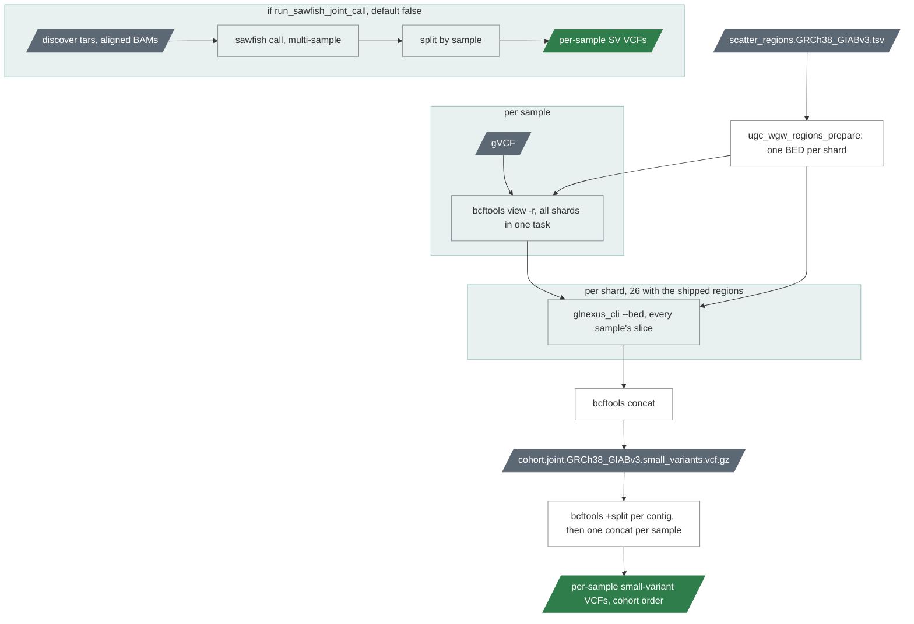

# `cohort_call`

Joint genotyping of the members' gVCFs with GLnexus, per region shard, and
each member's slice.

| | |
|---|---|
| Subject | cohort |
| Modes | joint |
| All stages | [08 Stages](../08-stages.md) |

GLnexus over the cohort's gVCFs, scattered by region; a per-sample split; an
optional multi-sample sawfish call. Mirrors upstream's `joint.wdl`.

Why the slicing: `glnexus_cli` ignores gVCF indices and reads every gVCF end
to end for each region, so 26 shards over 1000 samples would read 26 000
whole gVCFs. One `bcftools view` per sample cuts all 26 slices index-based,
and each GLnexus shard reads only its slices.

| Driver fills | You may override |
|---|---|
| `cohort_id`, `sample_ids`, `gvcfs`, `gvcf_indices`; with `run_sawfish_joint_call`: `discover_tars`, `aligned_bams`, `aligned_bam_indices` | `split_keep_homref` (true), `run_sawfish_joint_call` (false), `glnexus_threads` (32), `glnexus_mem_gb` (32 + 0.1 N), `split_mem_gb` (8 + 0.02 N), `scatter_regions_file`, `skip_contigs` (`["chrM"]`) |

GLnexus skips the `chrM` shard (`skip_contigs`): the cohort's mitochondrial
genotypes come from mitorsaw through `cohort_merge`, not from DeepVariant's
diploid calls on a genome that is not diploid, so the cohort small-variant
VCF carries no chrM record since 0.15.

Resources per shard: GLnexus `glnexus_threads` CPUs and `glnexus_mem_gb` GB,
which is also its `--mem-gbytes` budget; the database lives on the node's
local scratch when the site set `TASK_SCRATCH_ENV` (chapter 04), else in
the task's work directory.
The split runs one bgzip writer per sample. Outputs: cohort VCF, per-sample
split VCFs in cohort order, optional joint SV set (chapter 07).
