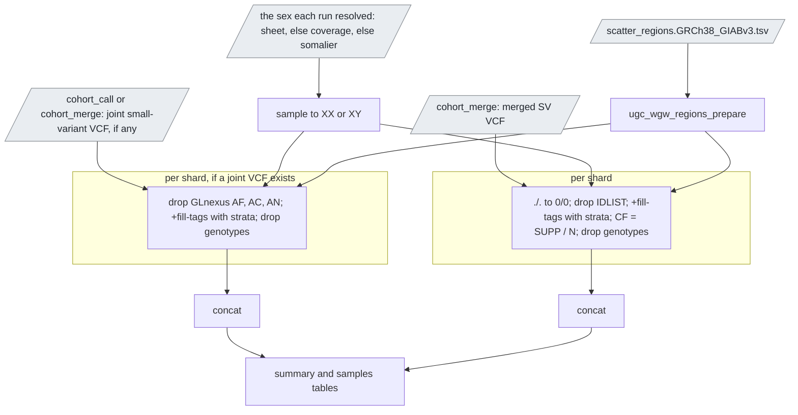

# `cohort_freq`

Allele frequencies of the cohort's call sets with sex strata.

| | |
|---|---|
| Subject | cohort |
| Modes | standalone, joint |
| All stages | [08 Stages](../08-stages.md) |

The last stage of both cohort modes turns the cohort's two multi-sample
VCFs into an in-house frequency resource: sites-only VCFs with allele
counts overall and per sex, a summary and the list of members with the sex
used. Nothing in it is upstream's; the tools are bcftools 1.23 from
`pb_wdl_base`.



Text version: one `ugc_wgw_regions_prepare`; per shard, `ugc_wgw_bcftools_freq`
over the joint small-variant VCF (when there is one) and over the merged SV
VCF; `bcftools concat` of each; `ugc_wgw_freq_summary`; the manifest.

| Driver fills | You may override |
|---|---|
| `cohort_id`, `sample_ids`, `sample_sexes` and `sample_sex_sources` (the sex each member's run resolved and where it came from: `declared`, `coverage` or `somalier`; for a run from before 0.14 the sheet, else the coverage inference), `sv_vcf` (+ index; from `cohort_merge`), `small_variant_vcf` (+ index; from `cohort_call` in joint mode, from `cohort_merge` with `run_glnexus` in standalone mode; absent otherwise), `mt_small_variant_vcf` and `mt_sv_vcf` (+ indices; from `cohort_merge` when it merged the mitochondrial sets) | `freq_threads` (2), `freq_mem_gb` (4), `mt_contig` (`chrM`), `mt_length` (16569) |

Outputs: `<cohort_id>.freq.GRCh38.` small-variant VCF (only with a joint
VCF), SV VCF, the two mitochondrial VCFs (when `cohort_merge` made the
sets), summary TSV, samples TSV (chapter 07). Resources are small: every
task streams one record at a time; the smoke cohort takes ten seconds.

## Reading the counts

- `AC`, `AN`, `AF` per ALT allele as `bcftools +fill-tags` counts them,
  plus `NS` (samples with a call), `AC_Hom`, `AC_Het`, `AC_Hemi`. With
  `_XX` and `_XY` suffixes the same over the members of that sex; a member
  of unknown sex counts in the unsuffixed tags only. Multiallelic records
  stay multiallelic (`Number=A`, one value per ALT); to split them, run
  `bcftools norm -m -any` on the frequency file.
- Small variants: missing genotypes (`./.`, uncovered in GLnexus) are not
  in `AN`, so `AN ≤ 2 · NS` and `AF` is over called alleles. GLnexus's own
  `AF` is replaced; its `AQ` and the `MONOALLELIC` filter are kept.
- SVs: the svx merge marks a sample without the variant in its own sawfish
  call set as `./.`, which is a non-carrier, not a missing call. The stage
  counts those as hom-ref, so `NS = N` and `AN = 2N` on every record and a
  true no-call cannot be told apart. `SUPP` is the number of carrier
  samples, `CF = SUPP / N` the carrier frequency; `AF` counts ALT alleles.
- Half-called genotypes: `AC_Hemi` is not sex-chromosome hemizygosity.
  GLnexus writes `./1` when one allele lacks depth and sawfish encodes
  depth-based CNV carriers as `./1`; the called allele of such a genotype
  counts under `AC_Hemi` with one added to `AN`.
- Sex chromosomes: upstream calls every contig diploid, so an XY sample's
  hemizygous ALT on chrX appears as `AC_Hom_XY` and `AN_XY` is two per XY
  sample there.
- Mitochondria (`…mt_small_variants.vcf.gz`, `…mt_svs.vcf.gz`): the counts
  come from mitorsaw's collapsed genotypes, not from the joint VCF, which
  carries no chrM. `0/1` means heteroplasmic (some haplotypes carry the
  allele), `1/1` homoplasmic, so `AC_Het` and `AC_Hom` count members in
  each state; a member without the variant in its mitorsaw call set counts
  as reference; no sex strata (mitochondria are maternal, and a split would
  only thin the cohort). The per-member read fraction (`VAF`) is in the
  merged VCF of `cohort_merge`, not in the sites-only frequency file.

The `##ugc_wgw_cohort_freq_*` header lines repeat these conventions in the file
itself, with the cohort, version and source file names.

## Using the files

```bash
# sites with an alternate allele in at most 1 % of alleles among XX members
bcftools view -i 'AF_XX <= 0.01 && AC_XX > 0' C1.freq.GRCh38_GIABv3.small_variants.vcf.gz

# annotate a sample VCF with the cohort frequency
bcftools annotate -a C1.freq.GRCh38_GIABv3.small_variants.vcf.gz -c INFO/AF,INFO/AC,INFO/AN \
    --rename-annots <(printf 'INFO/AF\tUGC_AF\nINFO/AC\tUGC_AC\nINFO/AN\tUGC_AN\n') sample.vcf.gz

# SVs carried by at least a tenth of the cohort
bcftools view -i 'CF >= 0.1' C1.freq.GRCh38_GIABv3.structural_variants.vcf.gz
```

Counts from cohorts that share no samples can be summed (`AC`, `AN`, `NS`
per record); a driver command for that is not written yet. Sample names of
fewer than three characters cannot be stratified by sex (a limit of
`bcftools +fill-tags --samples-file`); the stage fails and names them.
