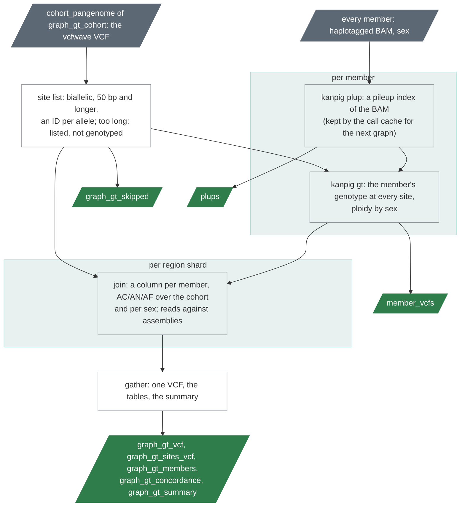

# `cohort_graph_gt`

The structural variants of a pangenome graph genotyped in every member of
a cohort from its reads.

| | |
|---|---|
| Subject | cohort, optional; only for a project that names a graph cohort |
| Modes | standalone, joint |
| All stages | [08 Stages](../08-stages.md) |

A graph is built from a subset of a cohort: the members the ranking
picked, twenty to a few hundred of them. Its structural variants then
have genotypes for those members only. An allele frequency from the
chosen members is not the cohort's, and everybody else has no call at an
insertion that only an assembly resolved.

Every member already has what closes that gap: its reads aligned to the
reference. This stage takes the graph's sequence-resolved SV alleles as a
fixed list of sites and asks of every member's reads: zero, one or two
copies? It is **genotyping, not discovery**: no new variant appears, and
every member is called at the same sites, hom-ref included (the
read-based SV merge of `cohort_merge` leaves a member without a call
uncalled).

It is the one stage of the read-based modes that needs the assembly
track: the graph of another cohort, or of this one. Name that cohort in
the project's `config.json`:

```json
"graph_gt_cohort": "P200"
```

Without the key the stage does not exist for the project: `submit`,
`status` and the cohort page say nothing about it. With it, the stage is
submitted like any other and waits for two things: every member's
per-sample stage (it reads the haplotagged BAM of `singleton` or
`downstream`), and a successful `cohort_pangenome` of the named cohort,
at any ugc-wgw version. It waits for no cohort stage of its own cohort,
and no stage waits for it.

```bash
ugc-wgw submit --mode standalone --cohort C1 --stage cohort_graph_gt
```

**A genotype table with a measured error, not a truth set.** The
genotyper is kanpig, which reads the pileups of the alignment to the
reference. It is fast and, away from repeats, agrees with the assemblies at
more than nine sites in ten; the stage measures that in every run
(below).



Text version: `ugc_wgw_graph_gt_sites` splits the graph's vcfwave VCF to
biallelic records, left-aligns them and keeps the alleles that change the
length by 50 bp or more, each with an ID, its type and length and the
allele count among the graph's own members; per member with reads
`ugc_wgw_kanpig_plup` turns the BAM into a pileup index and
`ugc_wgw_kanpig_gt` genotypes the sites from it; `ugc_wgw_files_bundle`
packs the members' VCFs; per region shard `ugc_wgw_graph_gt_join` puts
the members' columns side by side and counts; `ugc_wgw_graph_gt_gather`
concatenates the shards and writes the tables; the manifest.

## What is in the list, and what is not

- **The sites are the graph's**: `pangenome_wave_vcf` of
  `cohort_pangenome`, where vcfwave has realigned the alleles and taken
  nested bubbles apart. Insertions and deletions of `size_min` (50) bp
  and more. The same allele written by two records is one site.
- **Alleles longer than `size_max` (10,000 bp) are listed and not
  genotyped**: kanpig reads pileups, not split alignments, and its
  author's advice is to stop there. They are in the VCF with
  `SKIP=too_long` and no call in anybody, and in `graph_gt_skipped`.
- **Left out of the list**, with a row in `graph_gt_skipped`: alleles
  long on both sides with no change in length (inversions and
  replacements, `no_length_change`) and symbolic alleles.
- **Small variants are not genotyped here.** DeepVariant and GLnexus have
  them from the same reads.
- **Nothing is merged.** Two insertions that differ by a few bases are
  two sites, as the graph has them; kanpig genotypes the alleles of a
  neighbourhood together.

Every site carries `IN_TR` when it starts inside a tandem repeat of the
TRGT catalogue and `IN_EXCL` when it starts inside a region of the SV
caller's exclusion list (gaps, centromeres, common copy-number regions).
Both matter for how far to trust a genotype there.

## Per member

A member's pileup index (`plups`) depends on its BAM alone. The call
cache keeps it, so genotyping the same cohort against a later, larger
graph reads no BAM again: only the genotyping task and the join run. The
index is about a thousandth of the BAM.

Ploidy follows the member's sex (the one the read-based track resolved)
through the reference bundle's expected-copy-number BED: chrX outside the
pseudoautosomal regions is haploid in an XY member, chrY absent in an XX
member. A member of unknown sex is genotyped as diploid everywhere.

A member without an alignment (entry kind `vcf`) is not genotyped and is
uncalled at every site; the summary counts such members.

## Reading the result

| File | What it holds |
|---|---|
| `graph_gt_vcf` | `<cohort>.graph_gt.<graph cohort>.<ref>.vcf.gz`: every site, a column per cohort member in cohort order. FORMAT `GT` (unphased), `GQ`, `DP`, `AD`. INFO `SVTYPE`, `SVLEN`; `AC`, `AN`, `AF`, `NS` over the cohort and `_XX`, `_XY` per sex group; `GRAPH_AC`, `GRAPH_AN`, `GRAPH_NS` of the graph's own members from their assemblies; `IN_TR`, `IN_EXCL`, `SKIP`. |
| `graph_gt_sites_vcf` | The same without the member columns: the frequency resource. |
| `graph_gt_members` | `.members.tsv`: per member its sex, whether it has reads and is in the graph, genotyped sites, called and missing, call rate, hom-ref, het, hom-alt, insertions and deletions carried, mean reads per site. |
| `graph_gt_concordance` | `.concordance.tsv`: reads against assemblies (below), per member of the graph, SV type, size class and context, with totals as `ALL`. |
| `graph_gt_skipped` | `.skipped.tsv`: every allele listed and not genotyped, or left out of the list, with the reason. |
| `graph_gt_summary` | `.summary.tsv`: long format: the graph and its members, the cohort's members, sites by type and size class, call rate, the comparison's totals, the parameters. |
| `member_vcfs` | Per genotyped member, everything kanpig wrote (its phase set, score and filter fields included). |
| `plups` | Per genotyped member, the pileup index. |

The cohort page has a section with these numbers; `ugc-wgw export
--domains graph_gt` copies the four tables. The VCFs stay in the results
tree.

**Reads against assemblies.** A member that is in the graph has two
genotypes at every site: the one its assembly gave the graph, and the one
this stage reads from its alignment. The stage compares them wherever
both are called with the same ploidy, and that is the stage's own measure
of its error. Read it by context:

| Where the allele starts | Agreement on the smoke test (two genomes, chr20) |
|---|---|
| elsewhere | 92% of 426 genotypes; 94% of the carriers found |
| in a tandem repeat | 79% of 2,279 |
| in a region of the exclusion list | 47% of 373 |

Outside repeats the reads and the assembly agree, and the row is the
genotyper's error. Inside a tandem repeat an assembly and a read
alignment often write the same allele differently, so the two disagree
without either being wrong: almost every missed carrier there has no
supporting read at full depth. Those loci are TRGT's, and `cohort_tr`'s
tables are the place for them. In the excluded regions neither the
assembly nor the alignment is to be trusted.

Two limits of that table. It flatters, because the member's own alleles
are in the list; a member outside the graph has no such check, and its
genotypes at alleles unlike its own are harder. And it compares exact
alleles: a carrier of a near-identical neighbour counts as a miss.

**`graph_gt_missing_rate`** (cohort page, advisory): a member whose share
of uncalled sites is more than 5 points above the cohort's median (the
threshold `graph_gt_missing_excess_max`). Low depth, another kind of
sample, or a genome far from the graph's members. No pass list reads it.

**In the graph's members only.** A site that an assembly carries and no
member's reads do is either a rare allele of a graph member outside this
cohort, or a genotype the reads miss. The summary counts them
(`sites_graph_only`); where the graph cohort is part of this cohort, the
second reading is the likely one.

| Driver fills | You may override |
|---|---|
| `cohort_id`, `sample_ids`, `sample_sexes`; `read_sample_ids`, `read_sample_sexes`, `aligned_bams` and their indexes (the members whose `singleton` or `downstream` run has a haplotagged BAM); `graph_cohort_id` (`config.json` `graph_gt_cohort`), `graph_vcf` and its index (that cohort's `cohort_pangenome`, any version) | `size_min` (50), `size_max` (10000), `plup_threads` (8), `plup_mem_gb` (16), `gt_threads` (4), `gt_mem_gb` (8), `join_mem_gb` (8) |

Resources, from the smoke test only (four members, chr20, 1,694 sites):
23 CPU-seconds for a member's pileup index, 2 for its genotypes, the
whole stage in 23 seconds of wall time. kanpig's author gives 4 minutes
on 16 cores for the index of a 30x genome and 3 for genotyping it against
4.3 million SVs, so expect well under an hour per member; measure the
first twenty with `ugc-wgw usage --by task` before submitting hundreds.

Why kanpig and not an alignment to the graph: on the smoke test the two
were equally good on ordinary sites, and mapping every member to the
graph cost about 340 times the CPU. The graph route is the one for
alleles over 10 kb and for duplicated sequence; it is not built.
