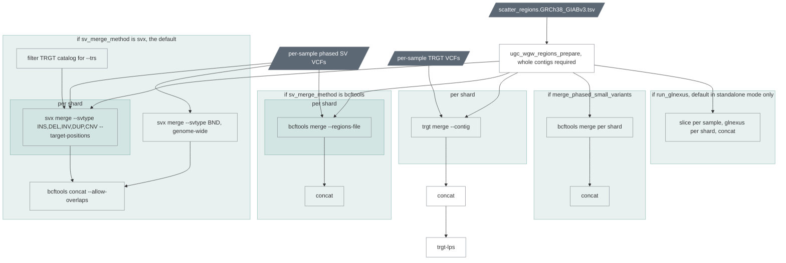
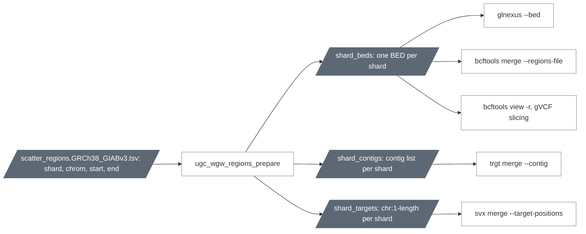

# `cohort_merge`

The cohort's SV, tandem-repeat and mitochondrial call sets, and in
standalone mode the joint small-variant set.

| | |
|---|---|
| Subject | cohort |
| Modes | standalone, joint |
| All stages | [08 Stages](../08-stages.md) |

Four independent branches after phasing, every one scattered over the shards
of `scatter_regions`: SV merge, TRGT merge with trgt-lps, optional phased
small-variant merge, optional GLnexus.

Why the genome-wide BND job: svx keeps only breakends whose mates are inside
the target positions, so a per-contig shard would silently drop
inter-chromosomal breakends. The BND job runs unscattered and its records are
concatenated with the per-contig results.

| Driver fills | You may override |
|---|---|
| `cohort_id`, `sample_ids`, `sv_vcfs`, `trgt_vcfs` (+ indices; from `singleton` in standalone, from `downstream` in joint), `gvcfs` when `run_glnexus`, `phased_small_variant_vcfs` when `merge_phased_small_variants`, `merge_mitochondria` with each member's `mt_small_variant_vcfs`, `mt_sv_vcfs`, `mt_haplogroups` (+ indices) or, for a member whose run predates 0.15, null plus its `mitorsaw_vcfs` and `mitorsaw_hap_stats`, `ugc_wgw_container_registry` | `sv_merge_method` (`svx`), `svx_threads` (8), `svx_min_supp` (1), `svx_mem_gb` (8 + 0.05 N), `trgt_merge_threads` (2), `trgt_merge_mem_gb` (8 + 0.02 N), `trgt_lps_threads` (8), `run_glnexus` (true in standalone, false in joint), `glnexus_threads` (32), `glnexus_mem_gb` (32 + 0.1 N), `merge_phased_small_variants` (false), `bcftools_merge_mem_gb` (8 + 0.02 N), `merge_mitochondria` (true when any member brings something; false leaves the branch out), `mito_sv_min_size` (50), `haplogrep_tree`, `run_haplogrep` (true), `skip_contigs` (`["chrM"]`, the GLnexus scatter only) |

Outputs: `<cohort_id>.merged.GRCh38_GIABv3.` SV VCF, TRGT VCF, trgt-lps TSV,
optional phased small-variant VCF and GLnexus VCF, and the mitochondrial
sets (chapter 07).

Since 0.15 the stage also merges the members' collapsed mitochondrial call
sets (`bcftools merge` over one contig, no scatter): `…mt_small_variants.vcf.gz`
and `…mt_svs.vcf.gz`, where `0/0` means mitorsaw reported no alternate
allele for that member at the site, and `…mt_haplogroups.tsv`, every
member's haplogroups in one table. A member whose per-sample run predates
the collapse (the 864) is collapsed and classified inside the stage from
its mitorsaw VCF and JSON (seconds each; the driver names them once), so
an existing cohort gets its mitochondrial sets without any per-sample
re-run (chapter 10). The GLnexus branch takes its own shard list without
chrM; the SV and TRGT merges keep every shard.

## Scatter regions

The shipped file has the 25 primary contigs as one shard each and a `rest`
shard holding the 193 other contigs (the 170 unplaced, unlocalised and decoy
contigs of GRCh38 plus the 23 decoys GIABv3 adds), 26 shards in total, so
region-scoped steps see the same contigs as upstream's unscoped ones.
`cohort_merge` requires whole-contig shards because `trgt merge` scopes by
contig only; `cohort_call` accepts finer shards (`scatter_regions_file`),
since GLnexus scopes by BED.
