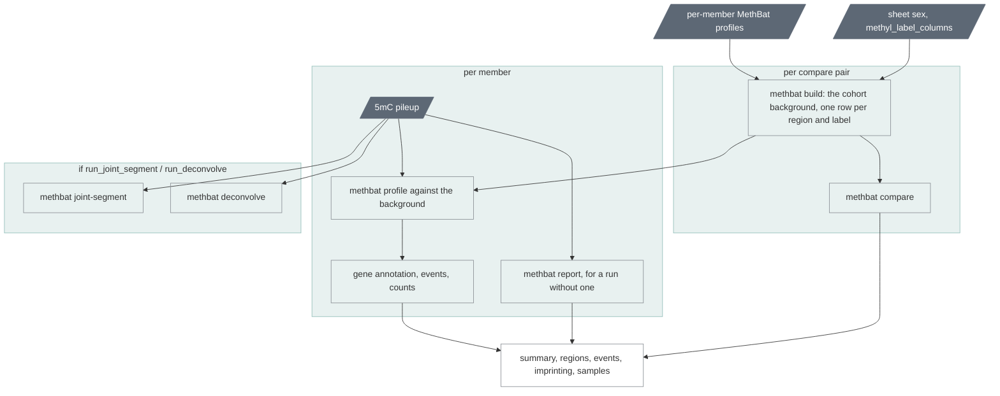

# `cohort_methyl`

Methylation across the cohort: the background, each member's events,
comparisons, imprinting, cell-type composition.

| | |
|---|---|
| Subject | cohort |
| Modes | standalone, joint |
| All stages | [08 Stages](../08-stages.md) |

The cohort's methylation layer, from the per-sample MethBat outputs: a
background profile of the cohort, every member scored against it, group
comparisons, the imprinting anomalies tabulated, every region annotated
with its genes, and optionally a joint segmentation and a cell-type
deconvolution. Nothing here is upstream's; the tools are MethBat 1.1.0 from
upstream's `methbat` image. Independent of `cohort_merge`, `cohort_freq`
and `cohort_tr`; last in both cohort modes.

Text version: one `ugc_wgw_methbat_build` (or N with `leave_one_out`);
per member `ugc_wgw_methbat_report` when its run has none, then
`ugc_wgw_methbat_profile_bg`; per pair `ugc_wgw_methbat_compare`;
optionally `ugc_wgw_methbat_joint_segment` and, per member,
`ugc_wgw_methbat_deconvolve`; one `ugc_wgw_methyl_summary`; the manifest.

Why the labels matter: the background's statistics are per label, and a
member is compared against each label it carries (`ALL` always, its sex
group as `cohort_freq` resolves it, and `column=value` for every sheet
column named in `config.json`'s `methyl_label_columns`). Without the sex
label every XX member looks hyper-methylated on chrX against an `ALL`
background that is half XY, and real events drown. A label group needs at
least `background_min_datasets` (10) members or every comparison against
it is `InsufficientData`; the summary notes the labels below that.

| Driver fills | You may override |
| --- | --- |
| `cohort_id`, `sample_ids`, `cpg_pileup_beds`, `methbat_profiles`, `methbat_reports` (null for a member whose run predates the report), `sample_labels` (`;`-joined per member: the sex group, then `column=value` of `methyl_label_columns`) | `compare_pairs` (`["XX:XY"]`, `baseline:compare`; empty = none), `leave_one_out` (false), `background_min_datasets` (10), `zscore_min` (3.0), `methyl_delta_min` (20), `run_joint_segment` (false), `run_deconvolve` (true), `build_mem_gb` (8), `profile_mem_gb` (4), `joint_segment_threads` (8), `joint_segment_mem_gb` (32), `summary_mem_gb` (4) |

Resources: chapters 12 and 15. The whole stage is minutes on the smoke
cohort and well under an hour at 800 members without the joint segmentation.

Outputs (`<cohort_id>.methyl.GRCh38_GIABv3.`): the background TSV, the
collection file it was built from, per member the scored profile as MethBat
writes it and the same with `hgnc_id`, `gene_symbol` and `region_type`
appended, one comparison TSV per pair, the per-region table, the events
file, the imprinting table, the samples table, the long summary, the
cell-type composition table with each member's estimate behind it, and
with its switch the joint segments (BED and two bedGraphs) (chapter 07).

## Cell-type composition

`methbat deconvolve` explains each member's 5mC pileup as a mixture of the
39 cell types of a reference atlas (nanomix's, built from bisulfite data)
by non-negative least squares: a minute and 2.5 GB per member, on by
default (`run_deconvolve`). The stage's table has every fraction per
member; the cohort page shows the cohort's composition per cell type, the
members' spread for the main types and each member's distance from the
cohort's median composition (half the summed absolute differences: 0 is
the median, 1 nothing shared); a member's page shows its own fractions
beside the cohort's medians.

What it is good for: a blood sample comes out as blood (the first
production examples: granulocytes 49 and 57%, T cells 30 and 21%,
monocytes 11 and 13%), so a member that is something else stands out:
another tissue or sample type, a cell line, contamination, an unusual
blood picture (the GIAB lymphoblastoid lines of the smoke test come out
59 to 78% B-cell). That member gets the advisory flag
`cell_composition_outlier` (beyond the cohort's median distance + 4 scaled
MADs and at least 0.25), and its methylation events should be read with
that in mind, because a different mixture of cells differs at many
regions without any of them being an epimutation. The rule is relative to
the cohort, so a cohort of saliva samples is judged against saliva.

What it is not: a blood count. The atlas is from bisulfite data and is not
validated on HiFi methylation calls; fractions of a few percent in
unrelated tissues (prostate or smooth muscle in a blood sample) are the
method's noise; closely related cell types share their signal, so B and
NK cells often read 0 and are counted with their neighbours. Use the
lineages and the large fractions, not the small ones.

## Reading the scores

- A member's scored profile is MethBat's single-dataset profile with the
  background columns filled: `compare_label` (`HypoMethylated`,
  `HyperMethylated`, `HypoASM`, `HyperASM`, `Uncategorized`,
  `InsufficientData`), `background_category` (one row per region per
  label), `mean_combined_methyl_zscore` and `mean_abs_meth_delta_zscore`,
  and the population counts (`category_pop_count`, `category_pop_freq`). In
  MethBat 1.1.0 a `Hyper`/`Hypo` label also requires the matching
  `summary_label` (`Methylated`/`Unmethylated`); 1.2.0 drops that coupling,
  so the next MethBat bump changes these counts and the sync procedure must
  say so.
- With `leave_one_out = false` (default) the member is one of the N datasets
  behind the mean and stdev it is compared against. At N ≥ 100 this is
  negligible; below that it makes z-scores conservative at exactly the
  regions where the member is an outlier. `leave_one_out = true` builds a
  background per member from the other N−1.
- Every per-region row carries `hgnc_id`, `gene_symbol` and `region_type`
  from `methbat_map` (the reference map key of the same name): the genes
  whose TSS is within 10 kb of the island or whose body overlaps it, and
  `imprinted`, `promoter`, `gene_body` or `intergenic`. The events file
  lists every member's Hypo/Hyper rows with those columns, sorted by gene
  then member: the file to filter by a gene list (`methyl_genes_of_interest`
  in `config.json` puts those genes first on the cohort page). Regions
  without a gene keep their rows. PacBio's review rule: genes within ±10 kb,
  then the genes of interest; this leaves tens of regions per sample.
- The per-region table (`n_hypo`, `n_hyper`, `n_hypo_asm`, `n_hyper_asm`
  across members, next to the background's dataset counts) separates
  recurrent cohort artefacts (a region flagged in 30 % of members is a
  reference or mappability problem, not 30 % rare events) from singletons.
- `compare` output: per region `summary_comparison`, z-scores and deltas,
  and the member counts per side; `InsufficientData` below 10 per side. The
  default `XX:XY` pair is a check as much as a result: chrX should light up
  and little else.
- Imprinting table: `PASS`, `Inconclusive`, `Anomalous`, `AnomalousQcWarning`
  per member per region from `methbat report`, with `report_source` (`run`,
  or `stage` for a member whose run predates the task).
  `LowHaplotypeCoverage` and `WeakASM` are phasing-quality signals as well
  as biology; a member with many QC warnings is a candidate for the phasing
  section of its sample page. `Anomalous` without a warning flags the
  member `imprinting_anomalous` (warn) on its own page.
- The cohort page's Methylation section draws the labels, the events per
  member (beyond median + 3 MAD: `methyl_outlier`, warn), the genes with
  the most members carrying an event, the events by region type, the
  recurrent regions, the imprinting screen, the comparisons and, when run,
  the deconvolution's top cell type per member (chapter 07).
