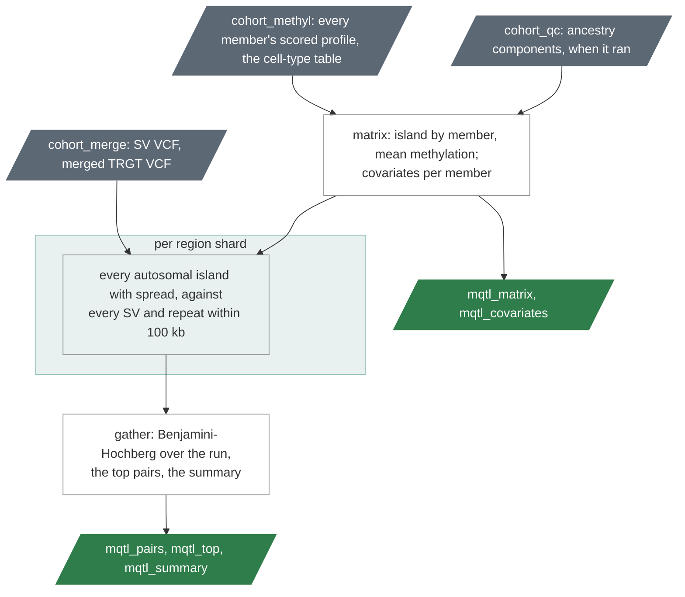

# `cohort_mqtl`

Structural variants and tandem repeats tested against the methylation of
nearby CpG islands; the island-by-member methylation matrix.

| | |
|---|---|
| Subject | cohort, optional |
| Modes | standalone, joint |
| All stages | [08 Stages](../08-stages.md) |

A HiFi cohort has every member's structural variants, tandem-repeat
lengths and methylation from the same reads. This stage joins them: does
carrying an insertion or deletion, or a longer repeat, go with a
different methylation of the CpG island next to it? It reads what
`cohort_merge` and `cohort_methyl` wrote and adds nothing to a member's
run. No stage waits for it (it is optional in the planner, like
`cohort_qc` and `cohort_tr`); it needs those two stages and takes
`cohort_qc`'s ancestry table when a run of it exists.

**A research screen, not a diagnostic result.** It finds associations in
cis, in one tissue, at CpG islands. An association is not a mechanism: a
variant that goes with lower methylation may cause it, or travel with
whatever does.

Text version: `ugc_wgw_mqtl_matrix` reads the members' annotated scored
profiles (the rows of the cohort-wide label `ALL`) into one table, a row
per CpG island and a column per member, and writes the covariates beside
it; per region shard `ugc_wgw_mqtl_shard` queries the two VCFs of
`cohort_merge` for the shard widened by the window and tests every pair;
`ugc_wgw_mqtl_gather` concatenates the shards, corrects for the number of
tests and writes the top table and the summary; the manifest.

## What is tested

- **The methylation** of an island is `mean_combined_methyl` of the
  member's profile, 0 to 100, kept when the member's median coverage
  there is at least `min_island_coverage` (8). An island is tested when
  `min_island_members_fraction` (0.8) of the members have a value and
  the values' standard deviation is at least `min_island_sd` (2 points):
  most islands are unmethylated in everybody and have nothing to
  explain.
- **A structural variant** (insertion, deletion, duplication, inversion)
  counts as 0, 1 or 2 copies from the merged VCF's genotype; a member
  without the call is 0. **A tandem repeat** counts as the mean length of
  the member's two alleles; a member without a call takes the cohort's
  median, and a locus where more than a tenth have none is left out.
- **A variant is tested** when at least `min_carriers` (10) members
  differ from the commonest genotype and at least as many have it.
- **A pair** is an island and a variant within `window_bp` (100,000) of
  each other. Autosomes only: on chrX both sides follow sex and X
  inactivation.

## The model

The island's methylation is rank-normalised across the members, so one
extreme member cannot make a result. Both the methylation and the variant
are then cleared of the covariates: sex, the five ancestry components of
`cohort_qc`, and the fractions of the five blood cell types of the
deconvolution (granulocyte, monocyte, T, B, NK). The ancestry components
and the cell fractions are used only when every member has them; the
summary names the covariates that went in. The test is the correlation of
what is left, with a two-sided p-value from Student's t, and
Benjamini-Hochberg over every pair of the run gives `q`.

The effect is reported on the original scale: methylation points per
copy of a structural variant, or per 100 bp of repeat length.

## Reading the result

| File | What it holds |
|---|---|
| `mqtl_matrix` | `<cohort>.mqtl.<ref>.matrix.tsv.gz`: a row per CpG island (coordinates, label, gene, region type, members with a value, mean, standard deviation), a column per member. The table to start any other methylation analysis from. |
| `mqtl_covariates` | `<cohort>.mqtl.<ref>.covariates.tsv`: per cohort member whether it is in the model and, if not, why; sex, components, cell fractions. |
| `mqtl_pairs` | `<cohort>.mqtl.<ref>.pairs.tsv.gz`: every tested pair: the island, the variant (type, ID, position, length), the distance, the members, how many differ from the commonest genotype, `r`, `t`, `df`, `p`, the effect and its unit, `q`. |
| `mqtl_top` | `<cohort>.mqtl.<ref>.top.tsv`: the pairs with `q` at or below `fdr` (0.05), by p-value. |
| `mqtl_summary` | `<cohort>.mqtl.<ref>.summary.tsv`: members, islands tested and why the others were not, variants and pairs, hits by variant type and region type, the covariates, the inflation factor, the parameters. |

The cohort page's section shows the counts, the inflation factor and the
top pairs. `ugc-wgw export --domains mqtl` copies the five files.

**The inflation factor** is the median test statistic over the value
expected when nothing is associated. Near 1 is what a clean cohort gives.
Above it, something runs through the whole cohort that the model does not
describe: relatives, population structure without ancestry components, a
batch. `exclude_ids` under `stage_inputs.cohort_mqtl` leaves members out
(one of each related pair from the cohort page's Identity section, for
instance).

A hit is a place to look, with the two things to check first: whether the
island's methylation event on the cohort page belongs to the members who
carry the variant, and whether the variant is real in those members
(their sample pages, the reads).

| Driver fills | You may override |
|---|---|
| `cohort_id`, `sample_ids`, `sample_sexes`; `scored_profiles` and `methyl_deconvolution` (from `cohort_methyl`); `sv_vcf`, `trgt_vcf` and their indices (from `cohort_merge`); `ancestry` (from `cohort_qc`, any version or mode, when a run has it) | `window_bp` (100000), `min_carriers` (10), `min_members` (40), `min_island_members_fraction` (0.8), `min_island_sd` (2.0), `min_island_coverage` (8), `fdr` (0.05), `exclude_ids` (none), `test_svs` (true), `test_trs` (true), `matrix_mem_gb` (8), `shard_mem_gb` (8), `gather_mem_gb` (4) |

Below `min_members` (40) members with a profile nothing is tested: the
tables hold their headers and the summary a note. The model has a dozen
covariates; forty members is the least it can say anything with, and
hundreds are where it becomes useful.

Resources: a 864-member shard with 300 islands and 10,000 variants took
33 seconds and 0.1 GB on one core in a test with synthetic data; expect
minutes per shard and well under an hour for the stage.
