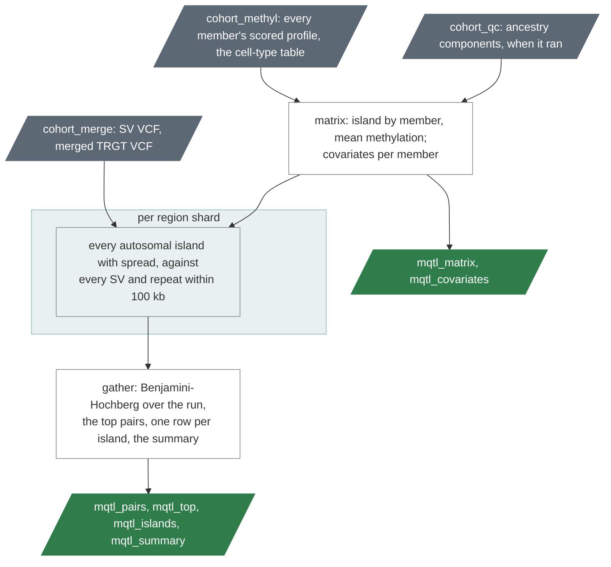

# `cohort_mqtl`

Structural variants and tandem repeats tested against the methylation of
nearby CpG islands; the island-by-member methylation matrix.

| | |
|---|---|
| Subject | cohort, optional |
| Modes | standalone, joint |
| All stages | [08 Stages](../08-stages.md) |

A HiFi cohort has every member's structural variants, tandem-repeat
lengths and methylation from the same reads. This stage joins them: does
carrying an insertion or deletion, or a longer repeat, go with a
different methylation of the CpG island next to it? It reads what
`cohort_merge` and `cohort_methyl` wrote and adds nothing to a member's
run. No stage waits for it (it is optional in the planner, like
`cohort_qc` and `cohort_tr`); it needs those two stages and takes
`cohort_qc`'s ancestry table when a run of it exists.

**A research screen, not a diagnostic result.** It finds associations in
cis, in one tissue, at CpG islands. An association is not a mechanism: a
variant that goes with lower methylation may cause it, or travel with
whatever does. Small variants are not tested, so the structural variant
or repeat named for an island is often the best marker of a haplotype
that carries the cause, not the cause.

Text version: `ugc_wgw_mqtl_matrix` reads the members' annotated scored
profiles (the rows of the cohort-wide label `ALL`) into one table, a row
per CpG island and a column per member, and writes the covariates beside
it; per region shard `ugc_wgw_mqtl_shard` queries the two VCFs of
`cohort_merge` for the shard widened by the window and tests every pair;
`ugc_wgw_mqtl_gather` concatenates the shards, corrects for the number of
tests and writes the top table, the islands table and the summary; the
manifest.

## What is tested

- **The methylation** of an island is `mean_combined_methyl` of the
  member's profile, 0 to 100, kept when the member's median coverage
  there is at least `min_island_coverage` (8). An island is tested when
  `min_island_members_fraction` (0.8) of the members have a value and
  the values' standard deviation is at least `min_island_sd` (2 points):
  most islands are unmethylated in everybody and have nothing to
  explain.
- **A structural variant** (insertion, deletion, duplication, inversion)
  counts as 0, 1 or 2 copies from the merged VCF's genotype; a member
  without the call is 0. **A tandem repeat** counts as the mean length of
  the member's two alleles; a member without a call takes the cohort's
  median, and a locus where more than a tenth have none is left out.
- **A variant is tested** when at least `min_carriers` (10) members
  differ from the commonest genotype and at least as many have it.
- **A pair** is an island and a variant within `window_bp` (100,000) of
  each other. Autosomes only: on chrX both sides follow sex and X
  inactivation.

## The model

The island's methylation is rank-normalised across the members, so one
extreme member cannot make a result. Both the methylation and the variant
are then cleared of the covariates: sex, the five ancestry components of
`cohort_qc`, and the fractions of the five blood cell types of the
deconvolution (granulocyte, monocyte, T, B, NK). The ancestry components
and the cell fractions are used only when every member has them; the
summary names the covariates that went in. The test is the correlation of
what is left, with a two-sided p-value from Student's t, and
Benjamini-Hochberg over every pair of the run gives `q`.

The effect is reported on the original scale: methylation points per
copy of a structural variant, or per base pair of the member's mean
repeat length (a repeat usually varies by a few base pairs; 0.23.0 gave
it per 100 bp, which no repeat in the table spans).

**The null.** Every tested island that all members cover is also tested
against ten variants drawn at random at least 5 Mb away on its
chromosome. No cis effect reaches that far, so these far pairs show what
the test does when nothing is there.

## Reading the result

| File | What it holds |
|---|---|
| `mqtl_matrix` | `<cohort>.mqtl.<ref>.matrix.tsv.gz`: a row per CpG island (coordinates, label, gene, region type, members with a value, mean, standard deviation), a column per member. The table to start any other methylation analysis from. |
| `mqtl_covariates` | `<cohort>.mqtl.<ref>.covariates.tsv`: per cohort member whether it is in the model and, if not, why; sex, components, cell fractions. |
| `mqtl_pairs` | `<cohort>.mqtl.<ref>.pairs.tsv.gz`: every tested pair: the island, the variant (type, ID, position, length), the distance, the members, how many differ from the commonest genotype, `r`, `t`, `df`, `p`, the effect and its unit, `q`. |
| `mqtl_top` | `<cohort>.mqtl.<ref>.top.tsv`: the pairs with `q` at or below `fdr` (0.05), by p-value. |
| `mqtl_islands` | `<cohort>.mqtl.<ref>.islands.tsv`: one row per island with such a pair: its lead pair (the top table's columns) and `n_pairs`, how many of its pairs stand; by the lead's p-value. |
| `mqtl_summary` | `<cohort>.mqtl.<ref>.summary.tsv`: members, islands tested and why the others were not, variants and pairs, hits by variant type and region type, the covariates, the two inflation factors, the parameters. |

The cohort page's section shows the counts, the inflation factors, a
warning for a covariate group that is missing, and the islands.
`ugc-wgw export --domains mqtl` copies the six files.

**Count islands, not pairs.** The variants of one haplotype are in
linkage, so an island with a real association has several pairs at the
rate: on the first whole cohort (861 members) 101,695 pairs stood on
10,180 islands, a median of three per island and up to 169. The islands
table is the result; the top table says which variants.

**The inflation factors** are the median test statistic over the value
expected when nothing is associated.

- Among the **far pairs** (`lambda_far`) it should be about 1, and
  `far_p05_share`, their share beyond the 5 % point, about 0.05. Above
  that, something runs through the whole cohort that the model does not
  describe: relatives, population structure without ancestry components,
  a batch. `exclude_ids` under `stage_inputs.cohort_mqtl` leaves members
  out (the Identity section's contaminated samples and one of each
  related pair).
- Among the **tested pairs** (`lambda`) real associations raise it too:
  1.38 on that cohort, where four islands in ten have one. It describes
  the result, not its trouble.

A real cis signal also thins out with distance: on that cohort the pairs
at the rate were ten times as dense within 1 kb of the island as at 75
to 100 kb. Confounding has no such shape.

A hit is a place to look, with the two things to check first: whether the
island's methylation event on the cohort page belongs to the members who
carry the variant, and whether the variant is real in those members
(their sample pages, the reads).

**The cell fractions come from `cohort_methyl`.** A run of that stage
from before 0.20.0 has no cell-type table; the model then has sex and
the ancestry components alone, and the page says so. Rerun
`cohort_methyl` (`--rerun`), then this stage.

| Driver fills | You may override |
|---|---|
| `cohort_id`, `sample_ids`, `sample_sexes`; `scored_profiles` and `methyl_deconvolution` (from `cohort_methyl`); `sv_vcf`, `trgt_vcf` and their indices (from `cohort_merge`); `ancestry` (from `cohort_qc`, any version or mode, when a run has it) | `window_bp` (100000), `min_carriers` (10), `min_members` (40), `min_island_members_fraction` (0.8), `min_island_sd` (2.0), `min_island_coverage` (8), `fdr` (0.05), `exclude_ids` (none), `test_svs` (true), `test_trs` (true), `matrix_mem_gb` (8), `shard_mem_gb` (8), `gather_mem_gb` (8) |

Below `min_members` (40) members with a profile nothing is tested: the
tables hold their headers and the summary a note. The model has a dozen
covariates; forty members is the least it can say anything with, and
hundreds are where it becomes useful.

Resources, from 861 members: 26 shard jobs of three minutes and 1.1 GB
on one core each, four minutes for the matrix, one for the gather (3.2
GB for 2.4 million pairs); a quarter of an hour for the stage.
