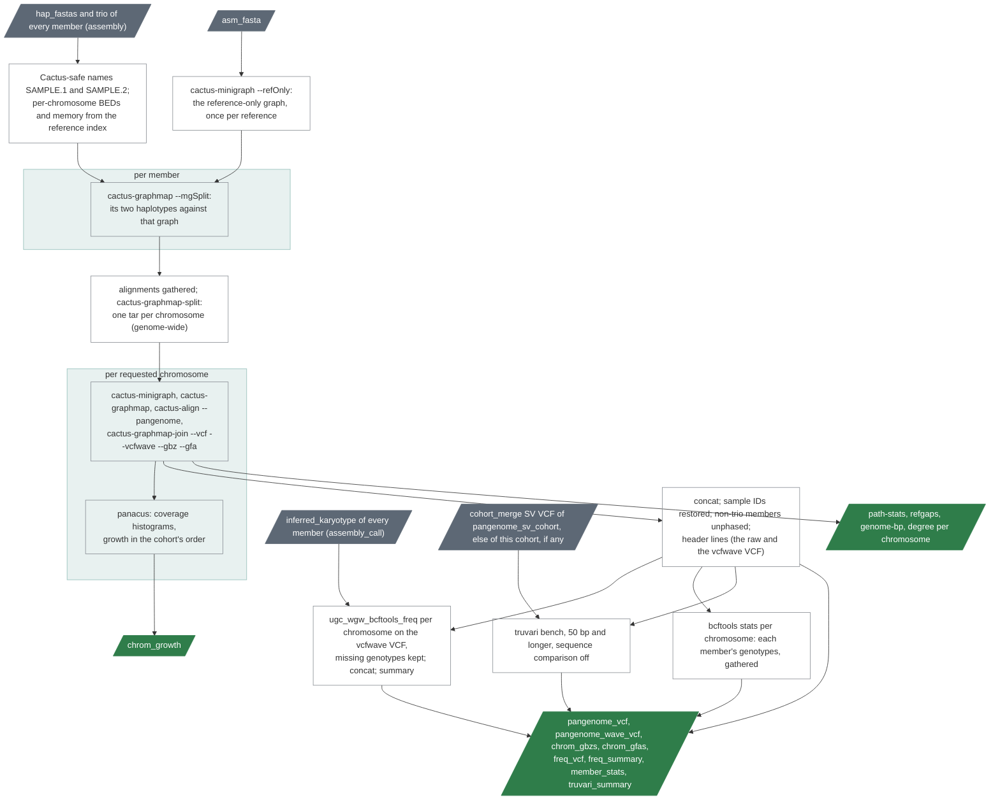

# `cohort_pangenome`

A Minigraph-Cactus pangenome graph of the members' assemblies and its
variants.

| | |
|---|---|
| Subject | cohort |
| Modes | assembly |
| All stages | [08 Stages](../08-stages.md) |

The last stage of the assembly mode builds a Minigraph-Cactus graph of the
cohort's haplotype assemblies on the decoy-free GRCh38 and turns it into
cohort VCFs with allele frequencies. The graph is built one chromosome at a
time (Cactus's `--mgSplit` route): every member's two haplotypes are mapped
to a reference-only graph in a task of their own, one step bins the contigs
by chromosome, then every requested chromosome is constructed, mapped,
aligned and joined in its own task. The tools are cactus v3.3.0 (minigraph
0.21, vg 1.76.1, vcfwave, panacus 0.5.2) from the
`comparative-genomics-toolkit/cactus` image, bcftools 1.23 from
`pb_wdl_base` and truvari 5.5.0.



Text version: `ugc_wgw_pangenome_names` maps each sample ID to a Cactus-safe
genome name (dots and dashes to `_`; a collision fails the run), writes the
rename table and, from the reference index, a BED and a memory size per
requested chromosome; `ugc_wgw_cactus_refgraph` runs `cactus-minigraph
--refOnly` on the reference; per member `ugc_wgw_cactus_map` runs
`cactus-graphmap --mgSplit` of its two haplotypes (`<name>.1`, `<name>.2`)
against that graph; `ugc_wgw_cactus_split` writes the seqfile (`GRCh38`,
then every haplotype in cohort order), concatenates the members'
alignments, runs `cactus-graphmap-split` over the whole genome, and tars
each chromosome's directory with its seqfile; per requested chromosome
`ugc_wgw_cactus_chrom` untars, rewrites the paths and runs the four
construction steps, ending in `cactus-graphmap-join` with `--vcf --vcfwave
--gbz --gfa`, and `ugc_wgw_pangenome_growth` runs panacus on the
chromosome's GFA; two
`ugc_wgw_pangenome_vcf_post` calls bring every chromosome VCF to the
cohort's sample columns (a member without sequence in a chromosome's
graph, an XX member on chrY, gets missing genotypes there), concatenate
the raw and the vcfwave VCFs, restore the sample IDs (`bcftools
reheader`), unphase the members that were not trio-binned and add the
header lines (cohort, chromosomes, the ambiguity rule, the phase policy);
the `cohort_freq` tasks run per
chromosome on the vcfwave VCF with missing genotypes kept, their shards are
concatenated and `ugc_wgw_pangenome_freq_summary` writes the summary (since
0.12.0 also records by nesting level, vcfwave type and allele length);
`ugc_wgw_pangenome_member_stats` runs `bcftools stats --samples -` per
chromosome on the same VCF and the gather task sums each member's
genotypes, singletons, missing calls and call rate (`member_stats`); the
chromosome task keeps the join's path statistics and reference gaps and adds
the bases per genome and the node degree histogram; with a read-based SV
merge, a biallelic copy of the vcfwave VCF (`bcftools norm -m -any`; truvari
refuses multiallelic records) goes through `ugc_wgw_truvari_bench`; the
manifest.

Contigs enter a chromosome's graph only when enough of their length aligns
to one reference contig (75, 50 or 25 % below 100 kb, below 1 Mb and from 1
Mb, with a best-to-second ratio of 2 at MAPQ 5 or more, Cactus's defaults);
the rest is ambiguous and in no graph. `ambiguous_contigs` counts them per
haplotype, and the summary's cohort page shows the totals. The other
contigs (chrM and the unplaced ones, lumped together as `chrOther`) are
built only with `build_other_contigs = true`.

| Driver fills | You may override |
|---|---|
| `cohort_id`, `sample_ids`, `hap1_fastas`, `hap2_fastas` and `trios` (from every member's `assembly`), `sample_sexes` and `sample_sex_sources` (`XX`, `XY` or empty from every member's `assembly_call` karyotype; the sheet's sex is not used), `sv_vcf` and its index (the `cohort_merge` SV VCF of `pangenome_sv_cohort`, else of this cohort, any version and either read mode, when one exists) | `chromosomes` (the map's chr1–22, X, Y), `build_other_contigs` (false), `split_map_cores` (8: cores of each member's mapping task), `map_mem_gb` (60 GB plus 15 times the member's gzipped FASTAs), `split_cpu` (16), `split_mem_gb` (64), `split_disk_gb` (from the inputs), `chrom_cpu` (16), `chrom_map_cores` (4), `chrom_mem_gb_floor` (64), `chrom_mem_gb_per_100mb` (32; the larger rule wins), `freq_threads` (2), `freq_mem_gb` (4) |

`chromosomes = ["chr20"]` under `stage_inputs.cohort_pangenome` is how the
ladder runs (and the smoke): every haplotype is still mapped genome-wide
and the split covers every chromosome, only the per-chromosome tasks are
limited. Every
member needs a successful `assembly` and `assembly_call` at the version
(or `--any-version`); freeze the pangenome cohort from `ugc-wgw summary
--pass-list` (chapter 06) so that no assembly with a QC failure enters the
graph. `ugc-wgw cohort rank` (chapter 06) chooses which members and how
many: it orders them by the structural variants each adds and shows where
the cohort's common variation is covered.

## One mapping per member, and the ladder

A haplotype's alignment to the reference-only graph depends on that
haplotype and the reference, not on the other members. So the mapping is
one task per member, with the member's files as its only inputs, and
miniwdl's call cache keeps it: a second cohort that holds the same member
does not map it again. That is what makes a ladder of nested cohorts
affordable. Freeze them as prefixes of one ranking (`ugc-wgw cohort rank
--emit`, chapter 06), set `chromosomes` to `["chr20"]`, and run them
smallest first:

```bash
for k in 20 100 200 400; do
  ugc-wgw cohort rank C1 --emit $k --pass-list asm-pass.txt
  ugc-wgw cohort freeze P$k --samples <results>/reports/rank/C1.top$k.txt
  ugc-wgw submit --mode assembly --stage cohort_pangenome --cohort P$k
done
```

P100 maps 80 members, P200 another hundred, and so on; every step runs the
split and the chr20 task again, which is what is being measured. After
each step `ugc-wgw usage --cohort P$k --by task` has the time and memory of
`ugc_wgw_cactus_split` and `ugc_wgw_cactus_chrom` against the number of
haplotypes, and the cohort page's growth curves say what the members
added. The same cohorts built on every chromosome are then graphs of
those sizes; nothing is mapped again for them.

The split's result is the same as when one task mapped everything (checked
on the dev machine: contig assignments, per-chromosome FASTAs and
alignments). The two routes are not a choice: there is one.

## Growth curves

`chrom_growth` holds, per chromosome, panacus's coverage histograms: how
many base pairs and nodes of the graph are carried by exactly one member,
by two, and so on, once for everything the members carry and once for the
sequence that is not on the reference's path. From them the cohort page
draws what k members drawn at random carry between them (the growth
curve), what all of them share (the core), and, beside the expectation,
the cumulative amount in the cohort's own order. The chromosomes add up
because each is counted against the whole cohort: an XX member carries
nothing on chrY. Read the non-reference curve for where a further member
stops bringing new sequence. It never goes quite flat: satellite arrays
and other sequence that aligns poorly look new in every genome.

## Resources

Dev-machine measurements on chr20-only assemblies: one member's mapping
task about an hour for its two haplotypes at 55 GB (the reference graph's
index; a whole-genome haplotype took 23 minutes and 65 to 80 GB on the
cluster), the reference-only graph 4 minutes, the split 17 minutes, one
chromosome task about 50 minutes with `cactus-align` peaking at 11 GB; the
growth task, the VCF post-processing, the frequencies and truvari are
minutes. The memory of
a chromosome task is the larger of `chrom_mem_gb_floor` and
`chrom_mem_gb_per_100mb` times the chromosome's length in 100 Mb; the
default rule gives 64 GB for every human chromosome but chr1 and chr2 (80
and 78 GB). Chapter 15 gets the scaling table as the ladder runs.

Outputs: the graph's cohort VCF and its vcfwave form, the GBZ and GFA per
chromosome with their statistics (graph size, path fragments, reference
gaps, bases per genome, node degrees, growth) and logs, the name map and the
split's tables, the frequency VCF with its summary and samples tables, the
members' genotype statistics, truvari's figures (chapter 07).
