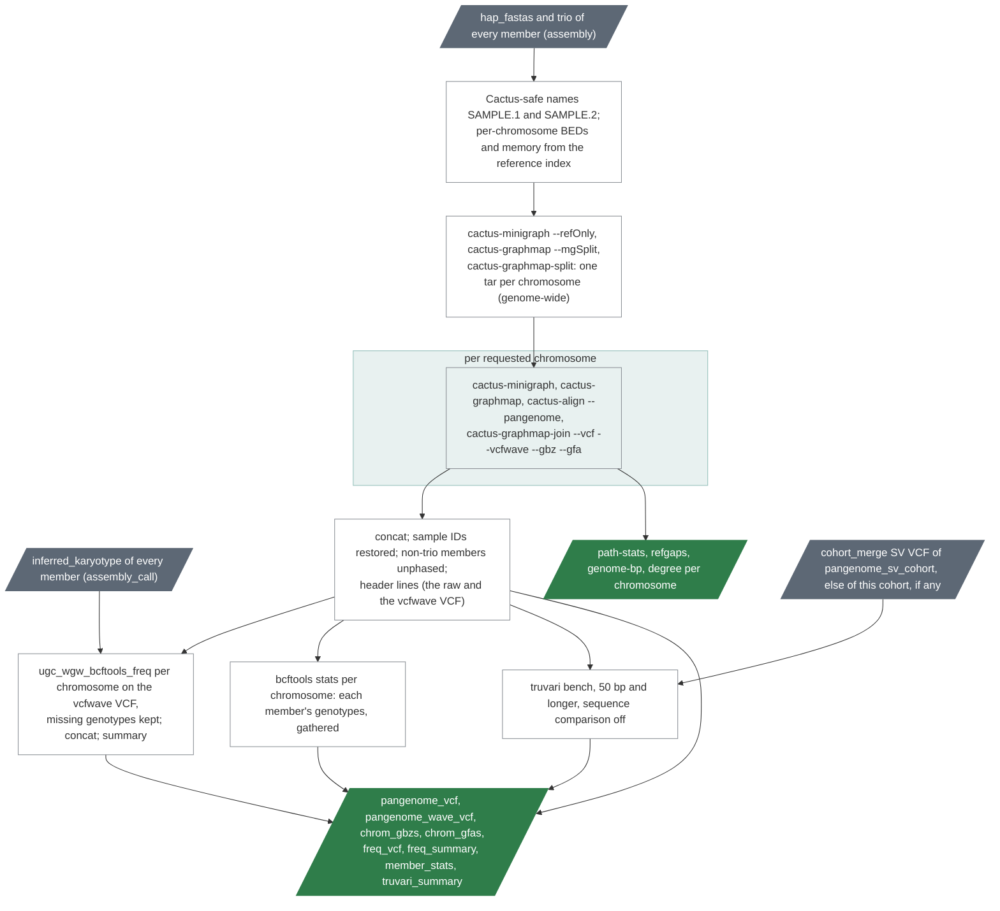

# `cohort_pangenome`

A Minigraph-Cactus pangenome graph of the members' assemblies and its
variants.

| | |
|---|---|
| Subject | cohort |
| Modes | assembly |
| All stages | [08 Stages](../08-stages.md) |

The last stage of the assembly mode builds a Minigraph-Cactus graph of the
cohort's haplotype assemblies on the decoy-free GRCh38 and turns it into
cohort VCFs with allele frequencies. The graph is built one chromosome at a
time (Cactus's `--mgSplit` route): one genome-wide step maps every haplotype
to a reference-only graph and bins the contigs by chromosome, then every
requested chromosome is constructed, mapped, aligned and joined in its own
task. The tools are cactus v3.3.0 (minigraph 0.21, vg 1.76.1, vcfwave) from
the `comparative-genomics-toolkit/cactus` image, bcftools 1.23 from
`pb_wdl_base` and truvari 5.5.0.

Text version: `ugc_wgw_pangenome_names` maps each sample ID to a Cactus-safe
genome name (dots and dashes to `_`; a collision fails the run), writes the
rename table and, from the reference index, a BED and a memory size per
requested chromosome; `ugc_wgw_cactus_split` writes the seqfile (`GRCh38`,
then `<name>.1` and `<name>.2` per member in cohort order), runs
`cactus-minigraph --refOnly`, `cactus-graphmap --mgSplit` and
`cactus-graphmap-split` over the whole genome, and tars each chromosome's
directory with its seqfile; per requested chromosome `ugc_wgw_cactus_chrom`
untars, rewrites the paths and runs the four construction steps, ending in
`cactus-graphmap-join` with `--vcf --vcfwave --gbz --gfa`; two
`ugc_wgw_pangenome_vcf_post` calls bring every chromosome VCF to the
cohort's sample columns (a member without sequence in a chromosome's
graph, an XX member on chrY, gets missing genotypes there), concatenate
the raw and the vcfwave VCFs, restore the sample IDs (`bcftools
reheader`), unphase the members that were not trio-binned and add the
header lines (cohort, chromosomes, the ambiguity rule, the phase policy);
the `cohort_freq` tasks run per
chromosome on the vcfwave VCF with missing genotypes kept, their shards are
concatenated and `ugc_wgw_pangenome_freq_summary` writes the summary (since
0.12.0 also records by nesting level, vcfwave type and allele length);
`ugc_wgw_pangenome_member_stats` runs `bcftools stats --samples -` per
chromosome on the same VCF and the gather task sums each member's
genotypes, singletons, missing calls and call rate (`member_stats`); the
chromosome task keeps the join's path statistics and reference gaps and adds
the bases per genome and the node degree histogram; with a read-based SV
merge, a biallelic copy of the vcfwave VCF (`bcftools norm -m -any`; truvari
refuses multiallelic records) goes through `ugc_wgw_truvari_bench`; the
manifest.

Contigs enter a chromosome's graph only when enough of their length aligns
to one reference contig (75, 50 or 25 % below 100 kb, below 1 Mb and from 1
Mb, with a best-to-second ratio of 2 at MAPQ 5 or more, Cactus's defaults);
the rest is ambiguous and in no graph. `ambiguous_contigs` counts them per
haplotype, and the summary's cohort page shows the totals. The other
contigs (chrM and the unplaced ones, lumped together as `chrOther`) are
built only with `build_other_contigs = true`.

| Driver fills | You may override |
|---|---|
| `cohort_id`, `sample_ids`, `hap1_fastas`, `hap2_fastas` and `trios` (from every member's `assembly`), `sample_sexes` and `sample_sex_sources` (`XX`, `XY` or empty from every member's `assembly_call` karyotype; the sheet's sex is not used), `sv_vcf` and its index (the `cohort_merge` SV VCF of `pangenome_sv_cohort`, else of this cohort, any version and either read mode, when one exists) | `chromosomes` (the map's chr1–22, X, Y), `build_other_contigs` (false), `split_cpu` (32), `split_map_cores` (`split_cpu`: cores per minigraph mapping, several haplotypes at once below it), `split_mem_gb` (128), `split_disk_gb` (from the inputs), `chrom_cpu` (16), `chrom_map_cores` (4), `chrom_mem_gb_floor` (64), `chrom_mem_gb_per_100mb` (32; the larger rule wins), `freq_threads` (2), `freq_mem_gb` (4) |

`chromosomes = ["chr20"]` under `stage_inputs.cohort_pangenome` is how the
scaling pilot runs (and the smoke): the split step still maps every
haplotype genome-wide, only the per-chromosome tasks are limited. Every
member needs a successful `assembly` and `assembly_call` at the version
(or `--any-version`); freeze the pangenome cohort from `ugc-wgw summary
--pass-list` (chapter 06) so that no assembly with a QC failure enters the
graph. `ugc-wgw cohort rank` (chapter 06) chooses which members and how
many: it orders them by the structural variants each adds and shows where
the cohort's common variation is covered.

Resources (dev-machine measurements on two chr20 assemblies, eight cores,
before the pilot sets the real rows): the split step took 12 minutes; one
chromosome task about 50 minutes with `cactus-align` peaking at 11 GB; the
VCF post-processing, the frequencies and truvari are minutes. The memory of
a chromosome task is the larger of `chrom_mem_gb_floor` and
`chrom_mem_gb_per_100mb` times the chromosome's length in 100 Mb; the
default rule gives 64 GB for every human chromosome but chr1 and chr2 (80
and 78 GB). Chapter 15 gets the scaling table once the pilot has run.

Outputs: the graph's cohort VCF and its vcfwave form, the GBZ and GFA per
chromosome with their statistics (graph size, path fragments, reference
gaps, bases per genome, node degrees) and logs, the name map and the split's
tables, the frequency VCF with its summary and samples tables, the members'
genotype statistics, truvari's figures (chapter 07).
