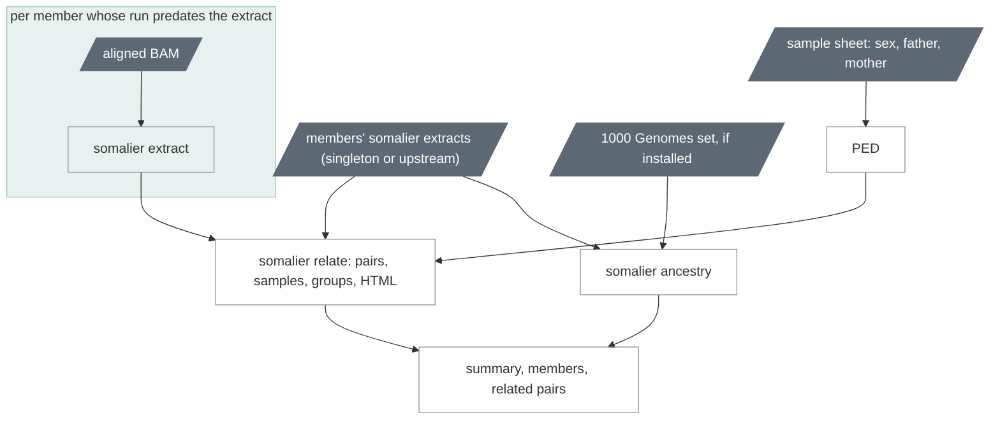

# `cohort_qc`

Identity: relatedness of every pair, the pedigree, sex and ancestry with
somalier.

| | |
|---|---|
| Subject | cohort, optional |
| Modes | standalone, joint |
| All stages | [08 Stages](../08-stages.md) |

The identity check of a frozen cohort, first of the cohort stages in both
read modes and the one stage that never blocks the stages after it: it runs
in minutes at any cohort size, and its findings go to the cohort page and
the identity pass list (chapter 06) rather than into the gating rule.
Everything in it is ours around somalier 0.3.7
(`workflows/ugc_wgw/qc/somalier.wdl`).

Text version: `ugc_wgw_somalier_extract` for each member without an
extract; `ugc_wgw_somalier_ped`; `ugc_wgw_somalier_relate` over every
extract (`SOMALIER_SEED=1`, every pair reported); `ugc_wgw_somalier_ancestry`
when `run_ancestry`; `ugc_wgw_qc_summary`; the manifest.

| Driver fills | You may override |
|---|---|
| `cohort_id`, `sample_ids`, `somalier_files` (each member's extract, null where the run predates it), `aligned_bams` and `aligned_bam_indices` (for those members: the haplotagged BAM in standalone, the aligned BAM in joint; one warning names them), `sample_sexes` and `sample_sex_sources` (the resolved sex of each member's run), `father_ids`, `mother_ids` (the sheet), `run_ancestry` (on when the reference map's `somalier_1kg_tar` exists) | `min_depth` (7), `min_ab` (0.3), `report_all_pairs` (true), `relate_threads` (2), `relate_mem_gb` (4), `ancestry_mem_gb` (8), `extract_mem_gb` (2) |

Outputs: `<cohort_id>.qc.GRCh38_GIABv3.` pairs, samples, groups and HTML
(somalier's), the PED, the summary, members and related-pairs tables, the
ancestry table and report when run (chapter 07). What the numbers mean:

- **Relatedness** is somalier's coefficient from shared genotypes at the
  sites: about 1 for the same individual, 0.5 for parent-child or
  siblings, 0.25 for second degree, near 0 for unrelated people. The
  cohort page bins every pair and flags `duplicate` at or above 0.9,
  `related` (undeclared) at or above 0.2, `pedigree_mismatch` for a
  declared parent-child pair outside 0.35–0.65 (chapter 07 lists the
  thresholds). `expected_relatedness` in the pairs table is the pedigree's
  (−1 when the PED says nothing about the pair).
- **Sex** per member: somalier's chrX call next to the sheet and the
  coverage inference, and the one the run used. On chr20-only data (the
  smoke) somalier genotypes no chrX site and says nothing; on a genome it
  has 365 sites.
- **Heterozygosity ratio** `n_het / (n_het + n_hom_alt)`: a contaminated
  sample or a mix of two has more heterozygous genotypes than the cohort;
  `het_outlier` is median ± 3 scaled MADs across the cohort.
- **Ancestry** is a projection onto the principal components of the 2,504
  1000 Genomes samples with the nearest superpopulation (AFR, AMR, EAS,
  EUR, SAS) and its probability: a description of genetic structure that
  `cohort_freq`'s export uses as strata, not a statement about origin. It
  needs the 83 MB reference set (`ugc-wgw-qc`), which the bundle carries
  unless it was built `--without-ancestry`.

A member whose run predates 0.14 (no extract among its outputs) is extracted
inside the stage from its aligned BAM: 1 CPU, 2 GB, a few minutes, cached by
BAM, sites file and reference, so it happens once however many cohorts the
member joins. The stage therefore runs on the 864 cohort without
re-running anything per sample (chapter 10).
