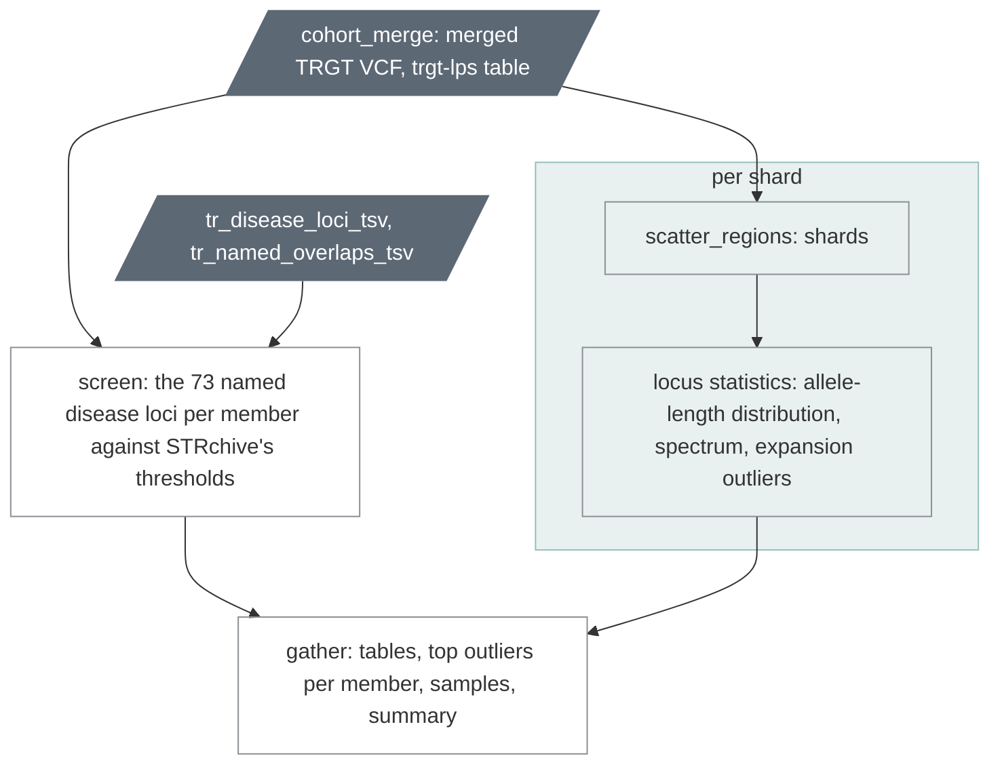

# `cohort_tr`

Tandem repeats across the cohort: the disease-locus screen, expansion
outliers, the allele-length resource.

| | |
|---|---|
| Subject | cohort, optional |
| Modes | standalone, joint |
| All stages | [08 Stages](../08-stages.md) |

What a cohort makes answerable about tandem repeats, from the merged TRGT
VCF and the trgt-lps table of `cohort_merge` alone: who carries an allele
in the pathogenic range at a known disease locus, which member and locus
pairs are expansion outliers against the cohort's own distribution, and
what that distribution is at every locus. Nothing here is upstream's; the
tools are bcftools and Python from `pb_wdl_base`. It reads no per-sample
file, adds nothing to a member's run, and the stages after it never wait
for it (it is optional in the planner, like `cohort_qc`).

Text version: one `ugc_wgw_tr_screen`; `ugc_wgw_regions_prepare`, then per
shard `ugc_wgw_tr_locus_stats`; one `ugc_wgw_tr_gather`; the manifest.

## The screen

The catalog's 73 named loci are STRchive's disease loci (the reference table
joins the two by locus id and carries STRchive's thresholds, in repeat
copies; STRchive v2.4.4, CC BY 4.0). Per member and locus, each allele's
copies of the pathogenic motif are TRGT's motif counts summed over the
catalog motifs STRchive calls pathogenic (RFC1: AAGGG and the other four,
not the benign AAAAG), or the allele length over the motif length where the
table matched none (`measure` says which). The class per allele: `normal`
inside the benign range, `pathogenic` at or above the pathogenic minimum,
`intermediate` in STRchive's intermediate range, `above_benign` and
`below_benign` for the gaps around the benign range, `below_pathogenic` at a
locus without a benign maximum (the seven FAME loci, SCA31 and XDP: the
pathogenic motif is absent in most people, and every allele short of the
pathogenic minimum gets this class), `not_assessable` where the reference
table says the thresholds do not count the repeat unit (ADTKD_MUC1: the
disease variant is one inserted base inside a unit, so the alleles are
reported and nothing is classed), and `uncalled`. The row's class is the
worse allele's. `mode_match` codes the fit to the locus's inheritance:
`consistent`, or `carrier` for one pathogenic allele at a recessive locus
(X-linked recessive: a haploid call is consistent). `borderline` marks an
allele whose class would change within 6 bp of sequence or within TRGT's own
allele-length range. Notes worth knowing: `expanded_other_motif` (long by
length, short by the pathogenic motif: an expansion of a benign or unlisted
motif), `hom_call` on a homozygous pathogenic or intermediate call at a
recessive locus (a haplotype dropout looks the same: check the spanning
reads per allele), `ploidy_sex_mismatch` (TRGT's karyotype for the run
disagrees with the sex group), `catalog_motifs_changed` (the installed
catalog is not the one the table was made from). The pathogenic motif's
longest pure segment and the allele's mean methylation ride along; neither
decides a class.

> **A research screen, not a diagnostic result.** TRGT's motif counts
> tolerate interruptions, its frame is wider than the clinical one at
> eight loci, and STRchive's ranges come from the literature of each
> locus. A class is a reason to look at the reads (`trgt plot` with the
> member's `trgt_spanning_reads`), nothing more. No QC flag is raised for
> a class.

## Reading the screen on a real cohort

The per-locus table
(`screen_loci.tsv`, and "Named loci" on the cohort page) is the first
thing to read, before any member's row: it says where the classes can be
trusted. `call_note` is `ok`; `few_uncalled` or `mostly_uncalled`;
`not_assessable`; or `threshold_or_frame_suspect` when more than a fifth
of the cohort's alleles fall above or below the benign range, which is a
statement about the thresholds and TRGT's frame at that locus, not about
the members (on the first 864-member cohort: CPEO_POLG and DBQD2_XYLT1
almost entirely above benign, OPDM1_LRP12, SCA8 and DMD largely below it,
FRAXE with 271 members intermediate). The cohort page lists the
pathogenic and intermediate rows and any call in doubt; the other classes
are counted there and per locus, and every row is in `screen.tsv`. Some
pathogenic-class counts are large because the allele is common and
incompletely penetrant, not because the screen is wrong (FECD3_TCF4: 64
of 864 members), and at a recessive locus most rows are carriers
(`mode_match`).

## The outlier scan

At every locus of the catalog (937,195), over the
called alleles of the cohort: median, MAD, quantiles. A member and locus
pair is listed when the member's longer allele is at least
`outlier_min_bp` (50) above the median and at least `outlier_mad_min` (5)
scaled MADs above it, the scale being 1.4826 × MAD but never less than one
repeat unit (most loci have MAD 0: there the rule asks for five units), at
loci with at least `outlier_min_called` (20) called members, and only
while the carriers are few: when more members qualify than
`outlier_max_carrier_fraction` (1%) of the called ones (at least
`outlier_max_carriers_min`, 2), the long allele is common polymorphism, the
locus is marked `common` and nobody is listed. A cohort of relatives
raises those two inputs. What the scan does not find: contractions, an
extreme allele at a locus that also has a common long one (the per-locus
table keeps `al_p99` and `al_max` for that), and anything at a locus with
too few calls. The 62 ordinary loci that overlap a named one (the same
repeat genotyped a second time under another motif) carry `named_locus`,
and outliers there or at the named loci do not count towards the
per-member figure that the cohort page plots and flags
(`tr_outlier_count_high`: beyond the median + 3 scaled MADs). On the first
production cohort that figure had a median of 75 per member; it was
higher for the members whose ancestry was rare in the cohort (11 of 14
flagged) and rose as depth fell (r = −0.43), so a flagged member is first
of all one of those two, and only then a sample to look at.

| Driver fills | You may override |
| --- | --- |
| `cohort_id`, `sample_ids`, `sample_sexes` (the sex group as `cohort_freq` derives it), `trgt_vcf`, `trgt_vcf_index`, `trgt_lps` (the cohort's `cohort_merge` outputs) | `outlier_min_bp` (50), `outlier_mad_min` (5.0), `outlier_min_called` (20), `outlier_max_carrier_fraction` (0.01), `outlier_max_carriers_min` (2), `screen_borderline_bp` (6), `top_outliers_per_member` (20), `tr_disease_loci_override`, `stats_mem_gb` (2), `screen_mem_gb` (2), `gather_mem_gb` (4) |

Resources: chapters 12 and 15. Two minutes on the smoke cohort; half a core-hour
on 864 members (26 shards of about 30 seconds, 444 MB at most).

Outputs (`<cohort_id>.tr.GRCh38_GIABv3.`): `screen.tsv` (one row per
member and named locus), `screen_loci.tsv` (one row per named locus),
`loci.tsv.gz` (every locus), `spectrum.tsv.gz` (the allele-length
resource: trid, al, n_alleles, n_members), `outliers.tsv.gz` (every pair),
`outliers_top.tsv` (the strongest 20 per member), `samples.tsv`,
`summary.tsv` (chapter 07). `tr_disease_loci_override` takes a table made
by `scripts/make-strchive-map.py` from a newer STRchive release, provided
the installed catalog was built from the same one.

trgt-denovo (de novo repeat mutations per trio) is not part of the stage:
it needs trios and an image of its own.
