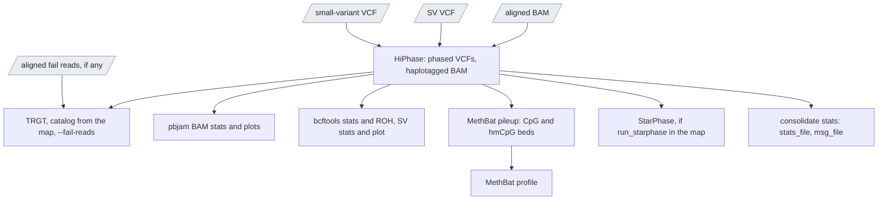

# `downstream`

The second half of a sample in joint mode: phasing, repeats, methylation,
pharmacogenes on the cohort-consistent calls.

| | |
|---|---|
| Subject | per sample |
| Modes | joint |
| All stages | [08 Stages](../08-stages.md) |

The post-phasing half. Mode-agnostic: it phases whatever small-variant and SV
VCF the driver hands it, and needs the inferred `sex` and the aligned BAM
from `upstream`.

| Driver fills | You may override |
|---|---|
| `sample_id`, `sex` (from `upstream.inferred_sex`), `aligned_hifi_reads` (+ index), `aligned_fail_reads` (+ index, when present), `small_variant_vcf` and `sv_vcf` (+ indices; from `cohort_call` slices in joint mode, from `upstream` otherwise), `stat_depth_mean`, `upstream_msg` | nothing beyond the shared inputs |

Outputs: the 62 `downstream` outputs plus `stats_file` and `msg_file`, so
that `upstream` plus `downstream` equals `singleton`, plus `methbat_report`.

> `methbat report` labels the imprinting regions of
> `methbat_report_regions_tsv` (`PLAGL1`, `GRB10`, `MEST`, `H19/IGF2`,
> `KCNQ1OT1`, `MEG3`, `SNRPN`, `PEG3`, the `GNAS` cluster and the others of
> MethBat's `hg38_imprinting_targets`) as `PASS`, `Inconclusive`, `Anomalous`
> or `AnomalousQcWarning` against their expected allele-specific methylation
> (`ugc_wgw_methbat_report`, 1 CPU, 4 GB, seconds). Output `methbat_report`,
> in `singleton` and `downstream` alike. Off with `run_methbat_report =
> false`. A run from before 0.16 has none: `cohort_methyl` makes it for the
> cohort.
