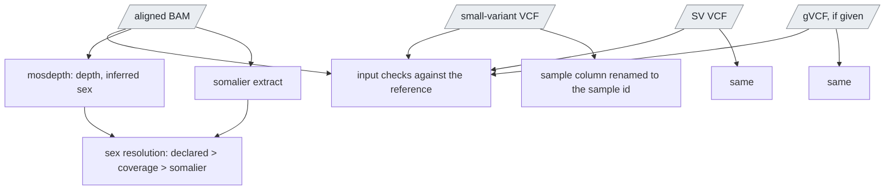

# `intake`

For a sample that arrives with its own alignment and calls: the checks and
what phasing needs.

| | |
|---|---|
| Subject | per sample |
| Modes | standalone, joint |
| All stages | [08 Stages](../08-stages.md) |

Per sample, the `vcf` entry kind only (chapter 05): a sample registered from
an aligned BAM and its small-variant and SV VCFs (and optionally a gVCF)
gets what `downstream` needs from `upstream` without alignment or calling.

Text version: `ugc_wgw_input_checks` first (the BAM is coordinate-sorted,
indexed, aligned to the installed reference with the same contig lengths,
its read group's sample name is the sample id, and it carries MM/ML tags in
its first reads; every VCF is BGZF-compressed,
indexed, has exactly one sample column and only reference contigs); a
failed check exits with `INPUT CHECK FAILED` lines and the driver records
an input error (the sample blocks, no retry). Then upstream's `mosdepth`,
our `ugc_wgw_somalier_extract`, the one-sample relate and
`ugc_wgw_resolve_sex` as in `upstream`, and `ugc_wgw_vcf_sample_rename` per
VCF (`bcftools reheader` when the column is not the sample id; the file is
copied otherwise) under upstream's file names. Minutes.

| Driver fills | You may override |
| --- | --- |
| `sample_id`, `declared_sex`, `aligned_bam` (+ index), `small_variant_vcf_in` (+ index), `sv_vcf_in` (+ index), `gvcf_in` (+ index, when the sheet has one), `ugc_wgw_container_registry` | `require_methylation_tags` (true), `somalier_sex_min_x_sites` (50), `somalier_sex_min_x_depth` (5.0) |

Outputs carry upstream's names for the fields `downstream` reads
(`aligned_hifi_reads`, `inferred_sex`, `resolved_sex`, `stat_depth_mean`,
`small_variant_vcf`, `sv_vcf`, `small_variant_gvcf`, `somalier_extract`,
`msg`) plus `input_checks` (check, target, status, detail),
`input_provenance` (the BAM header's `@PG` and `@RG` fields, the VCF
headers' `##source` and tool version lines) and the manifest, which names
the external files with their size and modification time. The member's
page and the cohort's members table mark it `external_input`
(informational), and `cohort_freq`'s samples file carries the kind. Such a
member has no mitorsaw call: `cohort_merge` leaves the mitochondrial merge
out for a cohort that holds one, and says so.

