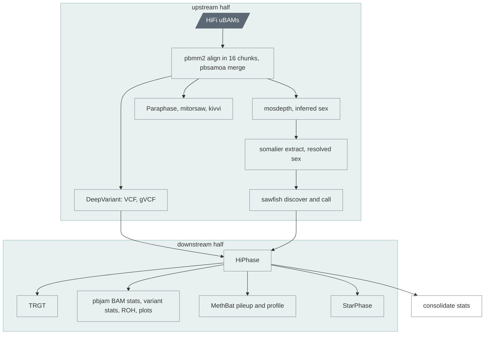

# `singleton`

Everything for one sample in one run: alignment, small variants, SVs,
phasing, repeats, methylation, the targeted callers.

| | |
|---|---|
| Subject | per sample |
| Modes | standalone |
| All stages | [08 Stages](../08-stages.md) |

Upstream's `singleton.wdl`, mirrored call for call (the reference data comes
from the rendered map instead of being unpacked from PacBio's data container
in every run), plus the manifest task. One run does everything `upstream` and
`downstream` do, in one process. Use it in standalone mode.

| Driver fills | You may override |
|---|---|
| `sample_id`, `hifi_reads`, `fail_reads` | `use_alignment_chunking` (true), `use_gpu` (false), `use_parabricks_deepvariant` (false), `use_pbdv` (false), `aligner` (pbmm2); the last four through the project's `deepvariant` and `aligner` keys (chapter 05) |

Outputs: the 96 upstream outputs by name plus the two ugc-wgw ones (chapter 07).
Task set: catalog preparation, pbmm2 per BAM (16 chunks) against the
prebuilt reference index of the reference map (upstream would build the
5.8 GB index once per BAM), pbsamoa merge,
mosdepth, DeepVariant (8 shards), sawfish discover and call, Paraphase,
mitorsaw, kivvi (KIV-2 and D4Z4), optional fail-reads baiting, HiPhase, TRGT,
pbjam BAM stats, variant stats, MethBat pileup and profile, then our
`methbat report` ([`downstream`](downstream.md)), StarPhase,
consolidate stats. An aligned input BAM is realigned as one chunk, with its
haplotype tags stripped and a message in `msg_file`.
