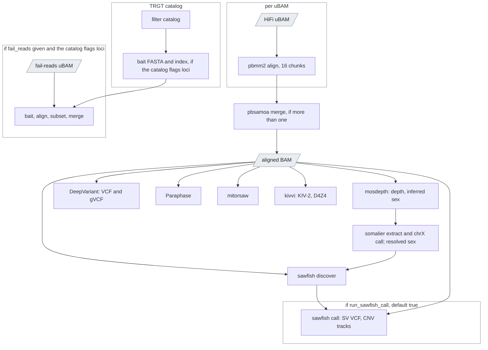

# `upstream`

The first half of a sample in joint mode: alignment, the small-variant gVCF,
SV discovery, the targeted callers.

| | |
|---|---|
| Subject | per sample |
| Modes | joint |
| All stages | [08 Stages](../08-stages.md) |

The pre-phasing half. Same code as inside `singleton`; the split lets the
cohort be joint-called before phasing.

| Driver fills | You may override |
|---|---|
| `sample_id`, `hifi_reads`, `fail_reads` | `run_sawfish_call` (true), `use_alignment_chunking` (true), `use_gpu`, `use_parabricks_deepvariant`, `use_pbdv`, `aligner` |

`run_sawfish_call = true` gives every sample its own SV VCF, so `downstream`
can run without a multi-sample call; set it to `false` only when
`cohort_call` will run `run_sawfish_joint_call`, in which case `upstream`
produces the discover tarball only. Upstream's own default for this flag
(`single_sample`) is `false`; ugc-pacbio-wgw flips it.

Outputs: aligned BAM, optional aligned fail reads, mosdepth and
`inferred_sex`, DeepVariant VCF and gVCF, `discover_tar`, optional per-sample
SV set, Paraphase, mitorsaw, kivvi (the allele plots only when an allele was
called; nothing when kivvi fails on low coverage), `msg` (chapter 07).

Since 0.14 both per-sample stages make a somalier **extract** (a 200 KB
genotype sketch at 17,766 informative sites, `<sample_id>.somalier`) right
after mosdepth and **resolve the sex** the run uses from the sheet, the
coverage inference and somalier's chrX heterozygosity call, in that order
(chapter 02); sawfish and TRGT take the resolved value, and the outputs
`resolved_sex`, `resolved_sex_source`, `somalier_sex`, `somalier_extract`
and `somalier_sex_tsv` (one row of every source and statistic) record it.
The three tasks sit at the end of the mosdepth branch, so a re-run of an
older sample replays everything else from the call cache; sawfish onward
recomputes only where the resolved sex differs from what coverage said.
`declared_sex` (the sheet's, filled by the driver), `somalier_sex_min_x_sites`
(50) and `somalier_sex_min_x_depth` (5.0) are the inputs.

Since 0.15 both per-sample stages also turn mitorsaw's chrM calls into a
call set the cohort can use. mitorsaw writes one genotype entry per
mitochondrial haplotype it detects (`0|1|1|1` for four haplotypes), which
nothing downstream can merge or count. `ugc_wgw_mito_collapse` rewrites it
as a diploid genotype by the rule nallo uses: every haplotype reference
`0/0`, every haplotype alternate `1/1` (homoplasmic), a mix `0/1`
(heteroplasmic); the read fraction of the allele is mitorsaw's own `VAF`.
It splits small variants from SVs at `mito_sv_min_size` (50 bp), writes a
VCF with one haploid column per haplotype, and a one-row summary. With
`run_haplogrep` (default true) `ugc_wgw_haplogrep` classifies every
haplotype against a phylogenetic tree (`haplogrep_tree`, default
`phylotree-fu-rcrs@1.3`, the forensic update of PhyloTree 17;
`phylotree-rcrs@17.3` is in the image too) and names the sample by its most
abundant haplotype. Outputs `mt_small_variant_vcf`, `mt_sv_vcf`,
`mt_haplotypes_vcf`, `mt_haplotypes_tsv`, `mt_summary`, `mt_haplogroups`
and the string `mt_haplogroup`. Both tasks hang off mitorsaw, so a re-run
of an older sample replays everything else from the call cache. On
chr20-only data (the smoke) mitorsaw sees no chrM read: the files are
empty but valid and the haplogroup is empty.

With `aligned_bam_in` (the driver sets it for a `bam`-kind sample, chapter
05) the alignment and the merge are skipped: `ugc_wgw_input_checks` first
checks the given BAM against the installed reference (coordinate-sorted,
indexed, every `@SQ` contig in the FASTA index with the same length, the
read group's sample name equal to the sample id, MM/ML methylation tags in
the first 2,000 reads; a failure stops the stage as an
input error, and `require_methylation_tags = false` turns the missing tags
into a note), writes `input_checks` and `input_provenance` (the header's
`@PG` and `@RG` fields), and every caller reads the given BAM unchanged.
`hifi_reads` is empty then. A `reads`-kind sample whose BAM happens to be
aligned still goes through upstream's own `samtools reset` path; the `bam`
kind is the deliberate opt-out of realignment.
